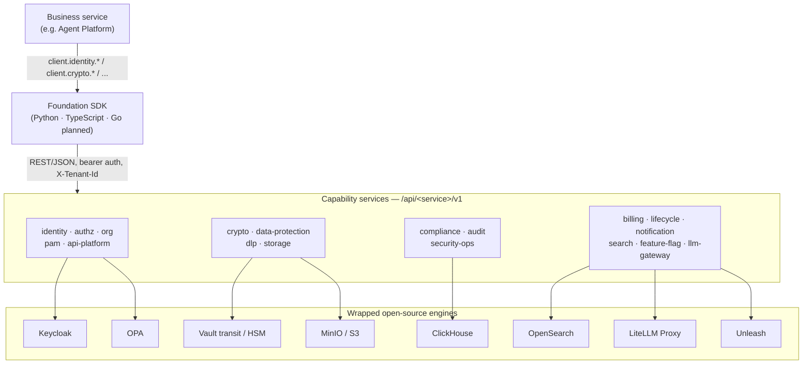

# SaaS Foundation

English | [中文](README.zh-CN.md)

[](./LICENSE)
[](https://www.python.org/)
[](#consume-it-from-a-typed-sdk)
[](#deployment-profiles)

> A reusable, private-cloud-first enterprise SaaS foundation. It packages identity, authorization, organization, billing, audit, compliance, cryptography, data protection, DLP, an LLM gateway and more into a set of capability services — all consumed through a typed SDK, so your business code never touches Keycloak, OPA, ClickHouse, OpenSearch or LiteLLM directly.

SaaS Foundation is a standalone enterprise base that any business system can build on. It turns the hard, cross-cutting concerns of a multi-tenant product — *who can do what, to which tenant's data, under which compliance regime, and how it's all audited* — into well-bounded services with a single client library in front of them. Each service wraps a battle-tested open-source engine and exposes a stable, versioned REST/JSON contract; the SDK aggregates them so a business developer writes `client.identity.get_user(...)` or `client.crypto.encrypt(...)` and never learns the engine underneath.

It is also the base that [Agent Platform](https://github.com/chenzefeng09/agent-platform) is built on top of — Agent Platform imports the Foundation SDK and calls Foundation services for identity, authorization, billing, audit and the LLM gateway.

## Design goals

- **Private-cloud first.** The default target is the customer's own data center: Kubernetes 1.24+, offline / air-gapped install via a Helm umbrella chart. SaaS is a profile of this, not the other way around.
- **SaaS-compatible via profiles.** The same chart serves multi-tenant SaaS by switching a values profile. Isolation strength scales from shared-table to schema-per-tenant to database-per-tenant to a dedicated cluster — Row-Level Security stays on in every tier.
- **Compliance built in.** A China DJCP/Dengbao (等保) 2.0 level-3 and PIPL baseline ship today, with 国密 (SM) cryptography / 信创 (domestic-stack) support and SOC 2 / ISO 27001 evidence export on the roadmap.
- **Business-zero-coupling via SDK.** Business code imports the SDK and nothing else. It never depends on, configures, or reaches the underlying open-source components — those live behind the capability services and can evolve without touching business code.

## How it fits together

A business service depends on the SDK, the SDK talks to the capability services over REST/JSON, and each capability service is the *only* thing that talks to the open-source engine it wraps.



## Capability packages

Eighteen capability packages, grouped by domain. Ports are the development defaults from the docker-compose stack; where a host port differs from the in-container port (to avoid a collision on a shared dev host), both are noted.

### Identity & access

| Package | Port (container / dev host) | What it does |
|---|---|---|
| `identity` | 8001 | Users, sessions, MFA (TOTP), SSO / social login, SCIM, and password / MFA / session policy — wraps the Keycloak Admin API. |
| `authz` | 8002 | RBAC for the common path plus OPA-based ABAC; single and batch permission checks and `list-accessible-ids` for UI/search filtering. |
| `org` | 8003 | The four-level org tree (Tenant → OrgUnit → Team → User) with subtree ops, tenant routing, and plan tier migration. |
| `pam` | 8015 / 18015 | Privileged Access Management: JIT elevation, four-eyes approval, recorded privileged sessions, high-risk command blocking. |
| `api-platform` | 8010 / 18010 | Tenant-internal API platform: scoped API keys, an OAuth2 server, and signed webhooks with delivery audit. |

### Data & crypto

| Package | Port (container / dev host) | What it does |
|---|---|---|
| `crypto` | 8004 | The single crypto boundary: envelope encryption (KEK never leaves Vault), signing/verification, Argon2id hashing, full KEK lifecycle. |
| `data-protection` | 8016 / 18016 | Masking & pseudonymization, data-export / DSAR workflows with four-eyes approval, PIPL cross-border checks, consent management. |
| `dlp` | 8007 (dev host 18007) | Five-level data classification (`L1_PUBLIC`→`L5_SECRET`) plus DLP enforcement: labels, clearances, rules, scanner, incidents. |
| `storage` | _library (no network port)_ | A boto3 storage abstraction over MinIO/S3 with tenant-scoped key layout, quota hooks and OTel spans — imported, not deployed. |

### Governance & compliance

| Package | Port (container / dev host) | What it does |
|---|---|---|
| `compliance` | 8014 (dev host 18014) | Source of truth for the active compliance mode; ROPA, DPIA, DSAR orchestration, 等保 self-assessment, SOC 2 / ISO 27001 export. |
| `audit` | 8013 | Immutable audit hub: outbox → ClickHouse → S3 WORM, with a hash chain and digital signatures from `crypto`. |
| `security-ops` | 8019 / 18019 | Platform-level security operations: SSDLC scans, vulnerability SLAs, SBOM, incident response, pentests and chaos drills. |

### Platform

| Package | Port (container / dev host) | What it does |
|---|---|---|
| `billing` | 8007 (dev host 8017) | Plans, subscriptions, per-dimension quotas, usage metering and invoices — dual offline / SaaS modes. |
| `lifecycle` | 8006 / 18006 | Retention policies, a recycle bin, legal holds, backup/restore, and signed PDF destruction certificates. |
| `notification` | 8008 / 18008 | Multi-channel notification center: templates, subscriptions, fan-out over 8 channels, retries with a DLQ, delivery audit. |
| `search` | 8009 | Unified cross-resource search over self-hosted OpenSearch, with mandatory tenant + ACL filter injection. |
| `feature-flag` | 8012 | Thin multi-tenant feature-flag service over a self-hosted Unleash, with DB-persisted overrides and an emergency kill-switch. |
| `llm-gateway` | 8011 | The single tenant-isolated egress for all LLM calls: wraps LiteLLM, exposes OpenAI- and Anthropic-compatible APIs, per-tenant virtual keys. |

> **Port notes.** `dlp` and `billing` both run on container port `8007`; on the shared dev host they are mapped to distinct host ports (`18007` and `8017`) to avoid collisions. `audit`, `compliance` and `data-protection` keep container `8013` / `8014` / `8016` but expose different host ports in dev. The numbers above are dev-stack defaults; production ports are set by the Helm chart.

## Consume it from a typed SDK

Business code never imports an open-source component directly — it imports the SDK and calls a resource group.

```python
from foundation_sdk import FoundationClient

client = FoundationClient.from_env()  # reads FOUNDATION_API_URL + FOUNDATION_API_TOKEN

user = client.identity.get_user(user_id)
token = client.crypto.encrypt(plaintext=secret, kek="default")
client.billing.check_quota(dimension="api_calls", amount=1)
reply = client.llm_gateway.chat(messages=[...])
```

| SDK | Status | Notes |
|---|---|---|
| **Python** (`foundation_sdk`) | Ready (v0.1.0) | Aggregates all 17 resource groups; optional `[fastapi]` extra ships request-context middleware + RFC 7807 problem-details. Derives every service URL from one base URL. |
| **TypeScript** (`@foundation/sdk`) | Ready (v0.1.0) | Mirrors the Python surface 1:1 — same resources, error taxonomy and context helpers. Zero runtime deps, fetch-based, dual ESM/CJS. |
| **Go** | Planned | `sdks/go/` is a stub; a `make sdk-go` generator is planned but not yet generated. |

The SDK also carries the tenant context: when a business service mounts the SDK's FastAPI middleware, it extracts identity and tenant into contextvars, and the SDK automatically attaches `X-Tenant-Id` on outbound calls. Business code never passes a `tenant_id` argument by hand.

## Multi-tenancy: three isolation walls

Tenant isolation does not rely on business code remembering to filter by tenant. It is enforced by three independent walls, designed so that even a forgotten `WHERE tenant_id` — or a SQL injection — cannot cross tenants:

1. **Gateway wall.** The API gateway extracts `tenant_id` from the verified JWT and force-injects `X-Tenant-Id`; a client cannot override it.
2. **Application wall.** On acquiring a DB connection, the adapter opens a transaction and runs `SET LOCAL app.tenant_id` (and `app.user_id` / `app.actor`).
3. **Data wall.** Postgres Row-Level Security (`ENABLE` + **`FORCE ROW LEVEL SECURITY`**, four policies per table) filters every row by `current_setting('app.tenant_id')`.

`current_setting(..., true)` returns `NULL` when unset, so the default is *deny*, not *open*. PgBouncer must run in transaction pool mode or `SET LOCAL` would leak across tenants — a startup health check refuses to boot otherwise, and a mandatory RLS fuzz suite (1000 randomized cross-tenant reads per service) runs in CI.

See [docs/multi-tenancy.md](docs/multi-tenancy.md) for the full baseline: the four DB roles (`app_user` / `app_admin` / `app_migrator` / `app_observability`), policy templates, the SaaS tier → isolation mapping, and the PR self-review checklist.

## Compliance posture

Stated honestly as *implemented today* versus *on the roadmap*.

| Area | Status |
|---|---|
| 等保 (DJCP/Dengbao) 2.0 **level 3** + PIPL | **Implemented baseline.** The level-3 self-assessment covers ~83% of technical and management controls, with the remainder documented as customer responsibility. |
| 等保 2.0 **level 4** | **Documented gap — not implemented.** A gap analysis enumerates the ~25 additional controls (mandatory access control, formal security model, trusted computing, APT detection); these are explicitly not yet built. |
| 国密 (SM2/SM3/SM4 + GMTLS) / 信创 (domestic stack) | **On the roadmap.** Crypto and deployment designs exist (Tongsuo primary, GmSSL fallback; Kunpeng/Phytium ARM64, Kylin/UOS); treat as pre-release. |
| SOC 2 / ISO 27001 | **On the roadmap.** The `compliance` service is built to export evidence for these; the formal programs are not yet in place. |

The `compliance` service is the single source of truth for the active compliance mode, which other services read to set their own policy strength (password rules, retention, crypto algorithms).

## Deployment profiles

One Helm umbrella chart, switched by a values profile — the chart body stays the same.

| Profile | Target | Shape |
|---|---|---|
| `small` | POC / single-node K3s / ≤50 users | All third-party deps embedded, 1 replica, no HA/mTLS/autoscaling. Baseline 8C/32G single node. |
| `medium` | Enterprise private cloud / 3–10 nodes / HA | 3+ replicas with HPA, mandatory standalone PgBouncer (transaction mode), mTLS via cert-manager, secrets from Vault/External Secrets. |
| `large` | Cross-AZ / 1000+ users / SaaS master cluster | All third-party components external, 5+ replicas, HPA + KEDA, PodDisruptionBudgets, topology spread, hardened pod security contexts, NetworkPolicy. |
| `信创` (Xinchuang) | Domestic-stack private cloud | Layered over small/medium with `dataResidency=cn-only`, GMTLS, Tongsuo PKCS#11, multi-arch (Kunpeng/Phytium) images, KingbaseES/DM8 substitution. |

```bash
cd deploy/helm/foundation
helm dependency update
helm install foundation . -f values-small.yaml -n foundation --create-namespace
```

## Quick start

```bash
# Bring up the full local dependency stack and initialize it in one shot:
# docker-compose deps → wait for the Keycloak realm → Vault transit / MinIO buckets / KC orgs → healthcheck
make up-full
```

Then explore the typical workflows:

```bash
make migrate && make seed     # alembic upgrade head (as app_migrator), then seed a dev tenant + users
make test                     # pytest across all packages
make test-rls-fuzz            # the mandatory RLS cross-tenant fuzz suite
make scan && make sbom        # local security gates: gitleaks + semgrep + license check, then CycloneDX/SPDX SBOM
make helm-render PROFILE=medium   # render the umbrella chart for a profile
```

**Prerequisites:** Docker Desktop 24+ with Compose v2 (Windows via WSL2), Python 3.12+ with Poetry 1.8+, Helm 3.15+ and kubectl, Node.js 20+ (for the Spectral lint / TypeScript SDK build). The Makefile is macOS/Linux-oriented (bash + GNU coreutils).

## Repository layout

```
saas-foundation/
├── packages/        # The 18 capability services (identity / authz / org / billing / audit / ...)
├── sdks/            # Business-layer SDKs — python (ready) / typescript (ready) / go (planned)
├── contracts/       # OpenAPI 3.1 specs (source of truth), gRPC proto, OPA bundle templates
├── deploy/          # Helm umbrella chart, docker-compose dev stack, offline bundle (planned)
├── docs/
│   ├── design/      # Rolling per-service design docs
│   └── adr/         # Architecture Decision Records
└── tests/
    ├── e2e/         # Cross-service integration tests
    └── conformance/ # Business-onboarding self-check suite
```

The contract layer is the source of truth: 18 OpenAPI 3.1 specs validated by Spectral, with six machine-enforced rules (all paths under `/v1`, `snake_case` JSON, shared `$ref` error bodies, four-segment error codes `FOUNDATION.<SVC>.<CAT>.<NAME>`, unique operation IDs, explicit security) and breaking-change detection gating PRs. SDKs, docs and mocks are generated from it.

## Documentation

- [Architecture conventions](docs/CONVENTIONS.md) — service naming, package layout, URL/versioning, pagination, the SDK compatibility policy. The binding top-level contract.
- [Multi-tenancy & RLS baseline](docs/multi-tenancy.md) — the three isolation walls, DB roles, RLS policy templates, SaaS tier mapping.
- [Developer quick start](docs/dev-quickstart.md) — get the local stack running.
- Service design docs live under [docs/design/](docs/design/); architecture decisions under [docs/adr/](docs/adr/).

## Contributing

Contributions are welcome. Please read the [architecture conventions](docs/CONVENTIONS.md) first — they are binding, and the most safety-critical one is the [multi-tenancy / RLS baseline](docs/multi-tenancy.md). New tenant tables must pass the RLS checks (FORCE RLS, tenant-leading index, four policies, fuzz test); CI enforces formatting, typing, security scans, license checks and OpenAPI lint.

## Security

If you discover a security vulnerability, please report it responsibly by email to **chenzefeng09@gmail.com**. Do not open a public issue for security-sensitive reports.

## License

Licensed under the Apache License 2.0. See [LICENSE](./LICENSE) and [NOTICE](./NOTICE).

Copyright 2026 The SaaS Foundation Authors.
