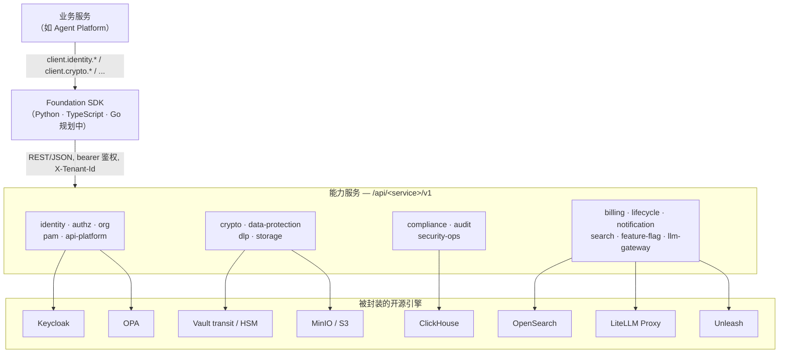

# SaaS Foundation

[English](README.md) | 中文

[](./LICENSE)
[](https://www.python.org/)
[](#通过类型化-sdk-接入)
[](#部署档位)

> 一个可复用、私有化优先的企业级 SaaS 底座。它把身份、授权、组织、计费、审计、合规、密码学、数据保护、DLP、LLM 网关等能力封装为一组能力服务，全部通过类型化 SDK 接入，业务代码无需直接接触 Keycloak、OPA、ClickHouse、OpenSearch 或 LiteLLM。

SaaS Foundation 是一个独立、可跨项目复用的企业级底座。它把多租户产品中那些横切、棘手的关注点——*谁能对哪个租户的数据做什么、在哪种合规模式下、以及这一切如何被审计*——收敛成边界清晰的服务，并在它们前面放一个统一的客户端库。每个服务封装一个久经考验的开源引擎，对外暴露稳定、带版本的 REST/JSON 契约；SDK 把它们聚合起来，业务开发者只写 `client.identity.get_user(...)` 或 `client.crypto.encrypt(...)`，永远不需要了解底层引擎。

它同时也是 [Agent Platform](https://github.com/chenzefeng09/agent-platform) 的底座——Agent Platform 引入 Foundation SDK，并调用 Foundation 的身份、授权、计费、审计与 LLM 网关服务。

## 设计目标

- **私有化优先。** 默认部署目标是客户自有机房：Kubernetes 1.24+，通过 Helm umbrella chart 离线 / 隔离网安装。SaaS 是这套体系的一个档位，而非相反。
- **SaaS 兼容（按 profile 切换）。** 同一份 chart 切换 values profile 即可服务多租户 SaaS。隔离强度从共享表 → 每租户独立 schema → 每租户独立库 → 专属集群逐级提升——Row-Level Security 在每一档都保持开启。
- **合规内建。** 等保（DJCP/Dengbao）2.0 三级 + PIPL 基线现已交付；国密（SM 系列）密码学 / 信创（国产栈）支持，以及 SOC 2 / ISO 27001 证据导出，在路线图上。
- **业务零耦合（经由 SDK）。** 业务代码只引入 SDK，别无其他。它从不依赖、配置或直接访问底层开源组件——这些组件藏在能力服务背后，可以独立演进而不触碰业务代码。

## 整体如何协作

业务服务依赖 SDK，SDK 通过 REST/JSON 调用能力服务，每个能力服务是*唯一*与其所封装开源引擎对话的角色。



## 能力包

共 18 个能力包，按领域分组。端口为 docker-compose 开发栈的默认值；当宿主机端口与容器内端口不同（为避免共享开发机上的端口冲突）时，两者都标注。

### 身份与访问（Identity & access）

| 能力包 | 端口（容器 / 开发宿主机） | 作用 |
|---|---|---|
| `identity` | 8001 | 用户、会话、MFA（TOTP）、SSO / 社交登录、SCIM，以及密码 / MFA / 会话策略——封装 Keycloak Admin API。 |
| `authz` | 8002 | 常规路径走本地 RBAC，外加基于 OPA 的 ABAC；单次与批量权限校验，以及供 UI/搜索过滤的 `list-accessible-ids`。 |
| `org` | 8003 | 四级组织树（租户 → 组织单元 → 团队 → 用户），含子树操作、租户路由与套餐档位迁移。 |
| `pam` | 8015 / 18015 | 特权访问管理：JIT 提权、四眼审批、特权会话录制、高危命令拦截。 |
| `api-platform` | 8010 / 18010 | 租户内部 API 平台：分级 API Key、OAuth2 服务器、带投递审计的签名 Webhook。 |

### 数据与密码（Data & crypto）

| 能力包 | 端口（容器 / 开发宿主机） | 作用 |
|---|---|---|
| `crypto` | 8004 | 唯一密码学边界：信封加密（KEK 永不离开 Vault）、签名/验签、Argon2id 哈希、完整 KEK 生命周期。 |
| `data-protection` | 8016 / 18016 | 脱敏与假名化、带四眼审批的数据导出 / DSAR 流程、PIPL 跨境检查、同意管理。 |
| `dlp` | 8007（开发宿主机 18007） | 五级数据分类（`L1_PUBLIC`→`L5_SECRET`）外加 DLP 管控：标签、密级、规则、扫描器、事件。 |
| `storage` | _库（无网络端口）_ | 基于 boto3 的 MinIO/S3 存储抽象，提供租户隔离的 key 布局、配额钩子与 OTel span——以库形式被引入，不单独部署。 |

### 治理与合规（Governance & compliance）

| 能力包 | 端口（容器 / 开发宿主机） | 作用 |
|---|---|---|
| `compliance` | 8014（开发宿主机 18014） | 合规模式的权威来源；ROPA、DPIA、DSAR 编排、等保自评估、SOC 2 / ISO 27001 报告导出。 |
| `audit` | 8013 | 不可篡改审计中枢：outbox → ClickHouse → S3 WORM，带哈希链与来自 `crypto` 的数字签名。 |
| `security-ops` | 8019 / 18019 | 平台级安全运营：SSDLC 扫描、漏洞 SLA、SBOM、事件响应、渗透测试与混沌演练。 |

### 平台（Platform）

| 能力包 | 端口（容器 / 开发宿主机） | 作用 |
|---|---|---|
| `billing` | 8007（开发宿主机 8017） | 套餐、订阅、按维度的配额、用量计量与发票——离线 / SaaS 双模式。 |
| `lifecycle` | 8006 / 18006 | 留存策略、回收站、法务保留（Legal Hold）、备份/恢复，以及签名的 PDF 销毁证书。 |
| `notification` | 8008 / 18008 | 多通道通知中心：模板、订阅、8 通道扇出投递、带死信队列的重试、投递审计。 |
| `search` | 8009 | 基于自托管 OpenSearch 的统一跨资源搜索，强制注入租户 + ACL 过滤。 |
| `feature-flag` | 8012 | 封装自托管 Unleash 的轻量多租户特性开关服务，带 DB 持久化覆盖与紧急 kill-switch。 |
| `llm-gateway` | 8011 | 所有 LLM 调用的唯一租户隔离出口：封装 LiteLLM，暴露 OpenAI 与 Anthropic 兼容 API，按租户分配虚拟 Key。 |

> **端口说明。** `dlp` 与 `billing` 容器内都用 `8007`；在共享开发机上映射为不同宿主机端口（`18007` 与 `8017`）以避免冲突。`audit`、`compliance`、`data-protection` 容器内分别保持 `8013` / `8014` / `8016`，但在开发栈中暴露为不同宿主机端口。上述数字均为开发栈默认值；生产端口由 Helm chart 设定。

## 通过类型化 SDK 接入

业务代码从不直接引入开源组件——它引入 SDK 并调用某个资源组。

```python
from foundation_sdk import FoundationClient

client = FoundationClient.from_env()  # 读取 FOUNDATION_API_URL + FOUNDATION_API_TOKEN

user = client.identity.get_user(user_id)
token = client.crypto.encrypt(plaintext=secret, kek="default")
client.billing.check_quota(dimension="api_calls", amount=1)
reply = client.llm_gateway.chat(messages=[...])
```

| SDK | 状态 | 说明 |
|---|---|---|
| **Python**（`foundation_sdk`） | 就绪（v0.1.0） | 聚合全部 17 个资源组；可选 `[fastapi]` extra 附带请求上下文中间件 + RFC 7807 problem-details。所有服务 URL 由单一 base URL 推导。 |
| **TypeScript**（`@foundation/sdk`） | 就绪（v0.1.0） | 与 Python 接口 1:1 对齐——相同的资源、错误分类与上下文辅助。零运行时依赖，基于 fetch，双 ESM/CJS。 |
| **Go** | 规划中 | `sdks/go/` 目前仅为占位；`make sdk-go` 生成器在规划中，尚未生成。 |

SDK 同时承载租户上下文：当业务服务挂载 SDK 的 FastAPI 中间件后，它会把身份与租户提取进 contextvars，SDK 在出站调用时自动附带 `X-Tenant-Id`。业务代码从不手动传 `tenant_id` 参数。

## 多租户：三道隔离墙

租户隔离不依赖业务代码记得按租户过滤。它由三道互相独立的墙强制保障，设计目标是：即便漏写了 `WHERE tenant_id`，甚至发生 SQL 注入，也无法跨租户：

1. **网关墙。** API 网关从校验过的 JWT 提取 `tenant_id` 并强制注入 `X-Tenant-Id`；客户端无法覆盖。
2. **应用墙。** 获取数据库连接时，适配器开启事务并执行 `SET LOCAL app.tenant_id`（以及 `app.user_id` / `app.actor`）。
3. **数据墙。** Postgres 行级安全（`ENABLE` + **`FORCE ROW LEVEL SECURITY`**，每表四条 policy）依据 `current_setting('app.tenant_id')` 过滤每一行。

`current_setting(..., true)` 在未设置时返回 `NULL`，因此默认是*拒绝*而非*放开*。PgBouncer 必须运行在 transaction 池模式，否则 `SET LOCAL` 会跨租户泄漏——启动健康检查会因此拒绝启动；CI 中还有强制的 RLS fuzz 套件（每服务 1000 次随机跨租户读）。

完整基线见 [docs/multi-tenancy.md](docs/multi-tenancy.md)：四类数据库角色（`app_user` / `app_admin` / `app_migrator` / `app_observability`）、policy 模板、SaaS 套餐 → 隔离模式映射，以及 PR 自查清单。

## 合规现状

如实区分*现已实现*与*路线图*。

| 领域 | 状态 |
|---|---|
| 等保 2.0 **三级** + PIPL | **已实现基线。** 三级自评估覆盖约 83% 的技术与管理控制项，其余部分被明确记录为客户责任。 |
| 等保 2.0 **四级** | **已记录的差距——尚未实现。** 一份差距分析列出了约 25 项额外控制（强制访问控制、形式化安全模型、可信计算、APT 检测）；这些明确尚未构建。 |
| 国密（SM2/SM3/SM4 + GMTLS） / 信创（国产栈） | **路线图中。** 密码学与部署设计已存在（铜锁 Tongsuo 为主、GmSSL 兜底；鲲鹏/飞腾 ARM64，麒麟/UOS），请视为预发布。 |
| SOC 2 / ISO 27001 | **路线图中。** `compliance` 服务已为导出这些证据而构建，但正式认证项目尚未落地。 |

`compliance` 服务是当前合规模式的唯一权威来源，其他服务读取它以设定自身策略强度（密码规则、留存期、密码算法等）。

## 部署档位

一份 Helm umbrella chart，按 values profile 切换——chart 主体保持不变。

| 档位 | 目标 | 形态 |
|---|---|---|
| `small` | POC / 单节点 K3s / ≤50 用户 | 所有第三方依赖内嵌，1 副本，无 HA/mTLS/弹性。基线 8C/32G 单节点。 |
| `medium` | 企业私有云 / 3–10 节点 / HA | 3+ 副本带 HPA，强制独立 PgBouncer（transaction 模式），cert-manager mTLS，机密来自 Vault/External Secrets。 |
| `large` | 跨可用区 / 1000+ 用户 / SaaS 主集群 | 所有第三方组件外置，5+ 副本，HPA + KEDA，PodDisruptionBudget，拓扑分散，加固的 Pod 安全上下文，NetworkPolicy。 |
| `信创`（Xinchuang） | 国产栈私有云 | 在 small/medium 之上叠加 `dataResidency=cn-only`、GMTLS、Tongsuo PKCS#11、多架构（鲲鹏/飞腾）镜像、KingbaseES/DM8 替换。 |

```bash
cd deploy/helm/foundation
helm dependency update
helm install foundation . -f values-small.yaml -n foundation --create-namespace
```

## 快速开始

```bash
# 一条命令拉起完整本地依赖栈并初始化：
# docker-compose 依赖 → 等待 Keycloak realm → Vault transit / MinIO buckets / KC orgs → 健康检查
make up-full
```

随后即可体验常见工作流：

```bash
make migrate && make seed     # 以 app_migrator 跑 alembic upgrade head，再 seed 一个开发租户 + 用户
make test                     # 跨全部 package 跑 pytest
make test-rls-fuzz            # 强制的 RLS 跨租户 fuzz 套件
make scan && make sbom        # 本地安全门：gitleaks + semgrep + 许可证检查，再生成 CycloneDX/SPDX SBOM
make helm-render PROFILE=medium   # 按 profile 渲染 umbrella chart
```

**前置条件：** Docker Desktop 24+ 且带 Compose v2（Windows 经 WSL2）、Python 3.12+ 且带 Poetry 1.8+、Helm 3.15+ 与 kubectl、Node.js 20+（用于 Spectral lint / TypeScript SDK 构建）。Makefile 面向 macOS/Linux（bash + GNU coreutils）。

## 仓库结构

```
saas-foundation/
├── packages/        # 18 个能力服务（identity / authz / org / billing / audit / ...）
├── sdks/            # 业务层 SDK——python（就绪） / typescript（就绪） / go（规划中）
├── contracts/       # OpenAPI 3.1 规格（权威来源）、gRPC proto、OPA bundle 模板
├── deploy/          # Helm umbrella chart、docker-compose 开发栈、离线包（规划中）
├── docs/
│   ├── design/      # 各服务滚动细化的设计文档
│   └── adr/         # 架构决策记录
└── tests/
    ├── e2e/         # 跨服务集成测试
    └── conformance/ # 业务接入自检套件
```

契约层是权威来源：18 份 OpenAPI 3.1 规格由 Spectral 校验，含六条机器强制规则（所有路径在 `/v1` 下、`snake_case` JSON、共享 `$ref` 错误体、四段式错误码 `FOUNDATION.<SVC>.<CAT>.<NAME>`、唯一 operation ID、显式 security），并以破坏性变更检测把关 PR。SDK、文档与 mock 均由它生成。

## 文档

- [架构总约定](docs/CONVENTIONS.md)——服务命名、包结构、URL/版本、分页、SDK 兼容策略。具约束力的顶层契约。
- [多租户与 RLS 基线](docs/multi-tenancy.md)——三道隔离墙、数据库角色、RLS policy 模板、SaaS 套餐映射。
- [开发快速上手](docs/dev-quickstart.md)——把本地栈跑起来。
- 各服务设计文档位于 [docs/design/](docs/design/)；架构决策位于 [docs/adr/](docs/adr/)。

## 贡献

欢迎贡献。请先阅读[架构总约定](docs/CONVENTIONS.md)——它具约束力，其中最关乎安全的是[多租户 / RLS 基线](docs/multi-tenancy.md)。新增租户表必须通过 RLS 检查（FORCE RLS、以 tenant_id 为前导列的索引、四条 policy、fuzz 测试）；CI 强制执行格式化、类型检查、安全扫描、许可证检查与 OpenAPI lint。

## 安全

如果你发现安全漏洞，请负责任地通过邮件 **chenzefeng09@gmail.com** 报告。请勿为涉及安全的问题公开提交 issue。

## 许可证

依据 Apache License 2.0 授权。见 [LICENSE](./LICENSE) 与 [NOTICE](./NOTICE)。

版权所有 2026 The SaaS Foundation Authors。
