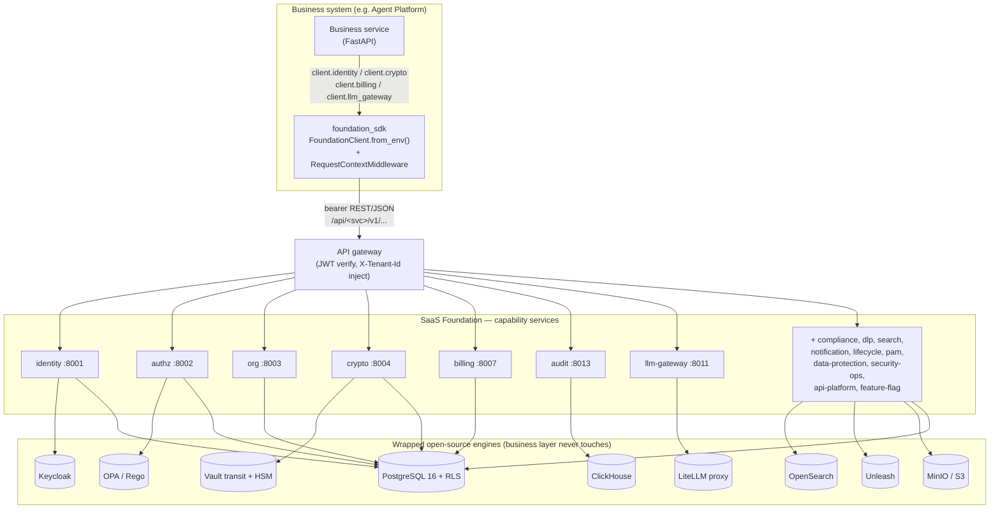
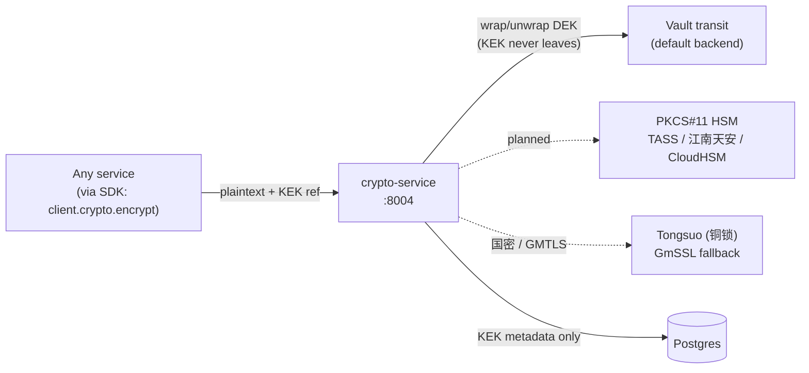

English | [中文](ARCHITECTURE.zh-CN.md)

# SaaS Foundation architecture

[](../LICENSE)


SaaS Foundation is a standalone, reusable enterprise base that any business system can build on. It packages the cross-cutting concerns every multi-tenant SaaS or private-cloud product needs — identity, authorization, organization modelling, billing, audit, compliance, data protection, an LLM gateway, and more — as a set of independent capability services fronted by a single typed SDK.

The design rule that shapes everything below: **a business service never imports an open-source engine directly. It imports the SDK.** Keycloak, OPA, ClickHouse, OpenSearch, Vault, and LiteLLM are all wrapped behind Foundation services, so the business layer codes against one stable contract instead of a dozen third-party APIs.

[Agent Platform](https://github.com/chenzefeng09/agent-platform) is one such business system: it is built on top of SaaS Foundation, imports `foundation_sdk`, and calls Foundation services for identity, authorization, billing, audit, and the LLM gateway. This document describes the Foundation itself; the two repositories are sibling checkouts.

> This guide is a map, not a contract. The binding contracts are [CONVENTIONS.md](./CONVENTIONS.md), [multi-tenancy.md](./multi-tenancy.md), and [errors.md](./errors.md). Where this guide and those documents disagree, those documents win.

---

## Table of contents

1. [The SDK-fronted architecture](#1-the-sdk-fronted-architecture)
2. [Multi-tenant isolation: three walls](#2-multi-tenant-isolation-three-walls)
3. [Capability package reference](#3-capability-package-reference)
4. [Contracts and SDKs](#4-contracts-and-sdks)
5. [The crypto boundary and the audit hash chain](#5-the-crypto-boundary-and-the-audit-hash-chain)
6. [Compliance architecture](#6-compliance-architecture)
7. [Deployment profiles](#7-deployment-profiles)
8. [Further reading](#8-further-reading)

---

## 1. The SDK-fronted architecture

Every capability is a separate FastAPI service that owns one domain, exposes REST + JSON over `/api/<service>/v1/...`, and wraps the open-source engine that domain needs. Business code never speaks to those engines; it calls a typed SDK that derives all per-service URLs from a single base URL and authenticates with a bearer token.



### What the picture means

- **One SDK, one base URL.** `FoundationClient.from_env()` reads `FOUNDATION_API_URL` and `FOUNDATION_API_TOKEN`, then exposes 17 resource groups (`identity`, `authz`, `org`, `billing`, `audit`, `lifecycle`, `notification`, `search`, `api_platform`, `llm_gateway`, `feature_flag`, `dlp`, `crypto`, `compliance`, `pam`, `data_protection`, `security_ops`). A call such as `client.crypto.encrypt(...)` becomes a bearer-authenticated REST request to `/api/crypto/v1/encrypt`.
- **Inbound context.** A service that handles requests mounts the SDK's `[fastapi]` extra: `RequestContextMiddleware` extracts identity, tenant, and request-id into `contextvars`, and `register_problem_details` wires RFC 9457 error responses.
- **One capability per service.** Each box on the right is a `<capability>-service` (see [CONVENTIONS.md §1](./CONVENTIONS.md)). New capabilities become new services; nothing stuffs two capabilities into one process.
- **Engines stay hidden.** identity wraps Keycloak; authz wraps OPA; audit writes to ClickHouse; search wraps OpenSearch; crypto wraps Vault transit + a PKCS#11 HSM; llm-gateway wraps a self-hosted LiteLLM proxy. The platform deploys **no inference engine of its own** — llm-gateway forwards to external providers.

### REST conventions (the parts that affect callers)

These are enforced by [CONVENTIONS.md §2](./CONVENTIONS.md) and the OpenAPI lint rules:

- Paths are `/api/<service>/v1/<resource>`; the version is explicit in the URL (no header versioning).
- JSON field names are `snake_case`; enum values are `UPPER_SNAKE_CASE`.
- Responses are bare resource JSON — no `{ code, data, message }` envelope. Lists return `{ "items": [...], "next_cursor": "..." }` with cursor pagination by default (`limit` default 50, max 200).
- Errors follow [RFC 9457 Problem Details](https://www.rfc-editor.org/rfc/rfc9457) with a four-segment code `FOUNDATION.<SERVICE>.<CATEGORY>.<NAME>` (see [errors.md](./errors.md)).
- Service-to-service performance-sensitive paths (authz check, quota check) may additionally use gRPC; the REST endpoints mirror those paths.

---

## 2. Multi-tenant isolation: three walls

Tenant isolation is the most safety-critical contract in the Foundation. It is defended in depth by **three walls**, listed in the order they fall back if an outer wall is bypassed. The full specification is [multi-tenancy.md](./multi-tenancy.md); this section summarizes it.

```mermaid
sequenceDiagram
    autonumber
    participant C as Client / SDK
    participant G as API gateway
    participant S as Service (FastAPI)
    participant DB as PgBouncer + Postgres

    C->>G: Authorization: Bearer <JWT> (claim tenant_id)
    Note over G: Wall 1 — verify JWT (Keycloak JWKS),<br/>extract tenant_id, force X-Tenant-Id<br/>(overrides any client-supplied value)
    G->>S: X-Tenant-Id, X-User-Id, X-Request-Id
    Note over S: middleware writes TenantContext into contextvars
    S->>DB: BEGIN; SET LOCAL app.tenant_id / app.user_id / app.actor
    Note over S,DB: Wall 2 — SET LOCAL inside a transaction
    DB-->>DB: Wall 3 — RLS policy filters by<br/>current_setting('app.tenant_id')
    DB-->>S: only this tenant's rows
    S-->>C: response (commit/rollback releases SET LOCAL)
```

### Wall 1 — the gateway forces `X-Tenant-Id` from the JWT

The API gateway verifies the JWT signature against Keycloak's JWKS, extracts the `tenant_id` claim, and **force-injects** `X-Tenant-Id`, overwriting any value the client sent. A client therefore cannot self-assert a tenant. If a client supplies `X-Tenant-Id` and it does not equal the JWT claim, the request is rejected. The SDK injects `X-Tenant-Id` automatically from the current `TenantContext`; business code is **not allowed to pass a `tenant_id` parameter** to the SDK (cross-tenant work must go through an explicit, audited `with sdk.as_tenant(...)`).

### Wall 2 — the app runs `SET LOCAL app.tenant_id` inside a transaction

When the database adapter acquires a connection, it opens a transaction and sets the tenant context with `set_config('app.tenant_id', ..., is_local=true)` (the parameterized, multi-value form of `SET LOCAL`), along with `app.user_id` and `app.actor` (`USER` / `SYSTEM` / `MIGRATOR` / `ADMIN`). Because `SET LOCAL` is transaction-scoped, it is released automatically on commit or rollback. **Business code never writes `SET LOCAL`** — that is the adapter layer's job, and a `SET LOCAL` in business code is treated as a bug (Semgrep-enforced).

### Wall 3 — Postgres RLS with `FORCE ROW LEVEL SECURITY`

Every tenant table enables **and forces** row-level security. `FORCE` is the load-bearing word: without it the table owner bypasses RLS, so any connection using the owner role could read all tenants. Each table carries at least four policies (`select` / `insert` / `update` / `delete`) keyed on `current_setting('app.tenant_id', true)`. The `true` argument returns `NULL` when the variable is unset, so the default is **deny, not open**.

```sql
ALTER TABLE identity.user ENABLE ROW LEVEL SECURITY;
ALTER TABLE identity.user FORCE  ROW LEVEL SECURITY;   -- owner is bound too

CREATE POLICY user_tenant_select ON identity.user
    FOR SELECT TO app_user
    USING (tenant_id = current_setting('app.tenant_id', true)
           AND (deleted_at IS NULL OR current_setting('app.show_deleted', true) = 'true'));
-- + tenant_insert / tenant_update (USING + WITH CHECK) / tenant_delete
```

Policies are generated by `foundation_common.db.rls.standard_tenant_policies(...)` rather than hand-written, so no table forgets one.

### The four database roles

Application code never connects as a superuser or a `BYPASSRLS` role.

| Role | LOGIN | BYPASSRLS | Used by | Purpose |
|---|---|---|---|---|
| `app_user` | yes | **no** | every service runtime | The runtime workhorse, fully bound by RLS. |
| `app_admin` | yes | **no** | admin-console service | Management console / SRE; `FORCE` RLS still applies, but a dedicated admin policy allows the `*ALL*` cross-tenant view. |
| `app_migrator` | yes | **yes** | CI migration jobs only | The **only** `BYPASSRLS` role; runs Alembic migrations and data moves. |
| `app_observability` | yes | **no** | audit / metrics exporters | Read-only reporting via a custom read-only policy. |

CI auto-rejects any PR that grants `BYPASSRLS` to `app_user`/`app_admin`, that wires a service to `app_migrator` credentials, or that contains `BYPASSRLS` in code.

### PgBouncer must be in transaction pool mode

`SET LOCAL` is transaction-scoped, so the connection pooler **must** run in `transaction` (or `session`) pool mode. In `statement` mode the pooler may swap the backend connection between statements, the `SET LOCAL` evaporates, and the next statement reads under a stale or empty tenant context — **a cross-tenant leak**. Two safeguards enforce this:

- A startup health check (`verify_pgbouncer_mode`) runs `SHOW pool_mode` and **refuses to boot** if the mode is `statement`.
- In transaction mode, `server_reset_query` is left empty (PgBouncer resets at the transaction boundary); adding `DISCARD ALL` there would only cost performance.

### RLS fuzz tests are mandatory

Every service ships an RLS isolation fuzz suite under `tests/security/`. It seeds two tenants and, under tenant A's context, performs **1000 randomized reads**, asserting that no row from tenant B is ever returned. CI runs all 1000 parametrized cases and blocks the merge on any leak. Companion tests verify the PgBouncer mode and that cross-tenant access is captured by the audit pipeline. The `foundation_db_rls_policy_violations_total` and `foundation_db_no_tenant_context_total` metrics are expected to be permanently zero and page on call as a top-severity incident if they are not.

### Isolation across tiers

RLS stays enabled in **every** SaaS tier, because an extra wall costs nothing measurable and migrations between tiers can leave data in two modes at once (see [multi-tenancy.md §11](./multi-tenancy.md)):

| Tier | Isolation mode | Role of RLS |
|---|---|---|
| Free / Pro | Shared DB + shared tables | RLS is the **only** isolation |
| Business | Schema-per-tenant (`search_path` switch) | RLS is double insurance |
| Enterprise | Database-per-tenant | RLS retained, physical isolation leads |
| Dedicated | Isolated cluster / DB | RLS retained |

---

## 3. Capability package reference

The Foundation ships **18 capability services** plus one in-process storage library. Each is an independent FastAPI service (unless noted), wraps a specific open-source engine where applicable, and exposes its contract at `/api/<svc>/v1`.

> **A note on ports.** The container port and the host port mapped in the dev compose file are not always the same, and a few OpenAPI `servers` entries still list a different number. The tables below give the canonical values from the fact-map; trust the running service's `/healthz` over any single number in a doc.

### Identity and access domain

| Service | Port (container / dev host) | Wraps | Purpose |
|---|---|---|---|
| **identity** | 8001 / 8001 | Keycloak Admin API | Users, sessions, MFA, SSO / social login, SCIM, and password / MFA / session policy. |
| **authz** | 8002 / 8002 | OPA sidecar | RBAC (local, the ~90% fast path) plus OPA-based ABAC for `policy_required` permissions. |
| **org** | 8003 / 8003 | PostgreSQL (`ltree`, GiST) | The four-level org tree Tenant → OrgUnit → Team → User, tenant routing, and tier migration. |
| **pam** | 8015 / 18015 | Teleport / external bastions | Privileged Access Management: JIT elevation, four-eyes approval, recorded sessions, high-risk-command kill. |

**identity** owns the user lifecycle, session issuance and refresh (including service-account and MFA-verified sessions), SSO/social provider config, TOTP enrolment, and tenant password policy, delegating password hashing to **crypto** (Argon2id). Key endpoints: `POST /sessions`, `POST /sessions/service-account-token`, `POST /sessions/{session_id}/mfa-verify`, `GET|POST /users`, `POST /users/{user_id}/freeze`, `POST /mfa/methods/totp:enroll`, `GET|POST /sso/providers`, `GET|PUT /policies/password`. Depends on Keycloak, Postgres (RLS), Redis, crypto, and compliance (reads the compliance mode to set policy strength).

**authz** answers single and batch permission checks and computes `list-accessible-ids` sets for search/UI filtering. RBAC decisions are served locally from `role_binding` tables for millisecond latency; `policy_required` permissions are forwarded to an OPA sidecar (`/v1/data/foundation/authz/allow`). Key endpoints: `POST /check`, `POST /check:batch`, `POST /list-accessible-ids`, `GET|POST /roles`, `GET|POST /bindings`, `GET|POST /policies`, `POST /policies/{policy_id}/simulate`. Depends on the OPA sidecar and Postgres (role bindings + RLS as defense-in-depth).

**org** manages tenants, nestable org units, teams, and memberships, backed by an adjacency list plus a Postgres `ltree` path column with GiST indexes for O(log n) ancestor/descendant queries; triggers recompute path/depth and prevent cycles. It layers `tenant_routing` (SaaS isolation/routing) and `tier_migration` (plan upgrade/downgrade with approve/execute/rollback). Key endpoints: `GET|POST /tenants`, `GET|POST /org-units`, `POST /org-units/{ou_id}/move`, `GET|POST /teams`, `.../teams/{team_id}/members`, `GET /tenants/{tenant_id}/routing`, `POST /tenants/{tenant_id}/migrations`, `POST /migrations/{migration_id}/{approve|execute|rollback}`. Depends on Postgres (`ltree`, GiST, RLS) and Redis Streams (event outbox target; the delivery worker is noted as not yet implemented).

**pam** implements Just-In-Time privileged access: admins request temporary elevation (approve → grant ≤4h → auto-revoke), with four-eyes approval for high-sensitivity operations. Privileged sessions (SSH / web console / DB) are recorded and command logs are WORM-stored; high-risk commands (`rm -rf /`, `DROP DATABASE`) trigger immediate session kill and alerts. Key endpoints: `GET|POST /elevations`, `POST /elevations/{elev_id}/revoke`, `POST /approvals/{approval_id}/decide`, `GET /sessions/{session_id}/recording`, `POST /sessions/{session_id}/kill`, `GET|POST /command-policies`, `GET /privileged-accounts`, `POST /privileged-accounts/{account_id}/rotate-password`. Depends on Postgres, identity/authz, audit (WORM logs), notification, crypto, and Teleport or an external bastion (JumpServer / 齐治 / 行云).

### Data, audit, and compliance domain

| Service | Port (container / dev host) | Wraps | Purpose |
|---|---|---|---|
| **audit** | 8013 / 8013 | ClickHouse + S3 WORM | Immutable audit-log hub: outbox → ClickHouse → S3 WORM with hash chain and signatures. |
| **compliance** | 8014 / 18014 | PostgreSQL | Compliance-mode source of truth, ROPA, DPIA, DSAR orchestration, 等保 self-assessment, SOC 2 / ISO 27001 export. |
| **dlp** | 8007 (internal) / 18007 | PostgreSQL | Data classification (L1_PUBLIC → L5_SECRET) plus DLP enforcement: labels, clearances, rules, scanner, incidents. |
| **data-protection** | 8016 / 18016 | PostgreSQL | Masking / pseudonymization, data-export & DSAR with four-eyes approval, PIPL cross-border checks, consent management. |
| **lifecycle** | 8006 / 18006 | PostgreSQL + storage lib | Retention policies, recycle bin, legal holds, backups, and signed destruction certificates. |

**audit** is the platform's tamper-evident log. Every Foundation and business service emits structured events through the `foundation_audit` SDK (async outbox); audit persists them to ClickHouse and archives to S3/MinIO WORM. It builds a hash chain and signs roots through **crypto** (Ed25519 by default, SM2 in compliance mode) and supports query, export, and chain-integrity verification. It does **not** decide whether to audit (the SDK caller does) and delegates sensitive-field masking to data-protection. Key endpoints: `GET|POST /events`, `POST /events:export`, `POST /chain/verify`, `GET|POST /schemas`. Depends on ClickHouse, crypto, S3/MinIO (WORM), `foundation-storage`, `foundation-feature-flag`, Postgres (outbox), and data-protection.

**compliance** is the single source of truth for the active compliance mode that other services read. It manages Records of Processing Activities (ROPA, incl. scan), DPIA assessments, DSAR orchestration, and the equal-protection (China DJCP / 等保 2.0 level-3) control checklist with assessments and dashboard, and it exports SOC 2 / ISO 27001 reports, pulling evidence from identity (MFA enablement), authz (RBAC coverage), and audit. Key endpoints: `GET /modes`, `POST /modes:enable`, `POST /modes:is-at-least`, `GET|POST /ropa`, `POST /ropa/scan`, `GET|POST /dpia/assessments`, `POST /dsar/orchestrate`, `GET /equal-protection/controls`, `POST /equal-protection/assessments`, `GET /equal-protection/dashboard`, `POST /reports:export`. identity, authz, audit, and lifecycle read its mode to set their own policy strength.

**dlp** combines a 5-level classification model with DLP enforcement. It manages resource labels and user clearances, runs the core check (clearance vs. sensitivity for read/download/external-send), maintains rules, runs scanner jobs, records incidents, and handles classification-downgrade requests with approval. It is packaged as two logical halves (classification for labeling/downgrade; dlp for check/rules/scan/events). Key endpoints: `GET|PUT /labels/{resource_type}/{resource_id}`, `GET|PUT /clearances/{user_id}`, `POST /check`, `GET|POST /rules`, `POST /scanner/jobs`, `GET /incidents`, `POST /downgrade-requests/{req_id}/approve`. Integrates with authz (clearance ≥ sensitivity), audit (all hits audited), lifecycle (longer retention / crypto destroy for L4/L5), and notification (alerts).

**data-protection** handles field masking and pseudonymization (safe egress to test/analytics), data-export and DSAR workflows with four-eyes approval, PIPL cross-border transfer checks (data residency / standard contract), and consent management with withdrawal. It renders and signs destruction-certificate PDFs in coordination with crypto, while lifecycle holds the certificate data. Consent records are written with a hash chain tied into audit. Key endpoints: `POST /mask`, `POST /pseudonymize`, `GET|POST /data-export-requests`, `POST /data-export-requests/{req_id}/approve`, `GET|POST /dsar-requests`, `POST /cross-border/check`, `GET|POST /consents`, `POST /consents/{consent_id}/withdraw`.

**lifecycle** owns the full data-survival pipeline: per-resource retention policies, a three-stage soft-delete recycle bin (default ~30 days), legal holds that override any deletion, backup/restore orchestration, and PDF destruction certificates with hash attestation. Hard deletion uses crypto key-destruction (via `crypto_url`) plus physical overwrite, and an APScheduler loop drives GC/retention. Key endpoints: `GET|POST /retention-policies`, `GET /recycle-bin`, `POST /recycle-bin/{item_id}/restore`, `POST /recycle-bin/{item_id}/purge`, `GET|POST /legal-holds`, `POST /legal-holds/{hold_id}/release`, `GET /backups`, `POST /backups/{backup_id}/restore`, `GET /destruction-certificates/{cert_id}/pdf`. Depends on `foundation-storage`, crypto, Postgres, and audit.

### Platform services domain

| Service | Port (container / dev host) | Wraps | Purpose |
|---|---|---|---|
| **crypto** | 8004 / 8004 | Vault transit + PKCS#11 HSM | The single cryptographic boundary: envelope encryption, KEK lifecycle, signing/verification, Argon2id hashing. |
| **billing** | 8007 (internal) / 18017 | Stripe / OfflineProvider, ClickHouse | Plans, subscriptions, quotas, usage metering, invoices, in dual offline / SaaS modes. |
| **llm-gateway** | 8011 / 8011 | LiteLLM proxy | The single tenant-isolated egress for all LLM calls; dual OpenAI- and Anthropic-compatible APIs. |
| **search** | 8009 / 8009 | OpenSearch | Cross-resource search with mandatory tenant + ACL filter injection. |
| **notification** | 8008 / 18008 | SMTP / IM / SMS / push | Multi-channel notification center: templates, subscriptions, 8-channel fan-out, retries with DLQ. |
| **feature-flag** | 8012 / 8012 | Unleash | Thin multi-tenant feature-flag service with DB-persisted overrides and an emergency kill-switch. |
| **api-platform** | 8010 / 18010 | PostgreSQL | Tenant-internal API keys, an OAuth2 server, and webhook subscriptions with delivery audit. |
| **security-ops** | 8019 / 18019 | PostgreSQL | SSDLC scans, vulnerability SLAs, SBOM, incidents, pentests, and chaos drills. |
| **storage** | — (in-process library) | MinIO / S3 (boto3) | Tenant-scoped key layout, quota hooks, OTel spans — imported, not deployed. |

**crypto** — covered in detail in [§5](#5-the-crypto-boundary-and-the-audit-hash-chain). It provides envelope encrypt/decrypt (the KEK never leaves Vault), rewrap on rotation, Ed25519 / ECDSA-P256 signing and verification, Argon2id hashing, and the full KEK lifecycle (create, rotate, two-step mark-for-destruction with a 30-day cooldown plus four-eyes destroy, and abort). It fails closed (503) when Vault is unreachable. Key endpoints: `POST /encrypt|decrypt|sign|verify`, `GET|POST /keks`, `POST /keks/{kek_id}/rotate`, `POST /keks/{kek_id}/mark-for-destruction`, `POST /keks/{kek_id}/destroy`, `POST /keks/{kek_id}/abort-destruction`, `GET /algorithms`. Depends on HashiCorp Vault (transit) and Postgres (KEK metadata).

**billing** manages plans, subscriptions (create / change-plan / cancel), per-dimension quota checks, usage ingestion, and invoices (PDF + provider webhooks). It runs dual-mode: a private-deployment default (OfflineProvider plus China e-invoicing) and a SaaS mode (Stripe plus Stripe Tax) toggled by feature flag. High-frequency usage records are designed to land primarily in ClickHouse (monthly partitions) with Postgres holding recent/aggregated data. It depends on **org** for the tenant FK, so its migrations run after identity/authz/org. Key endpoints: `GET|POST /plans`, `GET|POST /subscriptions`, `POST /subscriptions/{sub_id}/change-plan`, `POST /subscriptions/{sub_id}/cancel`, `GET /quotas`, `POST /quotas/{dimension}/check`, `GET|POST /usage`, `GET /invoices/{invoice_id}/pdf`, `POST /webhooks/{provider}`.

**llm-gateway** is the platform's only model exit point: it wraps a self-hosted LiteLLM proxy and forwards all inference to **external** endpoints (Claude / Bedrock / Azure OpenAI / Vertex / customer vLLM / Ollama) — no inference engine is deployed in-platform. The wrapper adds per-tenant virtual keys mapped to underlying provider keys, capability probing at provider registration, token-usage aggregation reported to billing, prompt/response auditing with DLP blocking of high-sensitivity prompts, data-residency enforcement (cn-only tenants cannot register overseas providers), and automatic fallback. It exposes both `POST /chat/completions` (OpenAI-compatible, SSE) and `POST /messages` (Anthropic-compatible, SSE), plus `GET /models`, `GET|POST /providers`, `POST /providers/{provider_id}/probe`, and `GET|POST /virtual-keys`. Depends on LiteLLM, Postgres, crypto (envelope-encrypts provider keys), billing, DLP/compliance, and audit.

**search** provides full-text and faceted search on top of self-hosted OpenSearch (chosen to avoid Elasticsearch license issues). Every SDK query is forced to include `tenant_id`, `sensitivity ≤ user.clearance`, and an accessible-id filter, with a second enforcement layer via OpenSearch index templates so unauthorized results are physically unreachable. Each tenant gets one index alias backed by 1–N physical indices that auto-rollover by size/docs/age. Key endpoints: `PUT /index/{resource_type}`, `DELETE /index/{resource_type}/{doc_id}`, `POST /query`, `GET|POST /schemas`. Depends on OpenSearch, Postgres, authz (`list_accessible_ids`), and DLP classification.

**notification** collects platform and business events and fans them out across **eight** channels (email, webhook, WebSocket, DingTalk, Feishu, WeCom, SMS, app-push) behind a unified `ChannelAdapter`. It provides Jinja2 templates with i18n (zh-CN/en-US/ja-JP) and tenant overrides, three-level subscriptions (tenant default / role / personal) with quiet hours and digests, and reliable delivery via an outbox + async worker with exponential-backoff retry (up to 8x), a dead-letter queue, and per-tenant/per-channel rate limiting. Key endpoints: `POST /messages`, `GET|POST /templates`, `GET|POST /subscriptions`, `GET /channels`, `POST /channels/{channel}:test`, `GET /dlq`, `POST /dlq/{message_id}/replay`.

**feature-flag** wraps a self-hosted Unleash server to inject tenant/user context into flag evaluation, adds plan-tier gating and gradual (percentage) rollout, and persists flag overrides plus an emergency kill-switch in its own schema. Business code normally calls `is_enabled(flag, user_ctx)` via the SDK; the REST endpoints back the management console. Key endpoints: `GET|POST /flags`, `GET|PUT|PATCH|DELETE /flags/{flag_key}`, `POST /flags/{flag_key}/kill-switch`, `POST /evaluate`, `POST /evaluate-batch`. Depends on Unleash and Postgres.

**api-platform** serves tenant-internal developers (explicitly **not** a public open platform): three-level scoped API keys (tenant/user/app) with IP allowlists, rate limits and expiry; an OAuth2 server for intra-tenant app SSO (`client_credentials`, `authorization_code`, `refresh_token`); and webhook endpoints with HMAC-SHA256 signing, exponential-backoff retry, a DLQ, and delivery audit. Key endpoints: `GET|POST /api-keys`, `DELETE /api-keys/{key_id}`, `GET|POST /oauth-apps`, `POST /oauth-apps/{client_id}/rotate-secret`, `GET|POST /webhooks`, `GET /webhook-deliveries`, `POST /webhook-deliveries/{delivery_id}/replay`, `GET /rate-limits`.

**security-ops** is a platform-level (no tenant context) service that tracks SSDLC scan runs, manages vulnerability SLAs with a dashboard and risk-acceptance workflow, records SBOMs and watches, captures license findings, runs incident response, and schedules security/chaos drills and pentest engagements. DELETE flows route through lifecycle so the recycle bin owns the S3 cleanup window. Key endpoints: `GET /chaos/scenarios`, `GET|POST /chaos/runs`, `GET /pentest/engagements`, `GET /vulnerabilities`, `POST /vulnerabilities/{vuln_id}/risk-accept`, `GET /vulnerabilities/sla-dashboard`, `GET /sbom/images/{image_ref}`, `GET|POST /incidents`, `GET|POST /drills`. Depends on `foundation-storage`, `foundation-feature-flag`, and `foundation-lifecycle` (all path deps) plus Postgres.

**storage** is the one exception to the "everything is a service" rule: it is a **boto3-based Python library, not an HTTP service** (no FastAPI, no OpenAPI contract, not its own compose service). Other Foundation services import it as a path dependency. It provides a `StorageClient` plus an `ObjectKey` helper enforcing a tenant-scoped key layout across the storage-v1 buckets (`foundation-audit` WORM, `foundation-workspace`, `foundation-kb-raw`, `foundation-kb-derived`), with quota hooks and OTel spans. Python API: `StorageClient.put_object / list_prefix / delete_object`, `ObjectKey.for_workspace_file(...)`. Consumed by audit, lifecycle, and security-ops.

---

## 4. Contracts and SDKs

The Foundation is **contract-first**: the OpenAPI specs are the source of truth, and the implementation must conform — not the other way around. This keeps SDKs, docs, and mocks from drifting with the code. See [contracts/openapi/README.md](../contracts/openapi/README.md).

### Contract-first OpenAPI 3.1 — 18 specs

`contracts/openapi/` holds one spec per service (identity, authz, org, crypto, audit, lifecycle, dlp, data-protection, notification, search, opa-bundle, scim-dingtalk, pam, feature-flag, compliance, billing, api-platform, llm-gateway, security-ops) plus `_common.yaml` (shared error / ID / pagination / security components), `_template.yaml`, `.spectral.yaml`, and a Makefile. FastAPI implementations align their `operationId` / examples to the spec via `openapi_extra` decorators rather than auto-generating the spec from code.

### The six machine-enforced spec rules

These are enforced by `contracts/openapi/.spectral.yaml`; any spec PR must pass `make lint` without errors (warnings are advice). CI's contract-check uses the same ruleset, Spectral version and threshold:

1. **The version ends the `servers` URL** (`/api/<service>/v1`) and paths do not repeat it — the version is explicit in the URL; header versioning is forbidden.
2. **JSON fields are `snake_case`; enums are `UPPER_SNAKE_CASE`** (SCIM resources keep their RFC 7643 attribute names, and compliance-mode identifiers are the documented enum exception).
3. **Error responses must `$ref` `_common.yaml`** — inline error bodies are not allowed. A response inlined for its own description still has an `application/problem+json` body that `$ref`s `_common.yaml`'s `Error` or `ValidationError`.
4. **Error codes are the four-segment `FOUNDATION.<SVC>.<CAT>.<NAME>`**, with `_` as `<SVC>` for the codes all services share.
5. **Every operation has a unique camelCase `operationId`** (consumed by the SDK generators).
6. **Every spec declares root `security` (e.g. `[bearerAuth]`)**, which covers every endpoint; public endpoints must declare `security: []` explicitly.

Breaking changes are caught by `oasdiff` (`make diff-base` against `main`); any breaking change blocks the PR and requires a `BREAKING:` commit footer plus a major version bump (compatibility policy in [CONVENTIONS.md §5](./CONVENTIONS.md)).

### The signed OPA bundle pipeline

authz's ABAC decisions run against **signed OPA bundles** (design in `docs/design/opa-bundle-v1.md`). A bundle is a tarball of Rego (`foundation.authz` core / rbac / abac / compliance) plus `data.json` (permissions, kill-switch, compliance matrix), a manifest, and a **JWS signature produced by the crypto service**. It is distributed over HTTPS and polled by each OPA sidecar every 5 seconds. Rollout is staged: shadow → canary 10% → 50% → 100%, with a one-click revert and a global kill switch (deny-all or last-good). The bundle is deployed via the `opa` (kube-mgmt) subchart.

### The three SDKs

The OpenAPI specs drive three client SDKs from a single source of truth:

| SDK | Status | Package | Notes |
|---|---|---|---|
| **Python** | shipping (v1.0.0) | `foundation_sdk` (`sdks/python`) | `FoundationClient.from_env()` aggregating 17 resource groups; async; optional `[fastapi]` extra adds `RequestContextMiddleware` + RFC 7807 problem-details registration. |
| **TypeScript** | shipping (v1.0.0) | `@foundation/sdk` (`sdks/typescript`) | Mirrors the Python surface 1:1 (same 17 resources, error taxonomy, context helpers); zero runtime deps, fetch-based, dual ESM/CJS (tsup), tested with vitest. |
| **Go** | **planned** | `sdks/go/` | A stub — only a `.gitkeep`, no `go.mod` or code. The README / Makefile reference a future `make sdk-go`, but it is not yet generated. |

Business systems depend on the generated `foundation_*` SDK packages and are **not** allowed to call a service URL directly or import a Foundation engine's internal package. For private-cloud customers, offline SDK tarballs (`sdks/python-1.0.0.tar.gz`, `sdks/typescript-1.0.0.tgz`) ship alongside the Helm chart.

> Note on `contracts/proto/` and `contracts/opa-bundles/`: both are currently placeholders (`.gitkeep`). The gRPC paths for performance-sensitive service-to-service calls are specified but the proto files are not yet authored.

---

## 5. The crypto boundary and the audit hash chain

### One cryptographic boundary

`crypto-service` is the **only** place in the platform that performs cryptography. Centralizing it means there is exactly one component to audit, rotate, and certify — and no business service ever holds a raw key.



The model is **envelope encryption** (MasterKey → KEK → DEK): the key-encryption key never leaves Vault/HSM, and only the wrapped data-encryption key travels. The default backend is **Vault transit**, with a PKCS#11 HSM abstraction and SM-algorithm backends on the roadmap. KEK rotation is on a 90-day cadence, and **key-destroy equals data-destroy**: the two-step mark-for-destruction (30-day cooldown) plus four-eyes destroy makes cryptographic erasure the mechanism behind lifecycle's destruction certificates. crypto fails closed (returns 503) when Vault is unreachable.

### The audit hash chain and WORM model

audit turns the event stream into tamper-evident evidence:

- Services emit events through the `foundation_audit` SDK's **async outbox**, decoupling the caller from audit availability.
- audit persists events to **ClickHouse** and archives them to **S3/MinIO WORM** storage through the `foundation-storage` library — write-once, read-many, so archived events cannot be altered or deleted within their retention window.
- It builds a **hash chain** over events and **signs the chain roots** via crypto — **Ed25519** by default, **SM2** in compliance mode. `POST /chain/verify` re-walks the chain to prove integrity, which is exactly the evidence a 等保 or SOC 2 auditor wants.
- audit does not decide *whether* to audit (the SDK caller does) and delegates sensitive-field masking to data-protection, keeping the audit store itself clean of raw sensitive data.

The same hash-chain idea reappears in **data-protection** (consent records are written with a hash chain tied into audit) and **lifecycle / data-protection** destruction certificates (PDF + hash attestation, signed via crypto).

---

## 6. Compliance architecture

Compliance is wired into the architecture rather than bolted on, and the Foundation is deliberately honest about what is implemented today versus on the roadmap.

### Compliance mode as a single source of truth

**compliance-service** is the single source of truth for the active **compliance mode**. Other services — identity, authz, audit, lifecycle — read it (`POST /modes:is-at-least`) and raise their own policy strength accordingly: stronger password/MFA/session policy in identity, SM-algorithm signing in audit, longer retention in lifecycle. This means the compliance posture is a property of the deployment's mode, not something each service decides independently.

### 等保 2.0 level-3 and PIPL — the v1.0 target

The binding roadmap claim (from the repo README) is: **v1.0 covers 等保 2.0 level-3 + PIPL; v1.1 adds 国密 + 信创; v1.2 adds SOC 2 + ISO 27001.** The architecture maps to this directly:

- **等保 2.0 level-3 (GB/T 22239-2019):** the equal-protection self-assessment (`docs/equal-protection-checklist-v1.md`) reports the baseline covering **176/211 technical (83%)** and **58/70 management (83%)** controls, with **35 technical + 12 management** items as explicit customer responsibility — an overall pass rate ≥85%. The 5-level DLP classification, RLS isolation, audit hash chain, PAM, and crypto boundary are the technical pillars behind those numbers.
- **PIPL:** data-protection handles cross-border transfer checks (data residency / standard contract), consent management with withdrawal, and DSAR orchestration; llm-gateway enforces cn-only residency so a cn-only tenant cannot register an overseas provider.

### The level-4 gap — stated plainly

等保 2.0 **level-4** is **not** claimed. The gap analysis (`docs/equal-protection-level4-gap-v1.md`) enumerates **+25 controls** beyond level-3 — mandatory access control (BLP / Biba), a formal security model, TPM/TCM trusted computing, hardware-level mutual authentication, APT detection — and marks them **mostly not yet implemented**. Treat level-4 as a documented gap, not a feature.

### 国密 / 信创 — the v1.1 roadmap

国密 (SM2/SM3/SM4 + GMTLS) and 信创 (domestic stack) are **roadmap items (v1.1)**, partially scaffolded:

- **国密:** crypto's design (`docs/design/crypto-v1.md`) defines a dual international / 国密 algorithm registry — **Tongsuo (铜锁)** primary, **GmSSL** fallback — with GMTLS for compliance modes and SM2 signing for the audit chain. This is a planned backend behind the single crypto boundary.
- **信创:** the deployment guide (`docs/xinchuang-deployment-guide-v1.md`) targets ARM64 (Kunpeng 920 / Phytium) and Hygon/Zhaoxin x86 on Kylin V10 / UOS V20, with multi-arch images, PKCS#11 HSM, and PG-compatible domestic databases (KingbaseES / DM8). LoongArch is planned (v1.2).

---

## 7. Deployment profiles

The Foundation ships as a single **umbrella Helm chart** (`deploy/helm/foundation`) that deploys all 18 services together. Third-party engines (postgresql, redis, keycloak, clickhouse, opensearch, vault, minio, opentelemetry-collector, opa, unleash) are subchart dependencies, each toggled by a condition. The chart body is unchanged across profiles — you switch behaviour with `-f values-<profile>.yaml`. The same chart serves both private-cloud and SaaS by switching profile; see [deploy/helm/README.md](../deploy/helm/README.md).

| Profile | Target | Replicas / HA | Third-party engines | Security posture |
|---|---|---|---|---|
| **small** | POC / single-node K3s / ≤50 users | 1 replica, no HA, no autoscaling | All embedded (postgres/redis/keycloak/clickhouse/opensearch/vault-dev/minio enabled) | TLS off, no mTLS. Baseline 8C/32G/500GB, Traefik ingress. |
| **medium** | Enterprise private cloud / 3–10 nodes / ~100–500 users | 3+ replicas with HPA, HA | External or customer-shared; **mandatory standalone PgBouncer (transaction pool mode)** | mTLS via cert-manager; secrets from Vault / External Secrets. ~32C/128G. |
| **large** | Cross-AZ / 1000+ users / SaaS master cluster | 5+ replicas (authz 8, audit 10, llm-gateway 10, search 6), HPA + KEDA up to 50, PDB minAvailable 3 | All external (customer-provided; external S3/OSS with object-lock buckets) | Topology spread across zones, hardened pod security context (runAsNonRoot, drop ALL caps, readOnlyRootFilesystem), NetworkPolicy. Default compliance modes: pipl + equal_protection_3 + soc2; equal_protection_4 / finance opt-in. |

Two cross-cutting profiles layer on top:

- **Private-cloud K8s (offline / air-gapped) — the design default.** The README's stated goal is private-cloud-first (K8s 1.24+, offline install), delivered as the umbrella chart plus a planned `deploy/offline-bundle` of image tars + chart + CRDs, with SDK offline tarballs alongside. Credentials come from Vault / K8s External Secrets; mTLS from cert-manager + a self-signed CA.
- **信创 (Xinchuang) domestic-stack profile.** Layer `values-xinchuang.yaml` over small/medium with `--set global.dataResidency=cn-only`, `complianceModes=pipl+equal_protection_3`, `crypto.gmtls.enabled=true`, `crypto.provider=tongsuo_pkcs11`. Uses multi-arch images for Kunpeng / Phytium on Kylin / UOS, with the database swappable to KingbaseES / DM8.

> The umbrella chart is currently a skeleton: a temporary `services-renderer.yaml` batch-renders the 18 Deployments until each package ships its own subchart (a `_service-template/` is provided for that migration). The `deploy/offline-bundle` is a planned deliverable (currently only a `.gitkeep`).

---

## 8. Further reading

### Binding contracts

- [CONVENTIONS.md](./CONVENTIONS.md) — the top architecture contract: service naming, package layout, URL / versioning, pagination, SDK compatibility. "Violating PRs are not merged."
- [multi-tenancy.md](./multi-tenancy.md) — the Postgres RLS + PgBouncer baseline: the three walls, the four DB roles, FORCE RLS, transaction pool mode, RLS fuzz tests, and the SaaS-tier → isolation mapping.
- [errors.md](./errors.md) — the error-code and RFC 9457 Problem Details specification.
- [contracts/openapi/README.md](../contracts/openapi/README.md) — the contract-first source of truth for all 18 services and three SDKs, the six spec rules, and breaking-change detection.

### Design documents (`docs/design/`)

- [crypto-v1.md](./design/crypto-v1.md) — the single crypto boundary, envelope encryption, Vault transit + PKCS#11 HSM, and the dual international / 国密 algorithm registry.
- [llm-gateway-v1.md](./design/llm-gateway-v1.md) — why the platform deploys no inference engine; LiteLLM as the wrapped routing backend with virtual keys, DLP filtering, and cn-only residency.
- [opa-bundle-v1.md](./design/opa-bundle-v1.md) — the signed OPA bundle pipeline and staged rollout.
- [saas-isolation-routing-v1.md](./design/saas-isolation-routing-v1.md) — SaaS tier → isolation mapping and per-tenant DSN routing.
- Plus one design doc per service (identity, authz, org, audit, lifecycle, dlp, data-protection, notification, search, pam, compliance, billing, api-platform, security-ops, storage) under [docs/design/](./design/).

### Compliance and 信创

- [equal-protection-checklist-v1.md](./equal-protection-checklist-v1.md) — 等保 2.0 level-3 self-assessment.
- [equal-protection-level4-gap-v1.md](./equal-protection-level4-gap-v1.md) — the honest level-4 gap analysis.
- [xinchuang-deployment-guide-v1.md](./xinchuang-deployment-guide-v1.md) — the 信创 hardware / OS / 国密 compatibility matrix.
- [crypto-evaluation-checklist-v1.md](./crypto-evaluation-checklist-v1.md) — cryptographic evaluation checklist.

### Deployment

- [deploy/helm/README.md](../deploy/helm/README.md) — the umbrella chart guide: the three-profile design table, install / upgrade / rollback, and the per-service-subchart migration plan.

### Related project

- [Agent Platform](https://github.com/chenzefeng09/agent-platform) — a business system built on top of SaaS Foundation. It requires a sibling checkout of this repository at `../saas-foundation`, imports `foundation_sdk`, and calls Foundation services for identity / authz / billing / audit / LLM gateway at runtime.

---

## License

SaaS Foundation is licensed under the Apache License 2.0. See [LICENSE](../LICENSE) and [NOTICE](../NOTICE). Copyright 2026 The SaaS Foundation Authors.
