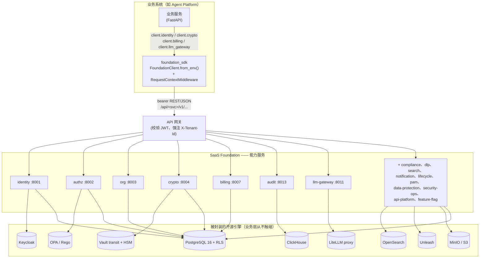
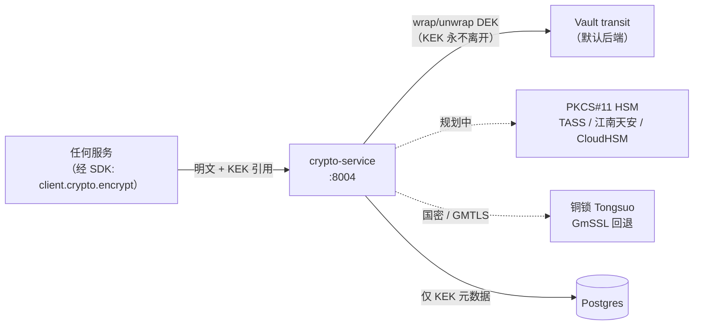

[English](ARCHITECTURE.md) | 中文

# SaaS Foundation 架构指南

[](../LICENSE)


SaaS Foundation 是一个可独立运行、可复用的企业级底座，任何业务系统都能在其上构建。它把每个多租户 SaaS 或私有云产品都需要的横切关注点——身份、授权、组织建模、计费、审计、合规、数据保护、LLM 网关等——封装成一组独立的能力服务，并由一套统一的强类型 SDK 对外提供。

贯穿全文的设计准则是：**业务服务永远不直接 import 开源引擎，而是 import SDK。** Keycloak、OPA、ClickHouse、OpenSearch、Vault、LiteLLM 全部被封装在 Foundation 服务背后，业务层因此只面对一份稳定契约，而不是十几套第三方 API。

[Agent Platform](https://github.com/chenzefeng09/agent-platform) 就是这样一个业务系统：它构建在 SaaS Foundation 之上，import `foundation_sdk`，并调用 Foundation 服务完成身份、授权、计费、审计与 LLM 网关。本文描述的是 Foundation 本身；两个仓库互为同级（sibling）检出。

> 本指南是一张地图，不是契约。具有约束力的契约是 [CONVENTIONS.md](./CONVENTIONS.md)、[multi-tenancy.md](./multi-tenancy.md) 与 [errors.md](./errors.md)。当本指南与这些文档冲突时，以这些文档为准。

---

## 目录

1. [SDK 前置的架构](#1-sdk-前置的架构)
2. [多租户隔离：三道墙](#2-多租户隔离三道墙)
3. [能力包参考](#3-能力包参考)
4. [契约与 SDK](#4-契约与-sdk)
5. [唯一加密边界与审计哈希链](#5-唯一加密边界与审计哈希链)
6. [合规架构](#6-合规架构)
7. [部署档位](#7-部署档位)
8. [延伸阅读](#8-延伸阅读)

---

## 1. SDK 前置的架构

每个能力都是一个独立的 FastAPI 服务，只负责一个领域，通过 `/api/<service>/v1/...` 暴露 REST + JSON，并封装该领域所需的开源引擎。业务代码从不直接与这些引擎对话；它调用一套强类型 SDK——该 SDK 从单一 base URL 派生出所有各服务 URL，并用 bearer token 鉴权。



### 这张图的含义

- **一套 SDK，一个 base URL。** `FoundationClient.from_env()` 读取 `FOUNDATION_API_URL` 与 `FOUNDATION_API_TOKEN`，对外暴露 17 个资源组（`identity`、`authz`、`org`、`billing`、`audit`、`lifecycle`、`notification`、`search`、`api_platform`、`llm_gateway`、`feature_flag`、`dlp`、`crypto`、`compliance`、`pam`、`data_protection`、`security_ops`）。一次 `client.crypto.encrypt(...)` 调用会变成一个对 `/api/crypto/v1/encrypt` 的、带 bearer 鉴权的 REST 请求。
- **入站上下文。** 处理请求的服务挂载 SDK 的 `[fastapi]` extra：`RequestContextMiddleware` 把身份、租户、request-id 提取进 `contextvars`，`register_problem_details` 接好 RFC 9457 错误响应。
- **一服务一能力。** 右侧每个方框都是一个 `<capability>-service`（见 [CONVENTIONS.md §1](./CONVENTIONS.md)）。新能力即新服务，绝不把两个能力塞进一个进程。
- **引擎始终隐藏。** identity 封装 Keycloak；authz 封装 OPA；audit 写入 ClickHouse；search 封装 OpenSearch；crypto 封装 Vault transit + PKCS#11 HSM；llm-gateway 封装自托管的 LiteLLM proxy。平台**自身不部署任何推理引擎**——llm-gateway 转发到外部供应商。

### REST 约定（与调用方相关的部分）

以下由 [CONVENTIONS.md §2](./CONVENTIONS.md) 与 OpenAPI lint 规则强制：

- 路径为 `/api/<service>/v1/<resource>`；版本号在 URL 中显式声明（不接受 header 版本）。
- JSON 字段名为 `snake_case`；枚举值为 `UPPER_SNAKE_CASE`。
- 响应是裸资源 JSON——不使用 `{ code, data, message }` 包络。列表返回 `{ "items": [...], "next_cursor": "..." }`，默认游标分页（`limit` 默认 50，最大 200）。
- 错误遵循 [RFC 9457 Problem Details](https://www.rfc-editor.org/rfc/rfc9457)，采用四段错误码 `FOUNDATION.<SERVICE>.<CATEGORY>.<NAME>`（见 [errors.md](./errors.md)）。
- 服务间性能敏感路径（authz check、quota check）可额外走 gRPC；REST 端点与这些路径对应镜像。

---

## 2. 多租户隔离：三道墙

租户隔离是底座中最关乎安全的契约。它由**三道墙**纵深防御，按外层被绕过后的回退顺序排列。完整规范见 [multi-tenancy.md](./multi-tenancy.md)；本节是摘要。

```mermaid
sequenceDiagram
    autonumber
    participant C as 客户端 / SDK
    participant G as API 网关
    participant S as 服务 (FastAPI)
    participant DB as PgBouncer + Postgres

    C->>G: Authorization: Bearer <JWT>（claim 含 tenant_id）
    Note over G: 第 1 道墙 —— 校验 JWT（Keycloak JWKS），<br/>提取 tenant_id，强注 X-Tenant-Id<br/>（覆盖客户端任何值）
    G->>S: X-Tenant-Id、X-User-Id、X-Request-Id
    Note over S: middleware 把 TenantContext 写入 contextvars
    S->>DB: BEGIN; SET LOCAL app.tenant_id / app.user_id / app.actor
    Note over S,DB: 第 2 道墙 —— 事务内 SET LOCAL
    DB-->>DB: 第 3 道墙 —— RLS policy 按<br/>current_setting('app.tenant_id') 过滤
    DB-->>S: 仅返回本租户的行
    S-->>C: 响应（commit/rollback 释放 SET LOCAL）
```

### 第 1 道墙——网关从 JWT 强制注入 `X-Tenant-Id`

API 网关用 Keycloak 的 JWKS 校验 JWT 签名，提取 `tenant_id` claim，并**强制注入** `X-Tenant-Id`，覆盖客户端发来的任何值。因此客户端无法自行声明租户。若客户端带了 `X-Tenant-Id` 且不等于 JWT claim，请求被拒绝。SDK 会自动从当前 `TenantContext` 注入 `X-Tenant-Id`；业务代码**不允许向 SDK 传 `tenant_id` 参数**（跨租户操作必须走显式、可审计的 `with sdk.as_tenant(...)`）。

### 第 2 道墙——应用在事务内执行 `SET LOCAL app.tenant_id`

数据库适配器在 acquire 连接时开启事务，并用 `set_config('app.tenant_id', ..., is_local=true)`（`SET LOCAL` 的参数化、可一次设多个的形式）设置租户上下文，同时设置 `app.user_id` 与 `app.actor`（`USER` / `SYSTEM` / `MIGRATOR` / `ADMIN`）。由于 `SET LOCAL` 的作用域是事务，提交或回滚时自动释放。**业务代码从不写 `SET LOCAL`**——那是适配器层的职责，业务代码里出现 `SET LOCAL` 视为 bug（Semgrep 强制扫描）。

### 第 3 道墙——Postgres RLS 且 `FORCE ROW LEVEL SECURITY`

每张租户表都**启用并强制（FORCE）**行级安全。`FORCE` 是承重词：缺了它，表 owner 会绕过 RLS，于是任何用 owner 角色的连接都能读到所有租户的数据。每张表至少带四条 policy（`select` / `insert` / `update` / `delete`），以 `current_setting('app.tenant_id', true)` 为键。第二个参数 `true` 在变量未设置时返回 `NULL`，因此默认是**拒绝，而非放开**。

```sql
ALTER TABLE identity.user ENABLE ROW LEVEL SECURITY;
ALTER TABLE identity.user FORCE  ROW LEVEL SECURITY;   -- owner 同样受约束

CREATE POLICY user_tenant_select ON identity.user
    FOR SELECT TO app_user
    USING (tenant_id = current_setting('app.tenant_id', true)
           AND (deleted_at IS NULL OR current_setting('app.show_deleted', true) = 'true'));
-- + tenant_insert / tenant_update（USING + WITH CHECK）/ tenant_delete
```

Policy 由 `foundation_common.db.rls.standard_tenant_policies(...)` 生成，而非手写，以免任何表漏写。

### 四个数据库角色

应用代码绝不以 superuser 或 `BYPASSRLS` 角色连库。

| 角色 | LOGIN | BYPASSRLS | 谁用 | 用途 |
|---|---|---|---|---|
| `app_user` | 是 | **否** | 所有服务运行时 | 运行时主力，完全受 RLS 约束。 |
| `app_admin` | 是 | **否** | 管理控制台服务 | 管理控制台 / SRE；`FORCE` RLS 仍生效，但有专门的 admin policy 允许 `*ALL*` 跨租户视图。 |
| `app_migrator` | 是 | **是** | 仅 CI 迁移 job | **唯一**的 `BYPASSRLS` 角色；跑 Alembic 迁移与数据搬运。 |
| `app_observability` | 是 | **否** | 审计 / 监控导出 | 通过自定义只读 policy 做只读报表。 |

CI 自动拒绝任何把 `BYPASSRLS` 授予 `app_user`/`app_admin` 的 PR、把服务接到 `app_migrator` 凭据的 PR，以及代码中出现 `BYPASSRLS` 的 PR。

### PgBouncer 必须为 transaction 池模式

`SET LOCAL` 的作用域是事务，因此连接池**必须**运行在 `transaction`（或 `session`）池模式。在 `statement` 模式下，连接池可能在语句之间切换后端连接，`SET LOCAL` 随之失效，下一条语句就会在陈旧或空的租户上下文下读取——**这就是跨租户泄露**。两个保险强制此约束：

- 启动健康检查（`verify_pgbouncer_mode`）执行 `SHOW pool_mode`，若模式为 `statement` 则**拒绝启动**。
- 在 transaction 模式下，`server_reset_query` 留空（PgBouncer 在事务边界自动 reset）；在此叠加 `DISCARD ALL` 只会损失性能。

### RLS 越权 fuzz 测试为强制项

每个服务都在 `tests/security/` 下提供 RLS 隔离 fuzz 套件。它播种两个租户，在租户 A 的上下文下执行 **1000 次随机读**，断言永远不会返回租户 B 的任何行。CI 跑全部 1000 个参数化用例，任何泄露都阻断合并。配套测试还验证 PgBouncer 模式，以及跨租户访问能被审计 pipeline 捕获。`foundation_db_rls_policy_violations_total` 与 `foundation_db_no_tenant_context_total` 指标预期恒为 0，否则以最高级别告警触发 on-call。

### 各档位下的隔离

RLS 在**每个** SaaS 档位都保持启用，因为多一道墙没有可测的代价，且档位之间的迁移期数据可能同时存在于两种模式（见 [multi-tenancy.md §11](./multi-tenancy.md)）：

| 档位 | 隔离模式 | RLS 的角色 |
|---|---|---|
| Free / Pro | 同库 + 同表（Shared） | RLS 是**唯一**隔离手段 |
| Business | 每租户独立 schema（切 `search_path`） | RLS 是双保险 |
| Enterprise | 每租户独立数据库 | 保留 RLS，物理隔离主导 |
| Dedicated | 独立集群 / 独立库 | 保留 RLS |

---

## 3. 能力包参考

Foundation 提供 **18 个能力服务**，外加一个进程内存储库。每个都是独立的 FastAPI 服务（除非另有说明），在适用处封装某个特定开源引擎，并在 `/api/<svc>/v1` 暴露其契约。

> **关于端口的说明。** 容器端口与 dev compose 中映射的宿主机端口并不总是一致，且少数 OpenAPI 的 `servers` 条目仍写着不同的端口号。下表给出 fact-map 中的标准值；以运行中服务的 `/healthz` 为准，而非某份文档里的某个数字。

### 身份与访问域

| 服务 | 端口（容器 / dev 宿主机） | 封装 | 用途 |
|---|---|---|---|
| **identity** | 8001 / 8001 | Keycloak Admin API | 用户、会话、MFA、SSO / 社交登录、SCIM 及密码 / MFA / 会话策略。 |
| **authz** | 8002 / 8002 | OPA sidecar | RBAC（本地，约 90% 快路径）加 OPA 的 ABAC 处理 `policy_required` 权限。 |
| **org** | 8003 / 8003 | PostgreSQL（`ltree`、GiST） | 四级组织树 Tenant → OrgUnit → Team → User、租户路由与套餐迁移。 |
| **pam** | 8015 / 18015 | Teleport / 外部堡垒机 | 特权访问管理：JIT 提权、四眼审批、会话录制、高危命令阻断。 |

**identity** 负责用户生命周期、会话签发与刷新（含 service-account 与 MFA 校验会话）、SSO / 社交供应商配置、TOTP 注册及租户密码策略，密码哈希委托给 **crypto**（Argon2id）。关键端点：`POST /sessions`、`POST /sessions/service-account-token`、`POST /sessions/{session_id}/mfa-verify`、`GET|POST /users`、`POST /users/{user_id}/freeze`、`POST /mfa/methods/totp:enroll`、`GET|POST /sso/providers`、`GET|PUT /policies/password`。依赖 Keycloak、Postgres（RLS）、Redis、crypto 与 compliance（读合规模式以决定策略强度）。

**authz** 回答单条与批量权限检查，并计算用于搜索/UI 过滤的 `list-accessible-ids` 集合。RBAC 决策由本地 `role_binding` 表以毫秒级延迟提供；`policy_required` 权限转发给 OPA sidecar（`/v1/data/foundation/authz/allow`）。关键端点：`POST /check`、`POST /check:batch`、`POST /list-accessible-ids`、`GET|POST /roles`、`GET|POST /bindings`、`GET|POST /policies`、`POST /policies/{policy_id}/simulate`。依赖 OPA sidecar 与 Postgres（角色绑定 + RLS 作为纵深防御）。

**org** 管理租户、可嵌套的组织单元、团队与成员，底层用邻接表加 Postgres `ltree` 路径列与 GiST 索引实现 O(log n) 的祖先/后代查询；触发器重算 path/depth 并防止成环。它叠加 `tenant_routing`（SaaS 隔离/路由）与 `tier_migration`（套餐升降级，approve/execute/rollback）。关键端点：`GET|POST /tenants`、`GET|POST /org-units`、`POST /org-units/{ou_id}/move`、`GET|POST /teams`、`.../teams/{team_id}/members`、`GET /tenants/{tenant_id}/routing`、`POST /tenants/{tenant_id}/migrations`、`POST /migrations/{migration_id}/{approve|execute|rollback}`。依赖 Postgres（`ltree`、GiST、RLS）与 Redis Streams（事件 outbox 目标；投递 worker 标注为尚未实现）。

**pam** 实现 Just-In-Time 特权访问：管理员请求临时提权（审批 → 授予 ≤4h → 自动回收），高敏操作需四眼审批。特权会话（SSH / web 控制台 / DB）全程录制，命令日志 WORM 存储；高危命令（`rm -rf /`、`DROP DATABASE`）立即杀会话并告警。关键端点：`GET|POST /elevations`、`POST /elevations/{elev_id}/revoke`、`POST /approvals/{approval_id}/decide`、`GET /sessions/{session_id}/recording`、`POST /sessions/{session_id}/kill`、`GET|POST /command-policies`、`GET /privileged-accounts`、`POST /privileged-accounts/{account_id}/rotate-password`。依赖 Postgres、identity/authz、audit（WORM 日志）、notification、crypto 及 Teleport 或外部堡垒机（JumpServer / 齐治 / 行云）。

### 数据、审计与合规域

| 服务 | 端口（容器 / dev 宿主机） | 封装 | 用途 |
|---|---|---|---|
| **audit** | 8013 / 8013 | ClickHouse + S3 WORM | 不可变审计日志枢纽：outbox → ClickHouse → S3 WORM，带哈希链与签名。 |
| **compliance** | 8014 / 18014 | PostgreSQL | 合规模式真相源、ROPA、DPIA、DSAR 编排、等保自评估、SOC 2 / ISO 27001 导出。 |
| **dlp** | 8007（内部）/ 18007 | PostgreSQL | 数据分级（L1_PUBLIC → L5_SECRET）加 DLP 强制：标签、密级、规则、扫描器、事件。 |
| **data-protection** | 8016 / 18016 | PostgreSQL | 脱敏 / 假名化、带四眼审批的数据导出 & DSAR、PIPL 跨境检查、同意管理。 |
| **lifecycle** | 8006 / 18006 | PostgreSQL + storage 库 | 留存策略、回收站、法律保留、备份与签名的销毁证明。 |

**audit** 是平台的防篡改日志。每个 Foundation 与业务服务通过 `foundation_audit` SDK（异步 outbox）发出结构化事件；audit 将其持久化到 ClickHouse 并归档到 S3/MinIO WORM。它在事件上构建**哈希链**，并通过 **crypto** 签名链根——默认 **Ed25519**，合规模式下用 **SM2**——支持查询、导出与链完整性校验。它**不**决定是否审计（由 SDK 调用方决定），并把敏感字段脱敏委托给 data-protection。关键端点：`GET|POST /events`、`POST /events:export`、`POST /chain/verify`、`GET|POST /schemas`。依赖 ClickHouse、crypto、S3/MinIO（WORM）、`foundation-storage`、`foundation-feature-flag`、Postgres（outbox）与 data-protection。

**compliance** 是当前**合规模式**的单一真相源。其他服务——identity、authz、audit、lifecycle——读取它（`POST /modes:is-at-least`）并据此抬高自身策略强度。它管理处理活动记录（ROPA，含扫描）、DPIA 评估、DSAR 编排，以及等保（中国 DJCP / 等保 2.0 三级）控制项清单（含评估与看板），并导出 SOC 2 / ISO 27001 报告，自动从 identity（MFA 启用）、authz（RBAC 覆盖）、audit 拉取证据。关键端点：`GET /modes`、`POST /modes:enable`、`POST /modes:is-at-least`、`GET|POST /ropa`、`POST /ropa/scan`、`GET|POST /dpia/assessments`、`POST /dsar/orchestrate`、`GET /equal-protection/controls`、`POST /equal-protection/assessments`、`GET /equal-protection/dashboard`、`POST /reports:export`。

**dlp** 把 5 级分级模型与 DLP 强制合二为一。它管理资源标签与用户密级，运行核心检查（密级对敏感度，决定 read/download/external-send），维护规则，跑扫描器作业，记录事件，并处理带审批的降级请求。它打包成两个逻辑半边（classification 负责打标/降级；dlp 负责 check/rules/scan/events）。关键端点：`GET|PUT /labels/{resource_type}/{resource_id}`、`GET|PUT /clearances/{user_id}`、`POST /check`、`GET|POST /rules`、`POST /scanner/jobs`、`GET /incidents`、`POST /downgrade-requests/{req_id}/approve`。与 authz（密级 ≥ 敏感度）、audit（所有命中均审计）、lifecycle（L4/L5 更长留存 / 加密销毁）与 notification（告警）集成。

**data-protection** 负责字段脱敏与假名化（安全出域到测试/分析）、带四眼审批的数据导出与 DSAR 流程、PIPL 跨境传输检查（数据驻留 / 标准合同）以及带撤回的同意管理。它与 crypto 协作渲染并签名销毁证明 PDF，而证明数据由 lifecycle 持有。同意记录以接入 audit 的哈希链写入。关键端点：`POST /mask`、`POST /pseudonymize`、`GET|POST /data-export-requests`、`POST /data-export-requests/{req_id}/approve`、`GET|POST /dsar-requests`、`POST /cross-border/check`、`GET|POST /consents`、`POST /consents/{consent_id}/withdraw`。

**lifecycle** 拥有完整的数据存活流水线：按资源的留存策略、三阶段软删除回收站（默认约 30 天）、可覆盖任何删除的法律保留、备份/恢复编排，以及带哈希存证的 PDF 销毁证明。硬删除用 crypto 的密钥销毁（经 `crypto_url`）加物理覆写，并由 APScheduler 循环驱动 GC/留存。关键端点：`GET|POST /retention-policies`、`GET /recycle-bin`、`POST /recycle-bin/{item_id}/restore`、`POST /recycle-bin/{item_id}/purge`、`GET|POST /legal-holds`、`POST /legal-holds/{hold_id}/release`、`GET /backups`、`POST /backups/{backup_id}/restore`、`GET /destruction-certificates/{cert_id}/pdf`。依赖 `foundation-storage`、crypto、Postgres 与 audit。

### 平台服务域

| 服务 | 端口（容器 / dev 宿主机） | 封装 | 用途 |
|---|---|---|---|
| **crypto** | 8004 / 8004 | Vault transit + PKCS#11 HSM | 唯一加密边界：信封加密、KEK 生命周期、签名/验签、Argon2id 哈希。 |
| **billing** | 8007（内部）/ 18017 | Stripe / OfflineProvider、ClickHouse | 套餐、订阅、配额、用量计量、发票，支持离线 / SaaS 双模式。 |
| **llm-gateway** | 8011 / 8011 | LiteLLM proxy | 所有 LLM 调用的唯一租户隔离出口；同时提供 OpenAI 与 Anthropic 兼容 API。 |
| **search** | 8009 / 8009 | OpenSearch | 跨资源搜索，强制注入租户 + ACL 过滤。 |
| **notification** | 8008 / 18008 | SMTP / IM / 短信 / 推送 | 多渠道通知中心：模板、订阅、8 渠道扇出、带 DLQ 的重试。 |
| **feature-flag** | 8012 / 8012 | Unleash | 薄封装的多租户功能开关服务，带 DB 持久化覆盖与紧急 kill-switch。 |
| **api-platform** | 8010 / 18010 | PostgreSQL | 租户内 API 密钥、OAuth2 服务器与带投递审计的 webhook 订阅。 |
| **security-ops** | 8019 / 18019 | PostgreSQL | SSDLC 扫描、漏洞 SLA、SBOM、事件、渗透测试与混沌演练。 |
| **storage** | —（进程内库） | MinIO / S3（boto3） | 租户隔离的 key 布局、配额钩子、OTel span——被 import，而非部署。 |

**crypto**——详见 [§5](#5-唯一加密边界与审计哈希链)。它提供信封 encrypt/decrypt（KEK 永不离开 Vault）、轮换时 rewrap、Ed25519 / ECDSA-P256 签名验签、Argon2id 哈希，以及完整的 KEK 生命周期（创建、轮换、两步 mark-for-destruction 含 30 天冷却期加四眼销毁、以及 abort）。Vault 不可达时**失败即关闭**（返回 503）。关键端点：`POST /encrypt|decrypt|sign|verify`、`GET|POST /keks`、`POST /keks/{kek_id}/rotate`、`POST /keks/{kek_id}/mark-for-destruction`、`POST /keks/{kek_id}/destroy`、`POST /keks/{kek_id}/abort-destruction`、`GET /algorithms`。依赖 HashiCorp Vault（transit）与 Postgres（KEK 元数据）。

**billing** 管理套餐、订阅（create / change-plan / cancel）、按维度配额检查、用量摄取与发票（PDF + 供应商 webhook）。它运行双模式：私有部署默认（OfflineProvider 加中国电子发票）与 SaaS 模式（Stripe 加 Stripe Tax），由功能开关切换。高频用量记录在设计上主要落入 ClickHouse（月分区），Postgres 保留近期/聚合数据。它依赖 **org** 的租户外键，故其迁移在 identity/authz/org 之后运行。关键端点：`GET|POST /plans`、`GET|POST /subscriptions`、`POST /subscriptions/{sub_id}/change-plan`、`POST /subscriptions/{sub_id}/cancel`、`GET /quotas`、`POST /quotas/{dimension}/check`、`GET|POST /usage`、`GET /invoices/{invoice_id}/pdf`、`POST /webhooks/{provider}`。

**llm-gateway** 是平台唯一的模型出口：它封装自托管的 LiteLLM proxy，把所有推理转发到**外部**端点（Claude / Bedrock / Azure OpenAI / Vertex / 客户 vLLM / Ollama）——平台内部不部署推理引擎。封装层加上按租户的虚拟密钥（映射到底层供应商密钥）、供应商注册时的能力探测、上报给 billing 的 token 用量聚合、带 DLP 高敏 prompt 阻断的请求/响应审计、数据驻留强制（cn-only 租户不能注册海外供应商）与自动回退。它同时暴露 `POST /chat/completions`（OpenAI 兼容，SSE）与 `POST /messages`（Anthropic 兼容，SSE），加 `GET /models`、`GET|POST /providers`、`POST /providers/{provider_id}/probe`、`GET|POST /virtual-keys`。依赖 LiteLLM、Postgres、crypto（信封加密供应商密钥）、billing、DLP/compliance 与 audit。

**search** 在自托管的 OpenSearch 上提供全文与分面搜索（选 OpenSearch 以规避 Elasticsearch 许可问题）。每条 SDK 查询都被强制包含 `tenant_id`、`sensitivity ≤ user.clearance` 与一个 accessible-id 过滤，并通过 OpenSearch 索引模板做第二层强制，使无权结果物理不可达。每个租户拥有一个索引别名，背后是 1–N 个按大小/文档数/年龄自动 rollover 的物理索引。关键端点：`PUT /index/{resource_type}`、`DELETE /index/{resource_type}/{doc_id}`、`POST /query`、`GET|POST /schemas`。依赖 OpenSearch、Postgres、authz（`list_accessible_ids`）与 DLP 分级。

**notification** 收集平台与业务事件，通过统一的 `ChannelAdapter` 扇出到**八个**渠道（邮件、webhook、WebSocket、钉钉、飞书、企业微信、短信、应用推送）。它提供带 i18n（zh-CN/en-US/ja-JP）与租户覆盖的 Jinja2 模板、三级订阅（租户默认 / 角色 / 个人）含免打扰与摘要，并通过 outbox + 异步 worker 实现可靠投递，含指数退避重试（最多 8 次）、死信队列与按租户/按渠道的限流。关键端点：`POST /messages`、`GET|POST /templates`、`GET|POST /subscriptions`、`GET /channels`、`POST /channels/{channel}:test`、`GET /dlq`、`POST /dlq/{message_id}/replay`。

**feature-flag** 封装自托管的 Unleash 服务器，把租户/用户上下文注入开关求值，加上套餐档位门控与渐进（百分比）放量，并在自有 schema 中持久化开关覆盖与紧急 kill-switch。业务代码通常通过 SDK 调 `is_enabled(flag, user_ctx)`；REST 端点支撑管理控制台。关键端点：`GET|POST /flags`、`GET|PUT|PATCH|DELETE /flags/{flag_key}`、`POST /flags/{flag_key}/kill-switch`、`POST /evaluate`、`POST /evaluate-batch`。依赖 Unleash 与 Postgres。

**api-platform** 面向租户内部开发者（明确**不是**对外开放平台）：三级作用域 API 密钥（tenant/user/app）含 IP 白名单、限流与过期；用于租户内应用 SSO 的 OAuth2 服务器（`client_credentials`、`authorization_code`、`refresh_token`）；以及带 HMAC-SHA256 签名、指数退避重试、DLQ 与投递审计的 webhook 端点。关键端点：`GET|POST /api-keys`、`DELETE /api-keys/{key_id}`、`GET|POST /oauth-apps`、`POST /oauth-apps/{client_id}/rotate-secret`、`GET|POST /webhooks`、`GET /webhook-deliveries`、`POST /webhook-deliveries/{delivery_id}/replay`、`GET /rate-limits`。

**security-ops** 是平台级（无租户上下文）服务，跟踪 SSDLC 扫描运行、用看板与风险接受流程管理漏洞 SLA、记录 SBOM 与 watch、捕获许可证发现项、运行事件响应，并排程安全/混沌演练与渗透测试。DELETE 流程经 lifecycle，使回收站掌握 S3 清理窗口。关键端点：`GET /chaos/scenarios`、`GET|POST /chaos/runs`、`GET /pentest/engagements`、`GET /vulnerabilities`、`POST /vulnerabilities/{vuln_id}/risk-accept`、`GET /vulnerabilities/sla-dashboard`、`GET /sbom/images/{image_ref}`、`GET|POST /incidents`、`GET|POST /drills`。依赖 `foundation-storage`、`foundation-feature-flag` 与 `foundation-lifecycle`（均为 path 依赖）加 Postgres。

**storage** 是"一切皆服务"规则的唯一例外：它是一个**基于 boto3 的 Python 库，而非 HTTP 服务**（无 FastAPI、无 OpenAPI 契约、不作为独立 compose 服务）。其他 Foundation 服务以 path 依赖 import 它。它提供 `StorageClient` 加一个 `ObjectKey` 助手，在 storage-v1 各 bucket（`foundation-audit` WORM、`foundation-workspace`、`foundation-kb-raw`、`foundation-kb-derived`）上强制租户隔离的 key 布局，并带配额钩子与 OTel span。Python API：`StorageClient.put_object / list_prefix / delete_object`、`ObjectKey.for_workspace_file(...)`。被 audit、lifecycle、security-ops 消费。

---

## 4. 契约与 SDK

Foundation 是**契约优先（contract-first）**：OpenAPI spec 是真相源，实现必须 conform——而非反过来。这样 SDK、文档、mock 不会随代码漂移。见 [contracts/openapi/README.md](../contracts/openapi/README.md)。

### 契约优先的 OpenAPI 3.1 —— 18 份 spec

`contracts/openapi/` 每个服务一份 spec（identity、authz、org、crypto、audit、lifecycle、dlp、data-protection、notification、search、opa-bundle、scim-dingtalk、pam、feature-flag、compliance、billing、api-platform、llm-gateway、security-ops），加上 `_common.yaml`（共享的错误 / ID / 分页 / security 组件）、`_template.yaml`、`.spectral.yaml` 与一个 Makefile。FastAPI 实现用 `openapi_extra` 装饰器把 `operationId` / examples 对齐到 spec，而不是从代码自动生成 spec。

### 六条机器强制的 spec 铁律

由 `.spectral.yaml` 强制；任何 spec PR 都必须 `make lint` 全绿：

1. **所有 path 带 `/v1` 前缀**——版本在 URL 中显式声明；禁止 header 版本。
2. **JSON 字段 `snake_case`；枚举 `UPPER_SNAKE_CASE`**（合规模式标识符为已声明的例外）。
3. **错误响应必须 `$ref` `_common.yaml`**——不允许内联错误 body。
4. **错误码为四段 `FOUNDATION.<SVC>.<CAT>.<NAME>`。**
5. **每个 operation 都有唯一的 camelCase `operationId`**（供 SDK 生成器使用）。
6. **每个非公开端点声明 `security: [bearerAuth]`**；公开端点必须显式声明 `security: []`。

破坏性变更由 `oasdiff` 捕获（`make diff-base` 对比 `main`）；任何破坏性变更都阻断 PR，并要求 `BREAKING:` commit footer 加主版本号递增（兼容性策略见 [CONVENTIONS.md §5](./CONVENTIONS.md)）。

### 签名 OPA bundle 流水线

authz 的 ABAC 决策针对**签名的 OPA bundle** 运行（设计见 `docs/design/opa-bundle-v1.md`）。一个 bundle 是 Rego（`foundation.authz` core / rbac / abac / compliance）加 `data.json`（权限、kill-switch、合规矩阵）、一个 manifest，以及一份**由 crypto 服务产生的 JWS 签名**的 tarball。它经 HTTPS 分发，被每个 OPA sidecar 每 5 秒轮询一次。放量分阶段：shadow → canary 10% → 50% → 100%，带一键回退与全局 kill switch（全拒或回到 last-good）。bundle 经 `opa`（kube-mgmt）subchart 部署。

### 三套 SDK

OpenAPI spec 从单一真相源驱动三套客户端 SDK：

| SDK | 状态 | 包 | 说明 |
|---|---|---|---|
| **Python** | 已交付（v0.1.0） | `foundation_sdk`（`sdks/python`） | `FoundationClient.from_env()` 聚合 17 个资源组；异步；可选 `[fastapi]` extra 增加 `RequestContextMiddleware` + RFC 7807 problem-details 注册。 |
| **TypeScript** | 已交付（v0.1.0） | `@foundation/sdk`（`sdks/typescript`） | 与 Python 表面 1:1 对齐（同 17 资源、错误体系、上下文助手）；零运行时依赖、基于 fetch、双 ESM/CJS（tsup），用 vitest 测试。 |
| **Go** | **规划中** | `sdks/go/` | 仅一个 stub——只有 `.gitkeep`，无 `go.mod` 或代码。README / Makefile 引用了未来的 `make sdk-go`，但尚未生成。 |

业务系统依赖生成的 `foundation_*` SDK 包，**不允许**直接调服务 URL 或 import Foundation 引擎的内部包。对私有云客户，离线 SDK tarball（`sdks/python-1.0.0.tar.gz`、`sdks/typescript-1.0.0.tgz`）随 Helm chart 一起交付。

> 关于 `contracts/proto/` 与 `contracts/opa-bundles/` 的说明：两者目前都是占位符（`.gitkeep`）。面向性能敏感服务间调用的 gRPC 路径已规定，但 proto 文件尚未编写。

---

## 5. 唯一加密边界与审计哈希链

### 唯一加密边界

`crypto-service` 是平台中**唯一**执行加密的地方。集中化意味着只有一个组件需要审计、轮换与认证——且没有任何业务服务持有裸密钥。



模型是**信封加密**（MasterKey → KEK → DEK）：密钥加密密钥永不离开 Vault/HSM，只有被包裹的数据加密密钥流转。默认后端是 **Vault transit**，PKCS#11 HSM 抽象与国密后端在路线图上。KEK 轮换以 90 天为周期，且**密钥销毁即数据销毁**：两步 mark-for-destruction（30 天冷却期）加四眼销毁，使加密擦除成为 lifecycle 销毁证明背后的机制。Vault 不可达时 crypto 失败即关闭（返回 503）。

### 审计哈希链与 WORM 模型

audit 把事件流变成防篡改的证据：

- 服务通过 `foundation_audit` SDK 的**异步 outbox** 发出事件，将调用方与 audit 可用性解耦。
- audit 把事件持久化到 **ClickHouse**，并通过 `foundation-storage` 库归档到 **S3/MinIO WORM** 存储——一次写入、多次读取，归档事件在其留存期内无法被改动或删除。
- 它在事件上构建**哈希链**，并经 crypto **签名链根**——默认 **Ed25519**，合规模式下用 **SM2**。`POST /chain/verify` 重走整条链以证明完整性，这正是等保或 SOC 2 审计员想要的证据。
- audit 不决定*是否*审计（由 SDK 调用方决定），并把敏感字段脱敏委托给 data-protection，使审计存储本身不含裸敏感数据。

同样的哈希链思路在 **data-protection**（同意记录以接入 audit 的哈希链写入）与 **lifecycle / data-protection** 的销毁证明（PDF + 哈希存证，经 crypto 签名）中再次出现。

---

## 6. 合规架构

合规是织入架构、而非事后外挂的，且 Foundation 刻意如实区分今天已实现的与路线图上的。

### 合规模式作为单一真相源

**compliance-service** 是当前**合规模式**的单一真相源。其他服务——identity、authz、audit、lifecycle——读取它（`POST /modes:is-at-least`）并据此抬高自身策略强度：identity 中更强的密码/MFA/会话策略、audit 中的国密签名、lifecycle 中更长的留存。这意味着合规姿态是部署模式的属性，而非每个服务各自独立决定的事。

### 等保 2.0 三级与 PIPL —— v1.0 目标

具有约束力的路线图主张（来自仓库 README）是：**v1.0 覆盖等保 2.0 三级 + PIPL；v1.1 加国密 + 信创；v1.2 加 SOC 2 + ISO 27001。** 架构与之直接对应：

- **等保 2.0 三级（GB/T 22239-2019）：** 等保自评估（`docs/equal-protection-checklist-v1.md`）报告基线覆盖 **176/211 技术项（83%）** 与 **58/70 管理项（83%）**，其中 **35 技术项 + 12 管理项**为客户明确责任——总体通过率 ≥85%。5 级 DLP 分级、RLS 隔离、审计哈希链、PAM 与加密边界是这些数字背后的技术支柱。
- **PIPL：** data-protection 处理跨境传输检查（数据驻留 / 标准合同）、带撤回的同意管理与 DSAR 编排；llm-gateway 强制 cn-only 驻留，使 cn-only 租户无法注册海外供应商。

### 四级 gap —— 如实陈述

等保 2.0 **四级**并**未**被声称达到。gap 分析（`docs/equal-protection-level4-gap-v1.md`）列举了三级之上的 **+25 个控制项**——强制访问控制（BLP / Biba）、形式化安全模型、TPM/TCM 可信计算、硬件级双向认证、APT 检测——并标注其**大多尚未实现**。请把四级视为一份已记录的 gap，而非一项功能。

### 国密 / 信创 —— v1.1 路线图

国密（SM2/SM3/SM4 + GMTLS）与信创（国产化栈）是**路线图项（v1.1）**，已部分搭好脚手架：

- **国密：** crypto 的设计（`docs/design/crypto-v1.md`）定义了一个国际 / 国密双算法注册表——**铜锁（Tongsuo）**为主、**GmSSL** 回退——合规模式下用 GMTLS，审计链用 SM2 签名。这是单一加密边界背后的一个规划中后端。
- **信创：** 部署指南（`docs/xinchuang-deployment-guide-v1.md`）面向 ARM64（鲲鹏 920 / 飞腾）与海光/兆芯 x86，运行于麒麟 V10 / 统信 UOS V20，配多架构镜像、PKCS#11 HSM 与 PG 兼容的国产数据库（KingbaseES / DM8）。LoongArch 规划中（v1.2）。

---

## 7. 部署档位

Foundation 以单一**伞形 Helm chart**（`deploy/helm/foundation`）交付，一次性部署全部 18 个服务。第三方引擎（postgresql、redis、keycloak、clickhouse、opensearch、vault、minio、opentelemetry-collector、opa、unleash）是 subchart 依赖，各由一个 condition 开关。chart 主体在各档位间不变——用 `-f values-<profile>.yaml` 切换行为。同一 chart 通过切换档位同时服务私有云与 SaaS；见 [deploy/helm/README.md](../deploy/helm/README.md)。

| 档位 | 目标 | 副本 / HA | 第三方引擎 | 安全姿态 |
|---|---|---|---|---|
| **small** | POC / 单节点 K3s / ≤50 用户 | 1 副本，无 HA，无自动扩缩 | 全内嵌（postgres/redis/keycloak/clickhouse/opensearch/vault-dev/minio 启用） | 关 TLS、无 mTLS。基线 8C/32G/500GB，Traefik ingress。 |
| **medium** | 企业私有云 / 3–10 节点 / 约 100–500 用户 | 3+ 副本带 HPA，HA | 外置或客户共享；**强制独立 PgBouncer（transaction 池模式）** | mTLS 经 cert-manager；机密来自 Vault / External Secrets。约 32C/128G。 |
| **large** | 跨 AZ / 1000+ 用户 / SaaS 主集群 | 5+ 副本（authz 8、audit 10、llm-gateway 10、search 6），HPA + KEDA 最多 50，PDB minAvailable 3 | 全外置（客户提供；外部 S3/OSS 带 object-lock bucket） | 跨区 topology spread、加固 pod 安全上下文（runAsNonRoot、drop ALL caps、readOnlyRootFilesystem）、NetworkPolicy。默认合规模式：pipl + equal_protection_3 + soc2；equal_protection_4 / 金融可选启用。 |

另有两个横切档位叠加其上：

- **私有云 K8s（离线 / 气隙）—— 设计默认。** README 既定目标是私有云优先（K8s 1.24+，离线安装），以伞形 chart 加规划中的 `deploy/offline-bundle`（镜像 tar + chart + CRD）交付，并随附 SDK 离线 tarball。凭据来自 Vault / K8s External Secrets；mTLS 来自 cert-manager + 自签 CA。
- **信创（Xinchuang）国产化栈档位。** 在 small/medium 之上叠加 `values-xinchuang.yaml`，配 `--set global.dataResidency=cn-only`、`complianceModes=pipl+equal_protection_3`、`crypto.gmtls.enabled=true`、`crypto.provider=tongsuo_pkcs11`。在麒麟 / UOS 上为鲲鹏 / 飞腾使用多架构镜像，数据库可替换为 KingbaseES / DM8。

> 伞形 chart 目前是骨架：一个临时的 `services-renderer.yaml` 批量渲染 18 个 Deployment，直到每个包提供自己的 subchart（为此迁移提供了 `_service-template/`）。`deploy/offline-bundle` 是规划中的交付物（目前仅一个 `.gitkeep`）。

---

## 8. 延伸阅读

### 具有约束力的契约

- [CONVENTIONS.md](./CONVENTIONS.md) —— 顶层架构契约：服务命名、包布局、URL / 版本化、分页、SDK 兼容性。"违反约定的 PR 不予合并。"
- [multi-tenancy.md](./multi-tenancy.md) —— Postgres RLS + PgBouncer 基线：三道墙、四个 DB 角色、FORCE RLS、transaction 池模式、RLS fuzz 测试，以及 SaaS 档位 → 隔离映射。
- [errors.md](./errors.md) —— 错误码与 RFC 9457 Problem Details 规范。
- [contracts/openapi/README.md](../contracts/openapi/README.md) —— 18 个服务与三套 SDK 的契约优先真相源、六条 spec 铁律与破坏性变更检测。

### 设计文档（`docs/design/`）

- [crypto-v1.md](./design/crypto-v1.md) —— 唯一加密边界、信封加密、Vault transit + PKCS#11 HSM 与国际 / 国密双算法注册表。
- [llm-gateway-v1.md](./design/llm-gateway-v1.md) —— 平台为何不部署推理引擎；LiteLLM 作为被封装的路由后端，带虚拟密钥、DLP 过滤与 cn-only 驻留。
- [opa-bundle-v1.md](./design/opa-bundle-v1.md) —— 签名 OPA bundle 流水线与分阶段放量。
- [saas-isolation-routing-v1.md](./design/saas-isolation-routing-v1.md) —— SaaS 档位 → 隔离映射与按租户 DSN 路由。
- 以及 [docs/design/](./design/) 下每个服务一份设计文档（identity、authz、org、audit、lifecycle、dlp、data-protection、notification、search、pam、compliance、billing、api-platform、security-ops、storage）。

### 合规与信创

- [equal-protection-checklist-v1.md](./equal-protection-checklist-v1.md) —— 等保 2.0 三级自评估。
- [equal-protection-level4-gap-v1.md](./equal-protection-level4-gap-v1.md) —— 如实的四级 gap 分析。
- [xinchuang-deployment-guide-v1.md](./xinchuang-deployment-guide-v1.md) —— 信创硬件 / OS / 国密兼容性矩阵。
- [crypto-evaluation-checklist-v1.md](./crypto-evaluation-checklist-v1.md) —— 密码评估检查清单。

### 部署

- [deploy/helm/README.md](../deploy/helm/README.md) —— 伞形 chart 指南：三档位设计表、安装 / 升级 / 回滚，以及每服务 subchart 的迁移计划。

### 相关项目

- [Agent Platform](https://github.com/chenzefeng09/agent-platform) —— 构建在 SaaS Foundation 之上的业务系统。它要求本仓库在 `../saas-foundation` 处的同级检出，import `foundation_sdk`，并在运行时调用 Foundation 服务完成身份 / 授权 / 计费 / 审计 / LLM 网关。

---

## 许可证

SaaS Foundation 采用 Apache License 2.0 许可。见 [LICENSE](../LICENSE) 与 [NOTICE](../NOTICE)。版权所有 2026 The SaaS Foundation Authors。
