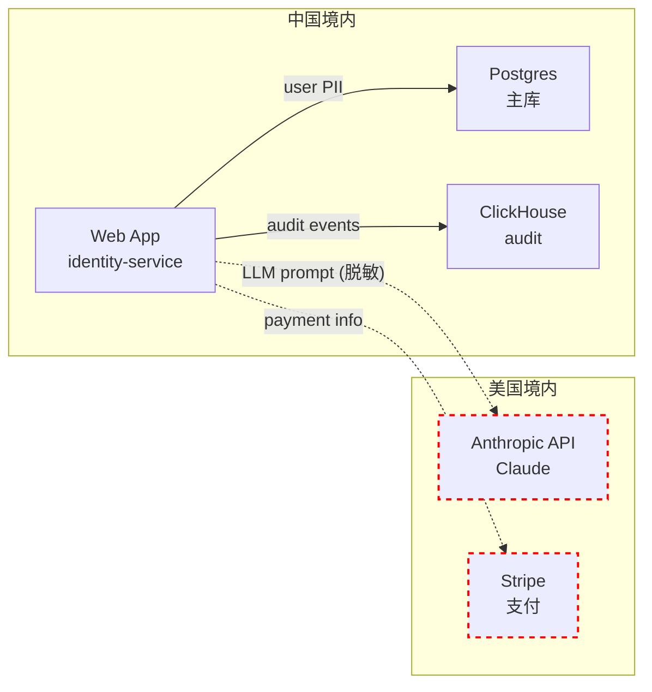

# 跨境合同 + 安评申报模板 v1

> 跨境数据传输合规材料生成器：**PIPL 标准合同（2023 网信办版）** + **安评申报材料** + **DPIA 报告** + **GDPR SCC 2021** + **数据流向图**。
> 是 compliance-v1 的「材料输出」子模块。

| 字段 | 值 |
|---|---|
| 状态 | Draft v1 |
| Owner | 合规 PM + 法务 |
| 实施 milestone | A-M4 |
| 相关文档 | compliance / data-protection / dlp / audit / crypto |

## 0. TL;DR

- **4 类材料**：① PIPL 标准合同 ② 安全评估申报书 ③ DPIA 报告 ④ GDPR SCC 2021
- **3 个机制**：自动从 ROPA 抽数据流 → 预填 60% 内容 → 法务/DPO 人工补 40%
- **输出格式**：Word（甲乙双方编辑）+ PDF（最终签字版）+ 数据流向图（draw.io/mermaid）
- **存证**：所有版本入审计；签字版数字签名 + WORM 归档
- **变更管理**：模板有版本；监管出新模板时通知所有租户

## 1. Context

- 法律强制：
  - PIPL §38：跨境传输需「安评 / 标准合同 / 认证 / 单独同意」4 选 1
  - PIPL §40：CII + 100w+ PI 必须安评（不可走标准合同）
  - GDPR Art.45-47：充分性认定 / SCC / BCR / 认证
- 合规咨询机构常用：合同模板 + 安评申报材料是「样板套」；客户每年要 1-2 次
- 数据流向图：监管要求「数据从哪到哪」可视化

## 2. PIPL 标准合同（2023 网信办版）

### 2.1 模板字段（自动 + 手工）

| 章节 | 来源 |
|---|---|
| 第一条 定义 | 固定文本 |
| 第二条 个人信息处理 | **自动**（从 ROPA + tenant config 抽） |
| 第三条 境外接收方义务 | 半自动（接收方填） |
| 第四条 个人信息主体权利 | 固定（PIPL 7 项权利） |
| 第五条 安全保障措施 | **自动**（从 compliance 模式生成） |
| 第六条 监管 | 固定 |
| 第七条 违约责任 | 固定 + 法务可调 |
| 附件一 数据清单 | **自动**（从 ROPA 抽） |
| 附件二 PIA 报告 | 链接到 DPIA 文档 |

### 2.2 生成 API

```python
from foundation_cross_border import CrossBorderTemplateClient

client = CrossBorderTemplateClient.from_env()

doc = client.pipl_standard_contract.generate(
    tenant_id="tnt_a",
    overseas_receiver={
        "entity_name": "Foundation Corp US Inc",
        "country": "US",
        "address": "...",
        "contact": "dpo@foundation-us.com",
    },
    data_scope=["customer_id", "email", "transaction"],  # 数据清单
    purpose="cross_border_data_analytics",
    retention="3_years",
    language="zh-CN",          # 'zh-CN' / 'en-US'
    format="docx",             # 'docx' / 'pdf'
)
# → 返回 docx bytes + metadata（含建议法务审阅点）
```

### 2.3 网信办备案

合同签订后 10 个工作日内向省级网信办备案：
- 生成「个人信息出境标准合同备案表」
- 上传至省网信办系统（手工，本模块不自动接入）
- 备案号回写 `compliance.cross_border_contract` 表

```sql
CREATE TABLE compliance.cross_border_contract (
  tenant_id        TEXT NOT NULL,
  contract_id      TEXT NOT NULL,
  contract_type    TEXT NOT NULL,           -- 'PIPL_STANDARD'/'GDPR_SCC'/'BCR'
  template_version TEXT NOT NULL,
  overseas_receiver JSONB NOT NULL,
  data_scope       TEXT[] NOT NULL,
  purpose          TEXT NOT NULL,
  signed_at        TIMESTAMPTZ,
  filed_at         TIMESTAMPTZ,             -- 备案时间
  filing_number    TEXT,                    -- 备案号
  expires_at       TIMESTAMPTZ,             -- 合同到期
  pdf_uri          TEXT,                    -- WORM 归档
  pdf_sha256       TEXT,
  signature        TEXT,                    -- 数字签名
  status           TEXT NOT NULL,           -- 'DRAFT'/'SIGNED'/'FILED'/'EXPIRED'/'TERMINATED'
  created_at       TIMESTAMPTZ NOT NULL DEFAULT now(),
  PRIMARY KEY (tenant_id, contract_id)
);
```

## 3. 安全评估申报材料（PIPL §40）

### 3.1 触发条件检测

由 compliance-v1 自动检测：
- CII 自我申报 = true
- 累计 100w+ PI / 10w+ 敏感 PI / 1w+ 敏感 PI 累计出境
- 高风险场景（医疗、金融、政务）

触发后通知 DPO → 启动申报工作流。

### 3.2 申报材料清单

模板生成器输出（标准网信办要求）：

1. 《数据出境安全评估申报书》（Word）
2. 《数据出境风险自评估报告》（Word + 嵌入数据流图）
3. 《与境外接收方拟订立的法律文件》（如已有合同）
4. 数据出境影响评估（DPIA）
5. 申请人组织架构图
6. 数据保护政策（自动从 compliance 模式 + ROPA 拼）
7. 申报人承诺书（固定模板）
8. 委托代理人材料（如适用）

### 3.3 API

```python
package = client.security_assessment.generate_package(
    tenant_id="tnt_a",
    overseas_receiver={...},
    trigger="cii_operator",
    estimated_data_volume={
        "ordinary_pi_count": 1_500_000,
        "sensitive_pi_count": 50_000,
    },
)
# → ZIP（含所有 Word/PDF + 数据流图 + 索引）
```

### 3.4 安评工作流

- 申报 → 网信办预审（15 工作日）→ 受理 → 评估（45 工作日）→ 决定
- 通过：2 年有效；到期前 60 天提醒重新评估
- 不通过：整改后重申

本模块只生成材料；实际申报由客户人工提交。

## 4. DPIA 报告

> compliance-v1 §4 已定义工作流；本模块提供 **PDF 报告模板**。

### 4.1 模板结构

```
1. 评估背景
   - 处理活动描述（从 ROPA 抽）
   - 触发原因
2. 数据流分析
   - 数据流向图（mermaid → svg → 嵌入）
   - 数据生命周期图
3. 必要性 + 比例性评估
4. 风险识别（PIA 矩阵）
   - 数据泄露 / 滥用 / 篡改 / 不可用
   - 似然 × 影响 = 等级
5. 缓解措施
   - 技术（来自 compliance 控制项映射）
   - 管理
   - 物理
6. 残余风险评估
7. 结论 + 建议
8. 审批签字（DPO + 法务）
```

### 4.2 自动化程度

- 第 1-2 节：100% 自动（ROPA + 数据流）
- 第 3-5 节：60% 自动（基于风险库 + 模式）
- 第 6-8 节：DPO 人工填

## 5. GDPR SCC 2021

> 欧盟 2021 年新版标准合同条款；4 个 module 按角色对应：
- **Module 1**: Controller → Controller
- **Module 2**: Controller → Processor
- **Module 3**: Processor → Sub-processor
- **Module 4**: Processor → Controller（数据返回）

### 5.1 模板生成

```python
doc = client.gdpr_scc.generate(
    tenant_id="tnt_a",
    module=2,                      # Controller → Processor
    data_exporter={...},           # 欧盟内出口方
    data_importer={...},           # 欧盟外进口方
    annex_i_data_subjects="customers and employees",
    annex_i_categories=["contact_info", "financial_info"],
    annex_ii_security_measures=[...],   # 自动从 compliance
    governing_law="Ireland",        # 选择欧盟成员国
    language="en-US",
)
```

### 5.2 配套 TIA（Transfer Impact Assessment）

SCC 2021 要求做 TIA — 评估进口国法律是否影响 SCC 执行：
- 模板提供 7 国常用 TIA（US / UK / India / Singapore / Australia 等）
- 客户在此基础上调

## 6. 数据流向图

### 6.1 自动生成

从 ROPA 抽数据流向：



跨境箭头自动用红色虚线标识，便于监管审阅。

### 6.2 输出格式

- mermaid (Markdown)
- SVG (报告嵌入)
- draw.io XML (法务可编辑)
- PDF

## 7. SDK 汇总

```python
client = CrossBorderTemplateClient.from_env()

# 1. PIPL 标准合同
client.pipl_standard_contract.generate(...)
client.pipl_standard_contract.list_versions()             # 网信办出新版时切

# 2. 安评材料
client.security_assessment.generate_package(...)
client.security_assessment.list_filings(tenant_id)       # 历史申报

# 3. DPIA 报告
client.dpia.render_pdf(dpia_id)

# 4. GDPR SCC
client.gdpr_scc.generate(...)
client.gdpr_scc.render_tia(country, sectors)

# 5. 数据流图
client.data_flow_diagram.generate(tenant_id, format="mermaid")
client.data_flow_diagram.list_cross_border_flows(tenant_id)
```

## 8. 与其他模块集成

| 模块 | 集成 |
|---|---|
| **compliance** | ROPA 数据源；DPIA 工作流；模式映射 |
| **data-protection** | 跨境检测触发本模块生成材料 |
| **identity** | 受让方 / 接收方信息；签字人 |
| **crypto** | 合同数字签名 + 时间戳 |
| **audit** | 所有模板生成 / 签订 / 备案审计 |
| **notification** | 合同到期提醒；安评 SLA 提醒；模板新版通知 |
| **lifecycle** | 合同到期归档；WORM 保留 |

## 9. 模板版本管理

```sql
CREATE TABLE cross_border.template (
  template_id      TEXT PRIMARY KEY,
  type             TEXT NOT NULL,           -- 'PIPL_SC'/'GDPR_SCC_M1'/'SA_REPORT'/'DPIA'/...
  version          TEXT NOT NULL,           -- '2023-06-01' 网信办颁布日
  language         TEXT NOT NULL,
  content_uri      TEXT NOT NULL,           -- s3:// 模板文件
  effective_from   TIMESTAMPTZ NOT NULL,
  effective_until  TIMESTAMPTZ,
  superseded_by    TEXT,
  created_at       TIMESTAMPTZ NOT NULL DEFAULT now()
);
```

监管出新版 → 平台运营 push 新版 → 客户旧合同到期前提醒走新版。

## 10. 错误码

| code | HTTP |
|---|---|
| `FOUNDATION.CROSS_BORDER.TEMPLATE.VERSION_DEPRECATED` | 410 |
| `FOUNDATION.CROSS_BORDER.TEMPLATE.NOT_APPLICABLE` | 422 |（如非欧盟出境用 GDPR SCC）|
| `FOUNDATION.CROSS_BORDER.CONTRACT.FILING_REQUIRED` | 412 |
| `FOUNDATION.CROSS_BORDER.CONTRACT.EXPIRED` | 410 |
| `FOUNDATION.CROSS_BORDER.ASSESSMENT.TRIGGER_REQUIRED` | 412 |（达到安评阈值未申报）|

## 11. 部署形态

| 形态 | 模板库 | 自动生成 | 审计存证 |
|---|---|---|---|
| small | 内置模板 | API only | 本地 |
| medium | + 租户自定义 | UI 向导 | WORM |
| large | + 模板订阅服务（监管更新自动推） | + DPO 看板 | WORM + 跨 AZ |

## 12. 待解决问题

| # | 问题 | 决策 |
|---|---|---|
| 1 | 法律有效性免责声明 | 所有模板加显著免责：「模板仅供参考，签署前必须经客户法务审阅」 |
| 2 | 多语言版本如何对齐 | 中英双语并排（双栏）；以中文为准（PIPL 场景）/ 英文为准（GDPR 场景） |
| 3 | 与第三方合规咨询机构对接 | 平台输出标准 ZIP；咨询机构可导入 |
| 4 | 监管模板自动更新 | 由平台运营人工 push（不自动改客户已签合同） |
| 5 | 安评未通过的整改路径 | 提供「整改建议生成器」（v1.1） |
| 6 | TIA 7 国库以外的国家 | 提供通用 TIA 框架 + 客户填具体国情 |
| 7 | 子处理者管理 | SCC Module 3 自动生成；前置需在 compliance 注册子处理者清单 |
| 8 | 备案号回写 | 提供 API 但需客户人工录入；不自动爬网信办系统 |

## 13. 验证标准（A-M4 出口）

| # | 验证 | 通过 |
|---|---|---|
| 1 | PIPL 标准合同生成 | docx 输出，法务初审免重大修改 |
| 2 | 安评材料 8 件齐全 | ZIP 解压可见全部材料 |
| 3 | DPIA 报告自动度 | 1-2 节 100%，3-5 节 ≥ 60% 预填 |
| 4 | GDPR SCC 4 module | 4 个 module 各跑一次 |
| 5 | TIA 模板 | 7 个国家库 v1 |
| 6 | 数据流图 | 自动生成 mermaid + 跨境箭头红色标识 |
| 7 | 模板版本管理 | 新版上线 → 通知 + 旧版可继续用 |
| 8 | 合同签字 + WORM | 数字签名 + TSA + S3 Object Lock |
| 9 | 审计 | 所有生成 / 签订 / 备案在 audit |
| 10 | RLS | 跨租户合同不可见 |
| 11 | 性能 | 1 份完整安评 ZIP < 30s 生成 |
