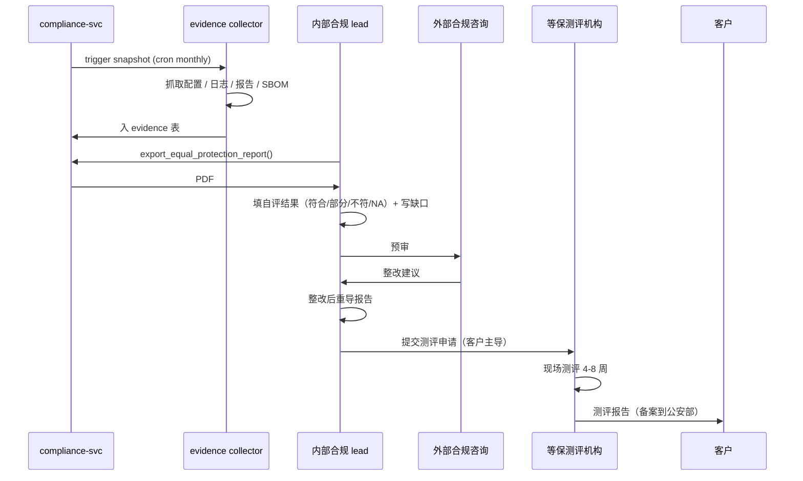

# 等保 2.0 三级自评清单与控制项映射 — Design v1

> 状态：Draft v1 · Owner：合规团队 + 安全团队 · 评审：架构组 + 外部合规咨询机构 · 配套：[CONVENTIONS](../CONVENTIONS.md) · [compliance-v1](./compliance-v1.md)
>
> 关联模块：全部 18 个 package（控制项落点） + security-ops-ci-v1（持续证据） + ha-fault-injection-v1（应急恢复证据） + penetration-test-scope-v1（脆弱性证据）

## 1. Context

GB/T 22239-2019《信息安全技术 网络安全等级保护基本要求》三级（"等保三级"）是国内政企客户准入门槛。约 **211 项技术控制 + 70 项管理控制 = 281 项**。

**问题**：

- 281 项分散在 10 大类，自评不易一次完成。
- 同一控制项常涉及多模块（如"身份鉴别"涉及 identity / authz / pam / audit）→ 容易漏。
- 自评不是"过 / 不过"二元判断，分 "符合 / 部分符合 / 不符合 / 不适用"四级；要给证据链。
- 监管最终走「**第三方测评机构**」（公安部认证），底座只能完成"**自评**"+ 准备"**测评配合材料**"。

**目标**：

1. 把 281 项映射到 18 个 package，每项写明：**owner package、实现说明、证据来源、自评结果、缺口与补救**。
2. 各 milestone 分摊：M1 鉴别/访问控制类（约 60 项），M2 审计/资源控制类（约 50 项），M3 入侵防范/恶意代码（约 40 项），M4 数据保护/密码（约 40 项），M5 备份恢复/应急（约 30 项），M5 末 管理类全集（70 项）。
3. 产出 `compliance-v1.export_equal_protection_report()` 一键导出 PDF。

**非目标**：
- 不替代第三方测评（本文是自评 + 配合材料；正式测评要等保测评机构上门）
- 不覆盖等保四级（金融/政务驱动 v1.1 强化，参考但不在 v1.0 出口）
- 不覆盖物理环境（机房在客户场地，物理项由客户负责）

## 2. 核心原则

1. **每项控制必须有 owner package**（"无主"项视为缺口）。
2. **每项必须有自动化证据**：log / metric / config 哈希 / report 文件 → 监管复核不靠"我们做了"口述。
3. **覆盖率 ≥ 95%** 才算 A-M5 出口达标；缺口必须有补救计划 + 时间表。
4. **自评 → 预审 → 正式测评 三步走**：底座只完成前两步；正式由客户/平台方组织。

## 3. 三级技术要求（211 项）总览

按 GB/T 22239-2019 第 8 章"第三级安全要求"分 5 大类：

| 类别 | 子类 | 项数 | 主 owner package |
|---|---|---|---|
| **8.1.1 安全物理环境** | 物理位置 / 防盗防破坏 / 防雷 / 防火 / 防水防潮 / 温湿度 / 电力 / 电磁 | 14 | （客户机房，底座出文档） |
| **8.1.2 安全通信网络** | 网络架构 / 通信传输 / 可信验证 | 8 | crypto + 部署文档 |
| **8.1.3 安全区域边界** | 边界防护 / 访问控制 / 入侵防范 / 恶意代码 / 安全审计 / 可信验证 | 23 | api-platform + security-ops + audit |
| **8.1.4 安全计算环境** | 身份鉴别 / 访问控制 / 安全审计 / 入侵防范 / 恶意代码 / 可信验证 / 数据完整性 / 数据保密性 / 数据备份恢复 / 剩余信息保护 / 个人信息保护 | 75 | identity + authz + audit + crypto + data-protection + lifecycle |
| **8.1.5 安全管理中心** | 系统管理 / 审计管理 / 安全管理 / 集中管控 | 11 | admin console + audit + pam |
| **小计** | | **131** | |
| **8.1.6-10 第三方 / 云服务 / 移动 / 物联 / 工控 扩展** | （按需） | 80 | 视客户场景启用 |

**底座 v1.0 重点：8.1.2 + 8.1.3 + 8.1.4 + 8.1.5 = 117 项必盖**；8.1.1（物理）出文档；8.1.6+ 客户驱动。

## 4. 控制项 → 模块映射表（核心 117 项节选）

> 完整 281 项表见 `docs/compliance/equal-protection-3-checklist.xlsx`（本文档节选展示模式）

### 4.1 安全通信网络（8.1.2，8 项）

| ID | 控制项 | owner package | 实现说明 | 证据 |
|---|---|---|---|---|
| 8.1.2.1.a | 网络架构应保证业务处理能力满足业务高峰需要 | （部署 + ha-fault-injection） | medium/large profile 三档 + HPA / KEDA | helm values + 压测报告 |
| 8.1.2.1.b | 划分不同网络区域、按区域 IP 地址 | 部署文档 + K8s NetworkPolicy | namespace 分区 + NetworkPolicy 模板 | networkpolicy.yaml + diagram |
| 8.1.2.1.c | 重要网络区域不部署在边界处 | 部署文档 | DB / Vault / Keycloak 在 internal subnet | architecture.md |
| 8.1.2.1.d | 提供通信线路、关键设备硬件冗余 | 部署文档 | medium+ profile HA 节点冗余 | helm + chaos report |
| 8.1.2.2.a | 通信过程完整性 | crypto | mTLS（TLS 1.3 AEAD），国密 GMTLS | tls-config 哈希 |
| 8.1.2.2.b | 通信过程保密性 | crypto | 同上 | 同上 |
| 8.1.2.3.a | 可信验证：根可信 → 链 | crypto + 部署 | image signing (cosign) + admission controller | sigstore log |
| 8.1.2.3.b | 验证结果形成审计 | audit + security-ops | image policy violation → audit | audit event sample |

### 4.2 安全区域边界（8.1.3，23 项）

| ID | 控制项 | owner | 实现说明 | 证据 |
|---|---|---|---|---|
| 8.1.3.1.a | 跨越边界访问受控 | api-platform + identity | Ingress + 认证强制 + IP 白名单 | ingress config |
| 8.1.3.1.b | 跨越边界数据流通过受控接口 | api-platform | 所有外发走 LLM Gateway / Webhook / Notification 注册接口 | sdk usage scan |
| 8.1.3.1.c | 限制无线网络 | 部署文档 | 客户机房 / 不引入无线 | — |
| 8.1.3.2.a | 根据规则允许 / 拒绝数据包 | 部署 + NetworkPolicy | 默认 deny + 显式 allow | NP yaml |
| 8.1.3.2.b | 删除多余 / 无效访问控制规则 | 部署运维 | 季度 review | review log |
| 8.1.3.2.c | 端口最小化 | 部署文档 | service exposed ports 列表 | port matrix |
| 8.1.3.2.d | 重要主机端口绑定到端口 | — | NodePort 限白名单 | — |
| 8.1.3.2.e | 按用户 / 用户组提供允许 / 拒绝 | authz | OPA + 网络层 NetworkPolicy 双控 | opa policies |
| 8.1.3.2.f | 会话状态化检测 | api-platform | Envoy stateful tracking | envoy config |
| 8.1.3.2.g | 应用协议命令级控制 | api-platform + WAF | ModSecurity + OpenAPI schema validation | WAF rules |
| 8.1.3.3.a | 检测、阻止从外部发起的攻击 | security-ops | WAF + IDS（Suricata 可选） | WAF log |
| 8.1.3.3.b | 检测、阻止从内部发起的攻击 | security-ops | egress NetworkPolicy + Falco runtime | Falco rules |
| 8.1.3.3.c | 检测 APT / 高级攻击 | security-ops | runtime threat detection + SIEM 接客户 | falco + audit |
| 8.1.3.3.d | 攻击源、攻击类型、攻击目标、攻击时间 → 报警 | notification + audit | Falco → notification | sample alerts |
| 8.1.3.3.e | 严重事件 → 实时报警 | notification | 钉钉/飞书/PagerDuty 通道 | channel config |
| 8.1.3.4.a | 系统恶意代码 / 检测、清除、升级 | security-ops | 镜像 Trivy 扫描 + Falco runtime | Trivy report |
| 8.1.3.4.b | 网络层异常流量 | security-ops | NetworkPolicy + Falco | — |
| 8.1.3.5.a | 安全审计：边界设备、网络设备、终端 | audit | Ingress / Envoy access log → audit | sample event |
| 8.1.3.5.b | 审计记录覆盖每个用户 | audit | event 含 user_id | sample |
| 8.1.3.5.c | 审计记录保护、备份 | audit | hash chain + WORM + 离线归档 | hash chain |
| 8.1.3.5.d | 远程访问 / 互联网访问审计 | audit | API Gateway log + audit | sample |
| 8.1.3.6.a | 可信验证：边界设备程序完整 | 部署 | image signing | sigstore |
| 8.1.3.6.b | 验证结果形成审计 | audit | 同上 | sample |

### 4.3 安全计算环境（8.1.4，75 项，节选）

| ID | 控制项 | owner | 实现 | 证据 |
|---|---|---|---|---|
| 8.1.4.1.a | 身份鉴别：用户唯一标识 | identity | Keycloak user_id + ULID | schema |
| 8.1.4.1.b | 鉴别信息复杂度 + 定期更换 | identity | password policy（NIST 800-63-4 + 等保基线） | policy doc + e2e test |
| 8.1.4.1.c | 多次失败锁定 | identity | brute force protection + 30min lock | keycloak config |
| 8.1.4.1.d | 远程管理过程鉴别信息防窃听 | identity + crypto | TLS 1.3 + MFA 强制 | tls + mfa policy |
| 8.1.4.1.e | 两种或两种以上组合机制鉴别（关键操作） | identity | MFA 在敏感操作强制（password + TOTP/U2F） | mfa policy |
| 8.1.4.2.a | 访问控制：策略已配置 + 默认拒绝 | authz | RBAC default deny + OPA default false | opa source |
| 8.1.4.2.b | 重命名 / 删除默认账户 | identity 部署 | 默认 admin 强制改名 + 默认密码强制改 | install checklist |
| 8.1.4.2.c | 删除 / 停用多余 / 过期账户 | identity | 离职自动 disable + 90 天 idle 软删 | identity v1 §9 |
| 8.1.4.2.d | 授权账户最小权限 + 分离权责 | authz | RBAC 最小权限 + 4 眼审批 | role matrix |
| 8.1.4.2.e | 由授权主体配置 | authz | 角色变更需管理员 | audit |
| 8.1.4.2.f | 主体客体安全标记 | classification | L1-L5 标签 | dlp-classification v1 |
| 8.1.4.2.g | 强制访问控制 + 标记 → 决策 | dlp | clearance check | dlp v1 §4 |
| 8.1.4.3.a | 安全审计：覆盖每用户 + 重要事件 | audit | 强制审计事件集 | audit v1 §5 |
| 8.1.4.3.b | 包含日期/时间/用户/事件类型/成功失败/其他 | audit | event schema | schema sample |
| 8.1.4.3.c | 审计记录保护 / 不被未授权改 | audit | hash chain + WORM + TSA | audit v1 §6 |
| 8.1.4.3.d | 审计进程保护 | audit | OTel Collector + 多副本 + 隔离 namespace | helm |
| 8.1.4.4.a | 入侵防范：操作系统遵循最小安装 | 部署 | distroless / minimal base image | Dockerfile |
| 8.1.4.4.b | 关闭多余服务、共享、端口 | 部署 | Pod securityContext + readOnlyRootFilesystem | helm template |
| 8.1.4.4.c | 终端接入管控 | pam + identity | 设备指纹 + 条件访问 | identity v1 §MFA |
| 8.1.4.4.d | 数据有效性校验 | api-platform | OpenAPI schema validation + pydantic | sdk |
| 8.1.4.4.e | 漏洞发现 + 经评估修复 | security-ops | SCA + SAST + SLA tracking | sec-ops dashboard |
| 8.1.4.4.f | 入侵检测 + 重要事件报警 | security-ops + notification | Falco + 通知 | falco rules |
| 8.1.4.5.a | 恶意代码：技术措施 + 实时检测 | security-ops | 镜像扫描 + runtime Falco | reports |
| 8.1.4.5.b | 主动免疫可信验证 | crypto + 部署 | image signing + admission | cosign |
| 8.1.4.6 | 可信验证 | 同 8.1.2.3 | — | — |
| 8.1.4.7.a | 数据完整性：传输 | crypto | TLS / mTLS | tls config |
| 8.1.4.7.b | 数据完整性：存储 | crypto + audit | DB checksum + audit hash chain | audit v1 |
| 8.1.4.8.a | 数据保密性：传输 | crypto | TLS 1.3 / 国密 GMTLS | tls config |
| 8.1.4.8.b | 数据保密性：存储 | crypto + data-protection | 字段加密 + Postgres TDE | crypto v1 |
| 8.1.4.9.a | 数据备份恢复：本地数据备份 | lifecycle | pgBackRest + Velero | backup schedule |
| 8.1.4.9.b | 提供异地备份 | lifecycle | 跨 region 复制（large profile） | replication config |
| 8.1.4.9.c | 提供主备 / 热备 | 部署 (HA) | Patroni / Sentinel | ha config |
| 8.1.4.10.a | 剩余信息保护：用户鉴别信息 | identity + crypto | secure memory wipe | code review |
| 8.1.4.10.b | 敏感数据存储空间释放前清除 | data-protection + lifecycle | crypto-key destroy / DoD 覆写 | data-protection v1 |
| 8.1.4.11.a | 个人信息保护：收集最小化 | data-protection | `@pii_processing` 注解 + ROPA | compliance v1 §ROPA |
| 8.1.4.11.b | 个人信息授权访问 | authz + data-protection | 字段级 ACL + 脱敏 | data-protection v1 |

> 完整 75 项表请见 xlsx；以上节选覆盖最常被测的高频项。

### 4.4 安全管理中心（8.1.5，11 项）

| ID | 控制项 | owner | 实现 |
|---|---|---|---|
| 8.1.5.1.a | 系统管理：单独账户 + 操作审计 | pam + audit | JIT 提权 + Teleport recording |
| 8.1.5.1.b | 系统资源 / 用户操作管理 | admin console + pam | 控制台 |
| 8.1.5.2.a | 审计管理：审计员账户 + 审计配置 | audit | 审计员 RBAC + audit-of-audit |
| 8.1.5.2.b | 审计记录分析 + 处理 | audit | 查询 + 导出 + 异常告警 |
| 8.1.5.3.a | 安全管理：安全员账户 + 安全策略 | identity + authz + pam | 三员分立（系统员/安全员/审计员） |
| 8.1.5.3.b | 各项安全控制策略 | compliance | 合规模式驱动 |
| 8.1.5.3.c | 安全标记的授权 | classification + dlp | L1-L5 标签管理 |
| 8.1.5.4.a | 集中管控：管理路径与业务路径分离 | 部署 + identity | admin domain 独立 + MFA |
| 8.1.5.4.b | 集中管控网络设备 | 部署 + pam | bastion 统一入口 |
| 8.1.5.4.c | 集中收集、分析安全相关审计数据 | audit | OTel → ClickHouse 汇聚 |
| 8.1.5.4.d | 集中识别 / 报警 / 分析安全事件 | security-ops + notification | Falco → alert |

## 5. 三级管理要求（70 项）总览

按 GB/T 22239 第 9 章分 5 类。**这部分是制度文档为主，由客户/平台方安全管理人员维护，底座出模板**。

| 类别 | 项数 | 落点 |
|---|---|---|
| 9.1 安全管理制度 | 11 | 客户出制度，底座提供模板 |
| 9.2 安全管理机构 | 9 | 客户人员架构 |
| 9.3 安全管理人员 | 10 | 客户人员培训 |
| 9.4 安全建设管理 | 25 | 实施流程 + SSDLC（security-ops v1） |
| 9.5 安全运维管理 | 15 | 运维 SOP + 应急响应（ha + sec-ops） |

**底座提供**：`docs/compliance/templates/` 下放 5 大类 70 项的 Word 模板，客户填空使用。

## 6. milestone 分摊

| Milestone | 覆盖控制项 | 数量 | 出口 |
|---|---|---|---|
| **A-M1** | 8.1.4.1（鉴别）+ 8.1.4.2 a-e（访问控制基线）+ 8.1.2.2（通信保密） | ~25 | identity + crypto + authz 上线 |
| **A-M2** | 8.1.4.3（审计）+ 8.1.4.9（备份）+ 8.1.4.10（剩余信息）+ 8.1.3.5（边界审计） | ~30 | audit + lifecycle + data-protection 上线 |
| **A-M3** | 8.1.4.4（入侵防范）+ 8.1.4.5（恶意代码）+ 8.1.3.3-4（边界入侵 / 恶意） + 8.1.5（管理中心）+ 8.1.4.2 f-g（强制访问控制 + 标记） | ~35 | pam + classification + dlp + security-ops 基础 |
| **A-M4** | 8.1.4.7-8（数据完整 / 保密）+ 8.1.4.11（个人信息）+ 8.1.3.1-2（边界访问控制） | ~30 | compliance + billing + api-platform + cross-border |
| **A-M5** | 8.1.4.6 / 8.1.2.3 / 8.1.3.6（可信验证）+ 8.1.2.1（网络架构）+ 9.4-5（建设 / 运维管理） + 应急 / 渗透 / 备份恢复证据 | ~30 + 70 mgmt | ha + pentest + 自评通过 |

## 7. 证据采集自动化

**铁律**：281 项每项必须有自动化或可重现的证据，不许"我们做了"口述。

| 证据类型 | 自动化工具 | 归档位置 |
|---|---|---|
| 配置哈希（policy / yaml / cron） | CI 流水线 `make compliance-snapshot` → 计算 SHA256 + 入 ClickHouse | `audit.evidence_config` 表 |
| 审计事件样本 | 定期从 ClickHouse 导出最近 30 天去敏样本 | S3 `evidence/audit-samples/` |
| 扫描报告（SAST/SCA/DAST/Trivy） | CI 上传 SARIF | `security_ops.scan_result` 表 |
| 演练报告（chaos / DR） | `ha-fault-injection-v1` 自动产 PDF | S3 `evidence/chaos-reports/` |
| 渗透报告（年度） | vendor 提交 PDF | S3 `evidence/pentest/` |
| 培训记录 / 审批记录 / 制度文档 | 人工上传到合规库 | S3 `evidence/management/` |
| SBOM | Syft 每次发版 | OCI registry attestation |

`compliance-service.export_equal_protection_report()` 把上述证据汇编成自评报告 PDF（一控制项一节，附证据链接 + 哈希 + 时间戳）。

## 8. 自评 → 测评工作流



## 9. 数据模型

```sql
-- packages/compliance/migrations/0xxx_equal_protection.sql

CREATE TABLE compliance.ep_control (
  id                 TEXT PRIMARY KEY,             -- '8.1.4.1.a'
  level              SMALLINT NOT NULL,            -- 3 / 4
  category           TEXT NOT NULL,                -- '8.1.4'
  title              TEXT NOT NULL,
  requirement        TEXT NOT NULL,
  owner_package      TEXT,                         -- 'identity' / NULL if cross-cutting
  evidence_query     TEXT,                         -- SQL or doc path generating evidence
  notes              TEXT,
  created_at         TIMESTAMPTZ NOT NULL DEFAULT now()
);

CREATE TABLE compliance.ep_self_assessment (
  id                 TEXT PRIMARY KEY,             -- assess_<ULID>
  control_id         TEXT NOT NULL REFERENCES compliance.ep_control(id),
  tenant_id          TEXT NOT NULL DEFAULT 'foundation',  -- 'foundation' = 平台自评
  result             TEXT NOT NULL,                -- 'CONFORMING'/'PARTIAL'/'NON_CONFORMING'/'NOT_APPLICABLE'
  evidence_refs      JSONB NOT NULL,               -- [{type, location, hash, captured_at}, ...]
  gap_description    TEXT,
  remediation_plan   TEXT,
  remediation_due    TIMESTAMPTZ,
  assessed_by        TEXT NOT NULL,
  assessed_at        TIMESTAMPTZ NOT NULL,
  next_review_at     TIMESTAMPTZ,
  created_at         TIMESTAMPTZ NOT NULL DEFAULT now()
);

CREATE INDEX idx_assess_result ON compliance.ep_self_assessment(result, tenant_id);
CREATE INDEX idx_assess_due ON compliance.ep_self_assessment(remediation_due) WHERE result IN ('PARTIAL','NON_CONFORMING');

ALTER TABLE compliance.ep_control ENABLE ROW LEVEL SECURITY;
ALTER TABLE compliance.ep_self_assessment ENABLE ROW LEVEL SECURITY;
ALTER TABLE compliance.ep_control FORCE ROW LEVEL SECURITY;
ALTER TABLE compliance.ep_self_assessment FORCE ROW LEVEL SECURITY;
```

> 结果值按 [CONVENTIONS §2.8](../CONVENTIONS.md) `UPPER_SNAKE_CASE`。

## 10. SDK 接口

```python
from foundation_compliance import equal_protection as ep

# 内部合规 lead
ep.list_controls(level=3, package="identity") -> List[Control]
ep.record_assessment(
    control_id="8.1.4.1.b",
    result="CONFORMING",
    evidence_refs=[{
        "type": "policy_config",
        "location": "identity/password_policy.yaml",
        "hash": "sha256:abcd...",
        "captured_at": "2026-05-20T00:00:00Z"
    }, {
        "type": "e2e_test",
        "location": "tests/e2e/test_password_policy.py::test_complexity",
        "result": "PASSED"
    }],
    assessed_by="compliance_lead",
)
ep.list_gaps() -> List[Assessment]
ep.export_report(level=3, format="pdf") -> bytes      # 给监管 / 第三方测评
ep.dashboard() -> {conformance_rate, gaps_overdue, evidence_freshness}
```

## 11. 事件契约

| 事件 | 触发 |
|---|---|
| `foundation.compliance.ep_assessment.recorded` | 录入自评结果 |
| `foundation.compliance.ep_assessment.gap_overdue` | 缺口超期 |
| `foundation.compliance.ep_evidence.captured` | 自动证据快照 |
| `foundation.compliance.ep_report.exported` | 报告导出（外审签字前必有） |

> 命名遵循 [CONVENTIONS §3.1](../CONVENTIONS.md) 四段式。

## 12. 错误码

| Code | HTTP |
|---|---|
| `FOUNDATION.COMPLIANCE.EP.CONTROL_NOT_FOUND` | 404 |
| `FOUNDATION.COMPLIANCE.EP.EVIDENCE_MISSING` | 412 |
| `FOUNDATION.COMPLIANCE.EP.STALE_EVIDENCE` | 409 |
| `FOUNDATION.COMPLIANCE.EP.LEVEL_INVALID` | 400 |

> 格式遵循 [errors.md](../errors.md) 四段式。

## 13. v1.0 出口验收（A-M5 通过线）

- [ ] 281 项 ep_control 表填齐 + 控制项 → owner package 映射 100%
- [ ] 技术控制（131 项）自评 CONFORMING ≥ 95%；非 CONFORMING 必须有 remediation_plan
- [ ] 管理控制（70 项）模板 100% 出具，"客户填空" 标注清楚
- [ ] 证据采集 cron 跑通 + 30 天证据完整 + 哈希校验通过
- [ ] 至少 1 家外部合规咨询机构预审通过
- [ ] export_report(level=3) 一键导出 PDF（500+ 页）+ 签字 + 时间戳
- [ ] 在 2-3 家 POC 客户处过等保测评机构现场预审

## 14. 待解决问题

1. **第三方测评机构选定**：与公安部认证测评机构（如安恒、绿盟、启明星辰）建立对接 → A-M5 前敲定
2. **PDF 模板美化**：500+ 页中文 PDF 用 wkhtmltopdf 排版有限 → v1.1 给 LaTeX 模板（含目录、控制项编号导航）
3. **国密版数据库证据**：v1.1 国密 + 信创补丁 → KingbaseES / openGauss 证据 schema 调整
4. **持续监管（备案后季度自查）**：备案后每季度复评 → cron + dashboard 已覆盖；流程文档补全

## 15. 参考

- [GB/T 22239-2019 信息安全技术 网络安全等级保护基本要求](https://openstd.samr.gov.cn/bzgk/gb/newGbInfo?hcno=BAFB07F38C50DAB99841A04EE4DCBFC9)
- [GB/T 28448-2019 网络安全等级保护测评要求](https://openstd.samr.gov.cn/bzgk/gb/newGbInfo?hcno=A6AF52FF77731215E81DB39C8AB970F1)
- [公安部网络安全等级保护备案及测评工作要求](https://www.beian.gov.cn/portal/index)
- 配套：[compliance-v1](./compliance-v1.md) §6 报表 / §7 数据模型
