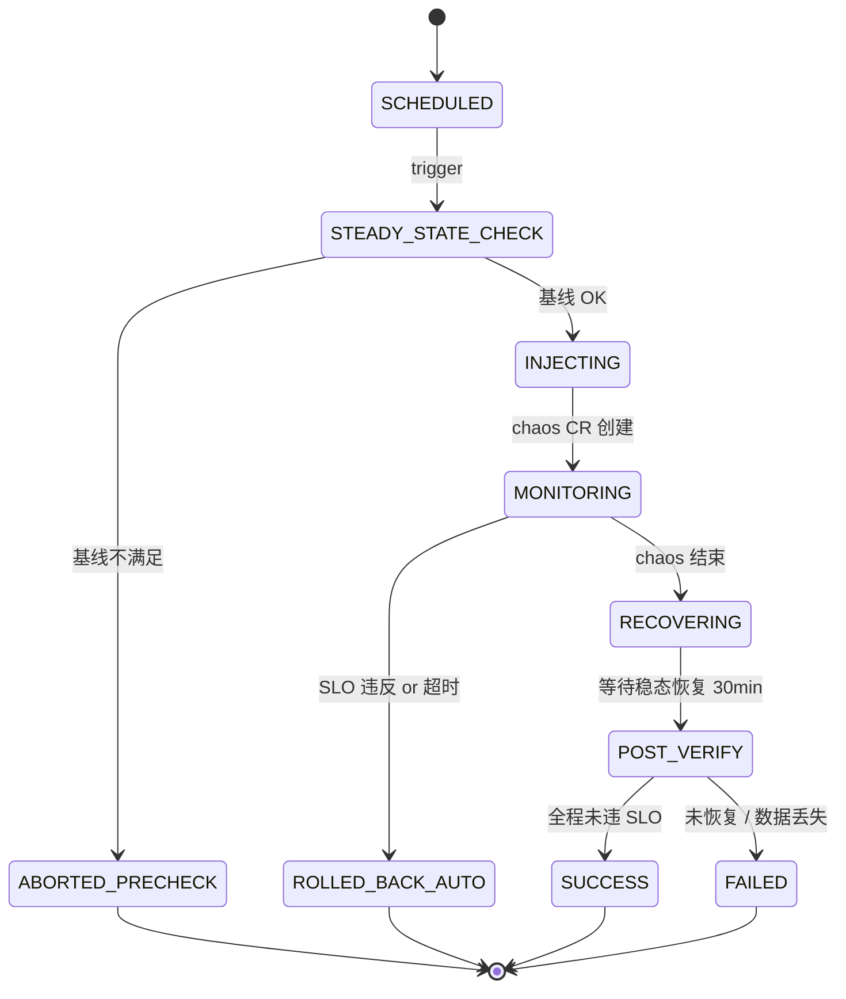

# HA 故障注入 — Design v1

> 状态：Draft v1 · Owner：SRE 架构组 · 评审：架构组 + 业务架构 · 配套：[CONVENTIONS](../CONVENTIONS.md) · [multi-tenancy](../multi-tenancy.md)
>
> 关联模块：所有底座 service（被注入对象） + audit-v1（演练事件入审计） + notification-v1（演练告警通道）

## 1. Context

底座承诺三档 profile 的 HA / SLA：

| Profile | 可用性 | RTO | RPO |
|---|---|---|---|
| small | 99.0% | 4h | 24h |
| medium | 99.5% | 30min | 1h |
| large | 99.9% | 5min | 5min |

**问题**：单写"我们是 HA 的"不算数。监管（等保三级 8.1.10.3、JR/T 0071 7.4）、采购、客户审计都要看「**已经把它打挂过、它恢复了、有报告**」。

**目标**：把"故障注入演练"固化为底座 CI/CD 流水线的一等公民，覆盖 4 大类故障（Pod / Node / Network / Stateful），medium+ profile 每月自动跑一次，结果入 WORM 审计，能在客户审计时一键导出 PDF。

**非目标**：
- 不做生产环境强制注入（GameDay 由客户运维决定是否启用，底座只提供工具）
- 不替代渗透测试（pentest 走 `penetration-test-scope-v1.md`，关注攻击面；本文件关注可用性）
- 不做混沌平台 SaaS（底座只内嵌 Chaos Mesh + Litmus，不自研控制面）

## 2. 核心原则（铁律）

1. **演练即测试**：故障注入用 K8s CR 描述，纳入 git，PR 模型审计；不许人工 kubectl exec rm。
2. **稳态先定义后注入**：每场景必须先声明 SLO（错误率、P95 延迟、RPO/RTO），稳态不满足 → 不准开始注入。
3. **爆炸半径可控**：注入前明确 namespace / pod label selector / 持续时长 / 最大并发；超出范围立即 abort。
4. **可观测全程录像**：注入前 5min、注入中、注入后 30min 的 Prometheus / OTel trace / 业务日志全部归档到 audit + S3。
5. **自动回滚**：超过 SLO 阈值或超时（默认 30min）→ chaos controller 主动 abort，恢复原状态。
6. **演练事件入审计**：发起人、范围、开始/结束时间、SLO 命中/未命中、报告链接 → `foundation.security_ops.chaos.executed` 事件。

## 3. 工具链选型

| 层 | 选型 | 备选 | 原因 |
|---|---|---|---|
| **K8s 内 Pod / Network / IO 故障** | [Chaos Mesh](https://chaos-mesh.org/)（CNCF 沙箱，Apache 2.0） | Litmus / Chaos Toolkit | CR 模型最丰富，社区活跃，K8s 原生 |
| **节点级故障 / 跨集群故障** | Litmus 2.x | AWS FIS / GCP Fault Injection | Litmus 节点故障 experiment 比 Chaos Mesh 强 |
| **应用层故障（JVM / Python 异常注入）** | Chaos Mesh JVMChaos + Python `chaostoolkit` | — | 业务自定义异常场景 |
| **稳态评估** | Prometheus + Litmus probe + 自研 probe-runner | — | SLO 用 PromQL 描述，可复用监控 |
| **结果归档** | audit-v1 写 ClickHouse + 报告 PDF 入 S3 WORM | — | 与底座审计链路一致 |

**不选 Gremlin/Harness**：商业付费，不符合"开源优先"。

## 4. 注入场景矩阵

> 4 大类 × 3 个 profile = 12 + 个标准场景。每个场景一个 CR 模板 + 一个稳态定义。

### 4.1 Pod 级（最常见）

| 场景 ID | 描述 | 工具 | 持续 | SLO 期望 |
|---|---|---|---|---|
| `POD_KILL_RANDOM_STATELESS` | 随机杀一个无状态服务 pod（identity/authz/bff …） | Chaos Mesh PodChaos `pod-kill` | 单次 | <5s 流量切走、错误率 <0.1% |
| `POD_KILL_PRIMARY_DB` | 杀 Postgres primary | PodChaos `pod-kill` + label `role=primary` | 单次 | Patroni 自动选主 <30s（medium）/ <10s（large） |
| `POD_KILL_ALL_REPLICAS_OF_SVC` | 同时杀某 service 全部副本 | PodChaos `pod-kill` selector | 30s | 重启后服务在 60s 内恢复，期间 503 给客户端 |
| `CPU_STRESS_50` | 50% CPU 压力注入 | StressChaos | 5min | HPA 触发扩容，无 OOM |
| `MEMORY_LEAK_SIMULATION` | 模拟内存泄漏 → OOM | StressChaos memory | 直到 OOM | K8s OOMKill + restart；audit 记录 |

### 4.2 Node 级（中危）

| 场景 ID | 描述 | 工具 | SLO 期望 |
|---|---|---|---|
| `NODE_DRAIN_WORKER` | drain 一个 worker 节点 | Litmus `node-drain` | Pod reschedule <2min；PDB 保证最小副本 |
| `NODE_NETWORK_LOSS` | 节点网络丢包 50% | Chaos Mesh NetworkChaos `loss` | 业务降级；HPA/HA 调度切走 |
| `NODE_POWER_OFF`（仅 large） | 模拟节点宕机 | Litmus `node-poweroff`（IPMI/云 API） | 跨 AZ 流量切；服务恢复 <5min |
| `AZ_FAIL_SIMULATION`（仅 large） | 整 AZ 隔离（network partition） | NetworkChaos partition + node taint | 跨 AZ failover；可用性不降 |

### 4.3 Network 级

| 场景 ID | 描述 | 工具 | SLO 期望 |
|---|---|---|---|
| `NET_LATENCY_100MS` | 注入 100ms 延迟到 Postgres | NetworkChaos `delay` | P95 延迟告警；业务可用 |
| `NET_PARTITION_DB_FROM_APP` | 业务 → DB 网络分区 | NetworkChaos `partition` | 业务进入降级（read-only 缓存）；恢复后自动复原 |
| `NET_DNS_FAILURE` | CoreDNS 50% 解析失败 | NetworkChaos DNS | 服务发现重试；不雪崩 |
| `NET_EGRESS_BLOCK_LLM` | 阻断到 LLM provider 的出网 | NetworkChaos | LLM Gateway 熔断 + fallback；audit 告警 |

### 4.4 Stateful（数据层，最高危）

| 场景 ID | 描述 | 工具 | SLO 期望 |
|---|---|---|---|
| `PG_PRIMARY_KILL` | 杀 PG primary | PodChaos + Patroni | Failover <30s（medium）/ <10s（large）；零数据丢失 |
| `PG_REPLICA_LAG_INJECT` | 模拟复制延迟 30s | NetworkChaos delay on replica | 读写分离自动切到主或告警；不返脏数据 |
| `CH_REPLICA_DOWN` | ClickHouse 副本下线 | PodChaos | ZooKeeper 协调；查询切其他副本 |
| `REDIS_SENTINEL_FAILOVER` | 杀 Redis master | PodChaos | Sentinel 选主 <10s；session 不丢（重连） |
| `OPENSEARCH_NODE_DOWN` | OS 数据节点下线 | PodChaos | 分片重新分配；查询继续可用 |
| `MINIO_NODE_DOWN` | MinIO 节点下线 | PodChaos + 节点 cordon | EC 容错；上传/下载继续 |
| `BACKUP_RESTORE_DRILL` | 恢复一份 7 天前的快照到隔离环境 | Velero + pgBackRest | RPO ≤ 1h（medium）/ 5min（large）；数据完整性校验通过 |

## 5. 稳态 SLO 定义

每个场景配套一个稳态定义（YAML），CI 跑时先校验「无故障基线 5min 满足 SLO」，再注入。

```yaml
# slo/identity-stateless.yaml
apiVersion: foundation.io/v1
kind: SteadyState
metadata:
  name: identity-stateless-slo
spec:
  service: identity-service
  checks:
    - name: error_rate
      promql: |
        sum(rate(http_requests_total{service="identity",status=~"5.."}[1m]))
        / sum(rate(http_requests_total{service="identity"}[1m]))
      threshold: "< 0.001"   # 错误率 < 0.1%
      window: 1m
    - name: p95_latency
      promql: |
        histogram_quantile(0.95,
          sum(rate(http_request_duration_seconds_bucket{service="identity"}[1m])) by (le))
      threshold: "< 0.5"      # P95 < 500ms
      window: 1m
    - name: pod_ready
      promql: |
        sum(kube_pod_status_ready{namespace="foundation",pod=~"identity-.*",condition="true"})
      threshold: ">= 2"        # medium profile 至少 2 副本
      window: 30s
  evaluationDuration: 5m
```

## 6. CR 模板示例

```yaml
# chaos/scenarios/POD_KILL_PRIMARY_DB.yaml
apiVersion: chaos-mesh.org/v1alpha1
kind: PodChaos
metadata:
  name: pg-primary-kill
  namespace: foundation-chaos
spec:
  action: pod-kill
  mode: one
  selector:
    namespaces: [foundation]
    labelSelectors:
      app: postgresql
      role: primary
  duration: "0s"   # 一次性
---
apiVersion: foundation.io/v1
kind: ChaosRun
metadata:
  name: monthly-pg-failover-drill
spec:
  scenario: POD_KILL_PRIMARY_DB
  steadyState: postgres-rw-slo
  blastRadius:
    namespaces: [foundation]
    maxPodsAffected: 1
  rollback:
    onSloViolation: true
    maxDuration: 30m
  reporting:
    auditEvent: foundation.security_ops.chaos.executed
    pdfReport: true
    notify: [sre-oncall, security-ops]
```

## 7. 流程与状态机



> 状态名称按 [CONVENTIONS §2.8](../CONVENTIONS.md) 使用 `UPPER_SNAKE_CASE`。

## 8. CI/CD 集成

### 8.1 PR 阶段（每次合并）
- **chaos lint**：YAML schema 校验、scenario 引用存在、blastRadius 不超阈值
- **不执行**：PR 阶段只 lint，不真实注入

### 8.2 每日 staging（自动）
- **场景子集**：所有 Pod 级 + 部分 Network 级（非数据层）
- **环境**：staging 集群（与生产配置一致，但流量从 traffic mirror）
- **失败 → 阻断**：当夜 release train 不发车

### 8.3 月度 medium+ profile（自动）
- **全场景**：含 Stateful 类（PG failover / 备份恢复）
- **环境**：dedicated chaos cluster（与生产 1:1，定期 refresh 数据快照）
- **报告**：自动生成 PDF + 入 audit + Slack/钉钉通知 SRE oncall + 安全团队

### 8.4 季度 GameDay（人工 + 自动）
- **目标**：复合故障（AZ 失败 + 数据库延迟 + 业务高峰）
- **人员**：SRE oncall + 业务 owner + 安全 oncall + 法务（应急响应预案触发）
- **流程**：参考 [security-ops-v1](./security-ops-v1.md) §应急响应预案（v1.1 输出）

## 9. SDK 接口（给业务层 / 客户 SRE 用）

```python
from foundation_security_ops import chaos

# 列举可用场景
chaos.list_scenarios(category="POD") -> List[Scenario]

# 触发一次演练（异步）
run = chaos.trigger(
    scenario="POD_KILL_PRIMARY_DB",
    steady_state="postgres-rw-slo",
    blast_radius={"namespaces": ["my-business"], "max_pods": 1},
    rollback_on_violation=True,
    notify=["sre-team"]
)

# 查询进度
chaos.get_run(run.id) -> ChaosRun

# 终止
chaos.abort(run.id, reason="发现异常告警")

# 历史报告
chaos.list_runs(tenant_id=..., since="2026-01-01") -> List[ChaosRun]
chaos.export_report(run.id, format="pdf") -> bytes
```

**租户隔离约束**：
- 业务租户只能在自己 namespace 内注入；不能选 `foundation-*` namespace
- L4/L5 资源所属 namespace 注入必须走 4 眼审批（接入 pam-v1）
- 生产环境注入默认禁用，需 tenant admin 在控制台显式开关 `chaos.production.allow`

## 10. 数据模型

```sql
-- packages/security_ops/migrations/0xxx_chaos.sql

CREATE TABLE security_ops.chaos_scenario (
  id               TEXT PRIMARY KEY,         -- 'POD_KILL_PRIMARY_DB'
  category         TEXT NOT NULL,            -- 'POD'/'NODE'/'NETWORK'/'STATEFUL'
  description      TEXT NOT NULL,
  cr_template_path TEXT NOT NULL,            -- git path of YAML template
  default_slo      TEXT NOT NULL,            -- SteadyState name
  risk_level       TEXT NOT NULL,            -- 'LOW'/'MEDIUM'/'HIGH'
  applicable_profiles TEXT[] NOT NULL,       -- ['medium','large']
  created_at       TIMESTAMPTZ NOT NULL DEFAULT now()
);

CREATE TABLE security_ops.chaos_run (
  id                  TEXT PRIMARY KEY,                 -- chaosrun_<ULID>
  tenant_id           TEXT NOT NULL,                    -- 触发租户（'foundation' = 平台方）
  scenario_id         TEXT NOT NULL REFERENCES security_ops.chaos_scenario(id),
  status              TEXT NOT NULL,                    -- UPPER_SNAKE_CASE per §7
  triggered_by        TEXT NOT NULL,                    -- user_id / 'system:cron'
  triggered_at        TIMESTAMPTZ NOT NULL,
  steady_state_passed BOOLEAN,
  injected_at         TIMESTAMPTZ,
  rolled_back_at      TIMESTAMPTZ,
  rollback_reason     TEXT,                             -- 'SLO_VIOLATION'/'TIMEOUT'/'MANUAL_ABORT'
  recovery_completed_at TIMESTAMPTZ,
  slo_violations      JSONB NOT NULL DEFAULT '[]'::jsonb,
  blast_radius        JSONB NOT NULL,
  report_s3_key       TEXT,                             -- PDF report
  audit_event_id      TEXT,                             -- 关联 audit event
  approval_id         TEXT,                             -- L4/L5 场景关联 pam approval
  created_at          TIMESTAMPTZ NOT NULL DEFAULT now()
);

CREATE INDEX idx_chaos_run_tenant_time ON security_ops.chaos_run(tenant_id, triggered_at DESC);
CREATE INDEX idx_chaos_run_status ON security_ops.chaos_run(status) WHERE status IN ('SCHEDULED','INJECTING','MONITORING','RECOVERING');

ALTER TABLE security_ops.chaos_scenario ENABLE ROW LEVEL SECURITY;
ALTER TABLE security_ops.chaos_run ENABLE ROW LEVEL SECURITY;
ALTER TABLE security_ops.chaos_scenario FORCE ROW LEVEL SECURITY;
ALTER TABLE security_ops.chaos_run FORCE ROW LEVEL SECURITY;
-- scenario 表对所有租户可读（公共目录），租户用 platform-level policy
-- chaos_run 表按 tenant_id 隔离
```

## 11. 事件契约

| 事件 | 触发 | payload 关键字段 |
|---|---|---|
| `foundation.security_ops.chaos.scheduled` | 演练入队 | run_id, scenario_id, blast_radius |
| `foundation.security_ops.chaos.injected` | 注入开始 | run_id, injected_at |
| `foundation.security_ops.chaos.slo_violated` | SLO 触发 | run_id, violation_details |
| `foundation.security_ops.chaos.executed` | 演练完成（成功/失败/回滚） | run_id, status, report_url |
| `foundation.security_ops.chaos.aborted` | 主动中止 | run_id, reason, operator |

> 事件命名遵循 [CONVENTIONS §3.1](../CONVENTIONS.md) 四段式 `foundation.<service>.<entity>.<action>`。

## 12. 错误码

| Code | HTTP |
|---|---|
| `FOUNDATION.SECURITY_OPS.CHAOS.SCENARIO_NOT_FOUND` | 404 |
| `FOUNDATION.SECURITY_OPS.CHAOS.STEADY_STATE_NOT_MET` | 412 |
| `FOUNDATION.SECURITY_OPS.CHAOS.BLAST_RADIUS_EXCEEDED` | 400 |
| `FOUNDATION.SECURITY_OPS.CHAOS.PROFILE_INCOMPATIBLE` | 400 |
| `FOUNDATION.SECURITY_OPS.CHAOS.PRODUCTION_DISABLED` | 403 |
| `FOUNDATION.SECURITY_OPS.CHAOS.APPROVAL_REQUIRED` | 403 |
| `FOUNDATION.SECURITY_OPS.CHAOS.CONCURRENT_RUN_FORBIDDEN` | 409 |
| `FOUNDATION.SECURITY_OPS.CHAOS.CONTROLLER_UNREACHABLE` | 503 |

> 错误码格式遵循 [errors.md](../errors.md) 四段式。

## 13. 部署形态差异

| Profile | Chaos Mesh / Litmus | 月度演练 | GameDay | 备份恢复演练 |
|---|---|---|---|---|
| small | 可选安装（不强制） | 不做 | 不做 | 季度手工 |
| medium | 强制安装 | ✅ 全 Pod/Network 类 | 季度 | 月度自动 |
| large | 强制 + 多 cluster federation | ✅ 全场景 + AZ 失败 | 月度 | 周度自动 |

## 14. 合规映射

| 合规模式 | 强制要求 |
|---|---|
| `equal_protection_3` | 月度演练 + 报告归档 ≥6 月 |
| `equal_protection_4` | 月度全场景 + 备份恢复 ≥ 月度 + 报告 ≥1 年 |
| `finance_jrt0071` | 同等保四级 + 季度 GameDay + 监管报送材料预案 |
| `soc2` | 至少年度 1 次 + 证据留 6 月（运行期内） |

> 各合规模式判定使用 `compliance.is_at_least(...)` helper，不拼字符串。

## 15. 待解决问题

1. **chaos 报告 PDF 模板**：先用 Markdown → wkhtmltopdf，v1.1 给 LaTeX 模板（外审更专业）
2. **跨集群联邦故障注入**：large profile 多集群场景，Chaos Mesh 单集群限制 → v1.1 引入 Karmada 或自研 cross-cluster controller
3. **业务自定义稳态 DSL**：现在 PromQL 硬编码，v1.1 支持业务在 SDK 注册自定义 prober（如 agent 任务完成率 / 工具调用成功率）
4. **生产 GameDay 流量隔离**：流量镜像方案（Envoy mirror / Istio mirror）选型 → v1.0 GA 前定型

## 16. 验证标准（A-M5 出口）

- [ ] 12+ 标准场景 CR 全部检入 git，CI lint 通过
- [ ] medium profile staging 每日自动跑 Pod 类，连续 7 天 0 误报
- [ ] medium profile chaos cluster 月度自动跑全场景，PG failover RTO <30s、RPO=0 验证通过
- [ ] 备份恢复演练 RTO ≤30min、RPO ≤1h 实测通过
- [ ] 报告 PDF 自动生成 + 入 S3 WORM + 审计事件链路完整
- [ ] L4/L5 namespace 注入要求 4 眼审批 e2e 通过
- [ ] 客户审计场景：能在 5 分钟内导出过去 12 月的全部 chaos 报告 + 校验签名

## 17. 参考

- [Chaos Mesh docs](https://chaos-mesh.org/docs/)
- [Litmus docs](https://docs.litmuschaos.io/)
- [Principles of Chaos Engineering](https://principlesofchaos.org/)
- 等保 2.0 三级 8.1.10.3 应急响应与备份恢复
- JR/T 0071-2020 7.4 业务连续性管理
- SOC 2 CC7.5 - Incident Response & Recovery
