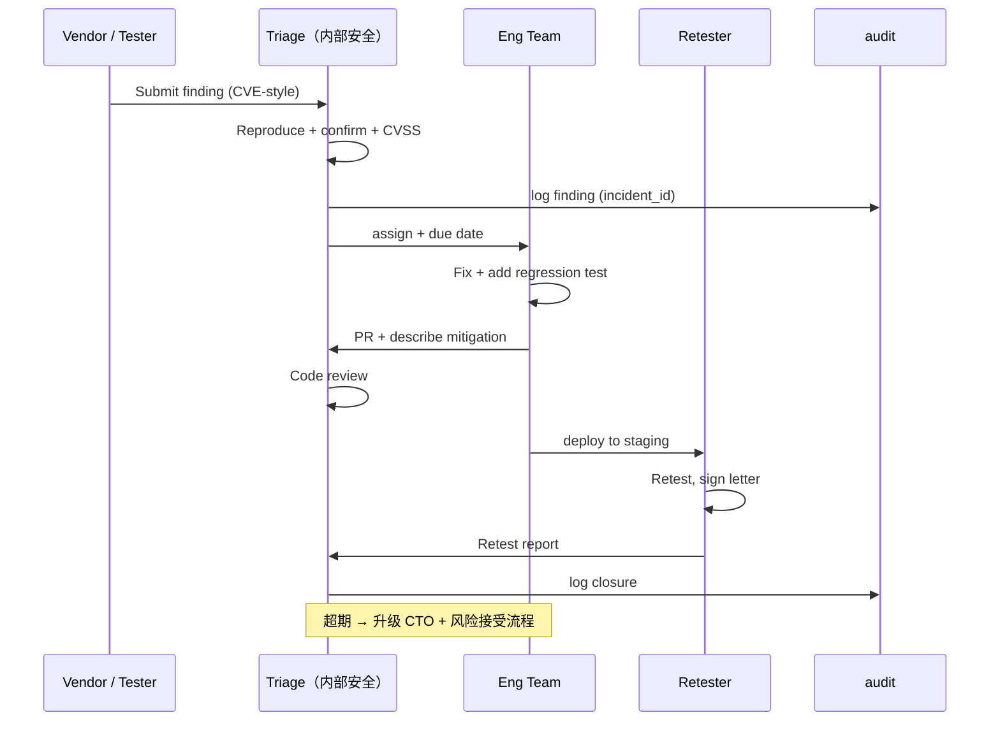

# 渗透测试范围与方法 — Design v1

> 状态：Draft v1 · Owner：安全团队 · 评审：架构组 + 法务 + 第三方渗透厂商 · 配套：[CONVENTIONS](../CONVENTIONS.md)
>
> 关联模块：security-ops-ci-v1（CI 安全门 = 持续测试）+ ha-fault-injection-v1（可用性测试） + compliance-v1（合规要求触发频次）

## 1. Context

底座 v1.0 在 A-M5 出口承诺「**外部渗透测试通过，高危为 0**」。SOC 2、等保三级、ISO 27001 都要求年度独立渗透。但「渗透测试」是模糊词：

- 测什么？（API、Web 控制台、K8s、CI/CD、物理？）
- 谁做？（内部红队 vs 外部第三方）
- 怎么做？（黑盒 / 灰盒 / 白盒；爬虫 / 手测 / fuzz）
- 出口标准？（是 0 高危还是修复 SLA 内？）
- 谁出报告？谁验证修复？

本文档把"渗透测试"从口号落到清单：**范围、目标、方法、责任分工、漏洞 SLA、修复验证 6 件套**。

**非目标**：
- 不替代 CI 自动安全门（自动扫描走 [security-ops-ci-v1](./security-ops-ci-v1.md)；本文件管深度人工 + 半自动）
- 不替代红蓝对抗（红蓝对抗是综合演练，本文件聚焦"找漏洞"）
- 不替代客户侧渗透（客户机房自身渗透是客户责任，底座只提供配合材料）

## 2. 核心原则（铁律）

1. **资产清单不全 → 测不全**：先有 asset inventory，再有 scope。
2. **范围 = SOW**：每次测试以 Statement of Work 文档锁定 scope / out-of-scope / 测试窗口 / 紧急联系人，双方签字。
3. **测前数据快照**：测试环境数据隔离；如果不得不在生产，必须有回滚预案 + 数据快照。
4. **发现即记录**：测试过程发现的高危必须 24h 内通报；不允许累积到报告日才告诉。
5. **闭环验证**：每个漏洞修复后必须由原测试方复测确认 closed。
6. **报告归档 ≥ 3 年**：审计 / SOC2 / 等保都要求长期保留。

## 3. 资产清单（Pentest 起点）

```
┌─ Exposed Surface ─────────────────────────────────────────────┐
│ A1. Public API Gateway (api.foundation.example.com)          │
│ A2. Admin Console (admin.foundation.example.com)             │
│ A3. Tenant Console (<tenant>.foundation.example.com)         │
│ A4. Webhook receivers (foundation → tenant)                  │
│ A5. OAuth2 endpoints (/oauth/authorize|token|introspect)     │
│ A6. SCIM endpoints (/scim/v2/*)                              │
│ A7. SSO endpoints (SAML SP + OIDC RP)                        │
│ A8. LLM Gateway (proxied OpenAI/Anthropic protocol)          │
│ A9. Sandbox runtime API (B 阶段)                              │
└───────────────────────────────────────────────────────────────┘
┌─ Internal Surface ────────────────────────────────────────────┐
│ B1. Service-to-service mTLS                                   │
│ B2. Postgres / ClickHouse / Redis / OpenSearch                │
│ B3. Vault / Keycloak / OPA                                    │
│ B4. K8s API server / etcd                                     │
│ B5. CI/CD (GitLab/GitHub) + Container Registry                │
│ B6. Bastion / Teleport                                        │
└───────────────────────────────────────────────────────────────┘
┌─ Supply Chain ────────────────────────────────────────────────┐
│ C1. Docker base images                                        │
│ C2. Python / Node / Go dependencies (SBOM)                    │
│ C3. Helm charts (third-party subcharts)                       │
│ C4. CI runners                                                │
└───────────────────────────────────────────────────────────────┘
```

每项资产标 owner、暴露面、上次测试时间、风险等级。维护文件：`docs/security/asset-inventory.md`，每季度刷新。

## 4. 范围矩阵（按测试类型）

| 测试类型 | scope | 频次 | 执行方 | 方法学 |
|---|---|---|---|---|
| **External Black-box Pentest** | A1-A9 公网暴露面 | 年度 ≥2 次 + 重大变更前 | 外部第三方 | OWASP WSTG + 自定义 |
| **Authenticated Web Pentest** | A2/A3 控制台（管理员 + 普通用户 + 跨租户） | 同上 | 外部 | OWASP ASVS L2 |
| **API Security Test** | A1/A5/A6/A8 OpenAPI spec → 自动 + 手动 | 同上 | 外部 + 内部辅助 | OWASP API Top 10 (2023) |
| **Infrastructure Pentest** | B1-B6 内网 | 年度 1 次 + 架构变更后 | 外部 | NIST SP 800-115 |
| **Container & K8s Audit** | 镜像 / 编排 / RBAC | 半年度 | 内部 + Trivy + kube-bench + kube-hunter | CIS K8s Benchmark |
| **Supply Chain Audit** | C1-C4 | 季度 | 内部 + Syft + Grype + dependency-review | SLSA Level 3 自评 |
| **Source Code Audit**（白盒） | 重点服务（identity / authz / crypto / billing） | 重大变更后 | 外部 + 内部 | OWASP Code Review Guide |
| **Social Engineering**（钓鱼） | 员工 | 年度 1 次 | 外部 | GoPhish 平台 |
| **Physical Pentest** | 客户机房（如适用） | 客户自行 | 客户责任 | 等保物理项 |

## 5. OWASP 必测覆盖（最低要求）

每次外部 pentest 报告必须明确覆盖以下条目，逐项给 PASS / FAIL / NOT APPLICABLE：

### 5.1 OWASP Top 10 Web (2021)
| ID | 项 | 底座关注点 |
|---|---|---|
| A01 | Broken Access Control | 跨租户访问、RLS 绕过、OPA 策略漏洞 |
| A02 | Cryptographic Failures | TLS 配置、密钥管理、加密算法（含国密） |
| A03 | Injection | SQL / NoSQL / OPA Rego / OS command / LDAP |
| A04 | Insecure Design | 业务逻辑漏洞（计费、配额、迁移） |
| A05 | Security Misconfig | K8s / Helm 默认值、Keycloak realm、Vault policy |
| A06 | Vulnerable Components | SBOM 中所有依赖的 CVE |
| A07 | Auth Failures | MFA bypass、session fixation、JWT 验签 |
| A08 | Software & Data Integrity | webhook 签名、bundle 签名、SBOM 签名 |
| A09 | Logging & Monitoring | audit 漏审、hash chain 断链、TSA 失败 |
| A10 | SSRF | LLM Gateway egress、Notification webhook、metadata service |

### 5.2 OWASP API Top 10 (2023)
| ID | 项 | 底座关注点 |
|---|---|---|
| API1 | BOLA (Broken Object Level Authz) | 资源 ID 直接遍历、跨租户取数 |
| API2 | Broken Authentication | API Key 泄露、OAuth token 滥用 |
| API3 | BOPLA (Object Property Level) | 字段级越权（如改 role/tier/quota） |
| API4 | Unrestricted Resource Consumption | 限流绕过、配额绕过 |
| API5 | BFLA (Function Level) | 跨角色调用（普通用户 → 管理员 API） |
| API6 | Unrestricted Business Flows | 注册刷量、配额抢占、迁移并发 |
| API7 | SSRF | 同 A10 |
| API8 | Security Misconfig | CORS、TLS、错误信息泄露 |
| API9 | Inventory Mgmt | 暗 API、debug endpoint、v0/internal 暴露 |
| API10 | Unsafe Consumption of 3rd-party | LLM provider 响应注入、webhook 回调污染 |

### 5.3 OWASP LLM Top 10（B 阶段强制；A 阶段 LLM Gateway 也测）
- LLM01 Prompt Injection / LLM02 Insecure Output Handling / LLM03 Training Data Poisoning（NA）/ LLM04 Model DoS / LLM05 Supply Chain / LLM06 Sensitive Info Disclosure / LLM07 Insecure Plugin Design（MCP）/ LLM08 Excessive Agency / LLM09 Overreliance / LLM10 Model Theft

## 6. 多租户专项测试用例（**最高优先**）

底座最大风险是跨租户数据泄露。每次 pentest **必跑**以下 fuzz 套件（也并入 CI 持续运行）：

```python
# tests/multi-tenant-fuzz/test_isolation.py 示例

@pytest.mark.parametrize("tenant_a, tenant_b", random_tenant_pairs(1000))
async def test_no_cross_tenant_read(tenant_a, tenant_b):
    # 1. tenant_a 创建资源
    res = await client(tenant_a).create_document(name="secret")
    # 2. tenant_b 试图通过各种途径读取
    for attempt in [
        get_by_id(res.id),
        list_with_filter(name="secret"),
        search(query="secret"),
        export_csv(),
        webhook_subscribe(resource_id=res.id),
        rls_set_var_bypass(tenant_a),       # SET app.tenant_id=tenant_a
        jwt_swap_tenant_claim(tenant_a),
    ]:
        assert (await client(tenant_b).attempt(attempt)).status_code in [403, 404]
```

**覆盖维度**：
- 直接 ID 遍历（BOLA）
- JWT claim 篡改（tenant_id / role / scope）
- RLS 变量绕过（`SET app.tenant_id` 是否被忽略）
- 搜索结果泄露（OpenSearch ACL filter 漏洞）
- 缓存 key 串扰（Redis prefix 是否生效）
- 审计跨租户读
- billing / quota 互算
- 通知 / webhook 错投
- LLM Gateway 配置串扰

**通过标准**：1 万次 fuzz 全部 403/404，无 200/泄露字段。

## 7. SOW 模板（每次测试必填）

```markdown
# Pentest SOW v__

## 1. 测试方
- Vendor: __
- Lead Tester: __
- Contact: __ (24/7)

## 2. 范围
- In-scope assets: A1, A2, A3, A8 (按 §3 编号)
- Out-of-scope: B5 (CI/CD)、Customer datacenters
- Target environment: staging.foundation.example.com (与生产 1:1)
- Test data: synthetic (10 tenants, 100 users)

## 3. 时间窗口
- Test window: 2026-__-__ to 2026-__-__
- Daily quiet hours: 02:00-06:00 UTC（避开备份窗口）
- Emergency stop: kill switch URL __ + 电话 __

## 4. 方法学
- Black-box first 5 days, gray-box (low-privilege account) next 5 days
- Authorized credentials: __ accounts provisioned

## 5. 规则
- No DoS / volumetric attacks
- No social engineering of employees (separate SOW)
- All findings reported within 24h if HIGH/CRITICAL
- Daily standup at 09:00 UTC

## 6. 交付物
- Detailed report (CVSS scored, OWASP-mapped, repro steps, screenshots)
- Executive summary
- Raw scan data
- Retest letter after fixes

## 7. 签字
- Vendor: __
- Foundation Security Lead: __
- Foundation Legal: __
```

## 8. 漏洞分级与修复 SLA

| Severity | CVSS | 通报 SLA | 修复 SLA | 验证 SLA |
|---|---|---|---|---|
| Critical | 9.0-10.0 | 1h | 24h | 7 天内 retest |
| High | 7.0-8.9 | 24h | 7 天 | 14 天内 retest |
| Medium | 4.0-6.9 | 周报 | 30 天 | 60 天内 retest |
| Low | 0.1-3.9 | 月报 | 60 天 | 下次 pentest |
| Info | 0.0 | 月报 | best-effort | — |

> SLA 与 [security-ops-ci-v1](./security-ops-ci-v1.md) §漏洞 SLA 对齐。

**超期处理**：
- 提交风险接受（risk acceptance）签字（CTO + Security Lead）+ 补偿控制（WAF 规则、监控告警、临时禁用）
- 入 audit；外审报材料附风险接受记录

## 9. 修复闭环工作流



## 10. 数据模型（漏洞跟踪）

```sql
-- packages/security_ops/migrations/0xxx_pentest.sql

CREATE TABLE security_ops.pentest_engagement (
  id                 TEXT PRIMARY KEY,             -- eng_<ULID>
  name               TEXT NOT NULL,                -- '2026Q1 annual external pentest'
  vendor             TEXT NOT NULL,
  sow_s3_key         TEXT NOT NULL,                -- 签字 PDF
  scope_assets       TEXT[] NOT NULL,              -- ['A1','A2',...]
  start_at           TIMESTAMPTZ NOT NULL,
  end_at             TIMESTAMPTZ NOT NULL,
  status             TEXT NOT NULL,                -- 'PLANNED'/'IN_PROGRESS'/'FIXING'/'COMPLETED'
  final_report_s3_key TEXT,
  retest_letter_s3_key TEXT,
  created_at         TIMESTAMPTZ NOT NULL DEFAULT now()
);

CREATE TABLE security_ops.pentest_finding (
  id                 TEXT PRIMARY KEY,             -- find_<ULID>
  engagement_id      TEXT NOT NULL REFERENCES security_ops.pentest_engagement(id),
  title              TEXT NOT NULL,
  severity           TEXT NOT NULL,                -- 'CRITICAL'/'HIGH'/'MEDIUM'/'LOW'/'INFO'
  cvss_vector        TEXT,
  cvss_score         NUMERIC(3,1),
  owasp_mapping      TEXT[],                       -- ['A01:2021','API1:2023']
  affected_asset     TEXT NOT NULL,                -- 'A1' / 'A2'
  description_md     TEXT NOT NULL,
  repro_steps_md     TEXT NOT NULL,
  status             TEXT NOT NULL,                -- 'OPEN'/'TRIAGED'/'IN_FIX'/'AWAITING_RETEST'/'CLOSED'/'RISK_ACCEPTED'
  reported_at        TIMESTAMPTZ NOT NULL,
  due_at             TIMESTAMPTZ NOT NULL,
  fixed_at           TIMESTAMPTZ,
  retested_at        TIMESTAMPTZ,
  retest_passed      BOOLEAN,
  fix_pr_url         TEXT,
  risk_acceptance_id TEXT,                         -- 如走风险接受流程
  audit_event_id     TEXT,
  created_at         TIMESTAMPTZ NOT NULL DEFAULT now()
);

CREATE INDEX idx_finding_status_due ON security_ops.pentest_finding(status, due_at) WHERE status NOT IN ('CLOSED','RISK_ACCEPTED');
CREATE INDEX idx_finding_severity ON security_ops.pentest_finding(severity, reported_at DESC);

ALTER TABLE security_ops.pentest_engagement ENABLE ROW LEVEL SECURITY;
ALTER TABLE security_ops.pentest_finding ENABLE ROW LEVEL SECURITY;
ALTER TABLE security_ops.pentest_engagement FORCE ROW LEVEL SECURITY;
ALTER TABLE security_ops.pentest_finding FORCE ROW LEVEL SECURITY;
-- 仅 security_ops 角色可读
```

> 状态值按 [CONVENTIONS §2.8](../CONVENTIONS.md) `UPPER_SNAKE_CASE`。

## 11. SDK 接口

```python
from foundation_security_ops import pentest

# 平台安全管理员
pentest.create_engagement(name=..., vendor=..., sow_pdf=..., scope=[...])
pentest.import_findings(engagement_id, findings_csv)            # vendor 提交

# 工程团队
pentest.list_my_findings(team_id, status="OPEN") -> List[Finding]
pentest.mark_in_fix(finding_id, pr_url)
pentest.request_retest(finding_id)

# CTO / 安全 Lead
pentest.risk_accept(finding_id, rationale, mitigations)        # 走审批

# 报表
pentest.export_engagement_report(engagement_id, format="pdf")  # 给客户审计 / SOC2 外审
pentest.dashboard_overdue() -> List[Finding]
```

## 12. 事件契约

| 事件 | 触发 |
|---|---|
| `foundation.security_ops.pentest.engagement_started` | 测试开始 |
| `foundation.security_ops.pentest.finding_reported` | 新漏洞 |
| `foundation.security_ops.pentest.finding_overdue` | SLA 超期 |
| `foundation.security_ops.pentest.finding_closed` | 闭环 |
| `foundation.security_ops.pentest.risk_accepted` | 走风险接受 |

> 命名遵循 [CONVENTIONS §3.1](../CONVENTIONS.md) 四段式。

## 13. 错误码

| Code | HTTP |
|---|---|
| `FOUNDATION.SECURITY_OPS.PENTEST.ENGAGEMENT_NOT_FOUND` | 404 |
| `FOUNDATION.SECURITY_OPS.PENTEST.FINDING_OUT_OF_SCOPE` | 400 |
| `FOUNDATION.SECURITY_OPS.PENTEST.RETEST_BLOCKED` | 409 |
| `FOUNDATION.SECURITY_OPS.PENTEST.RISK_ACCEPT_APPROVAL_REQUIRED` | 403 |

## 14. 合规映射

| 合规模式 | 强制要求 |
|---|---|
| `equal_protection_3` | 年度 ≥1 次外部 pentest + 报告归档 ≥1 年 |
| `equal_protection_4` | 年度 ≥2 次 + 重大变更追加 + 国家测评机构出具报告 |
| `finance_jrt0071` | 同等保四级 + 监管要求时配合现场测试 |
| `soc2` | 年度 ≥1 次（CC4.1）+ 修复证据留 6 月 |
| `iso27001` | A.12.6.1 持续脆弱性评估 + A.18.2.3 技术合规审查 |

## 15. 不接受的发现（明确）

避免 vendor 灌水降低信噪比，明确以下默认不算漏洞（除非有真实利用链）：
- TLS 1.2 在内部 mTLS 链路（外网强制 1.3）
- 缺失的 HTTP 安全 header 在内网 service-to-service
- `Server:` header 暴露
- SPF / DKIM / DMARC（domain layer，不归底座管）
- 速率限制提示（公开 docs 已说明）
- 弱密码登录失败（已有 brute force 防御）

## 16. 待解决问题

1. **第三方 vendor 选定**：v1.0 GA 前确定 2 家国内 + 1 家国际备选；签 MSA
2. **LLM Gateway prompt injection 测试方法学**：业界还在演进 → 跟踪 OWASP LLM Top 10 + AI Red Team Playbook
3. **沙盒逃逸测试**：B 阶段沙盒方案（首选 gVisor/E2B，备选 CubeSandbox microVM）上线后，要求 vendor 具备容器/microVM 逃逸技能
4. **bug bounty 是否开**：v1.0 不开（私有化为主）；SaaS 公有化阶段（v2+）评估

## 17. 验证标准（A-M5 出口）

- [ ] asset inventory 完成 + 季度刷新机制就位
- [ ] 至少 1 次外部 pentest 完成，报告归档
- [ ] 全部 HIGH 及以上漏洞在 SLA 内修复 + retest passed
- [ ] 多租户 fuzz 套件 1 万次 0 漏（在 CI 持续跑）
- [ ] SOW 模板 + 漏洞跟踪表 + dashboard + 报表导出 e2e
- [ ] 应急联系链路（24/7 kill switch）测试通过

## 18. 参考

- [OWASP Web Security Testing Guide v4.2](https://owasp.org/www-project-web-security-testing-guide/)
- [OWASP API Security Top 10 (2023)](https://owasp.org/API-Security/editions/2023/en/0x00-header/)
- [OWASP LLM Top 10 (2025)](https://owasp.org/www-project-top-10-for-large-language-model-applications/)
- [OWASP ASVS v4.0.3](https://owasp.org/www-project-application-security-verification-standard/)
- [NIST SP 800-115 Technical Guide to Information Security Testing](https://csrc.nist.gov/publications/detail/sp/800-115/final)
- [CIS Kubernetes Benchmark](https://www.cisecurity.org/benchmark/kubernetes)
- SOC 2 Trust Services Criteria CC4.1 / CC7.1
