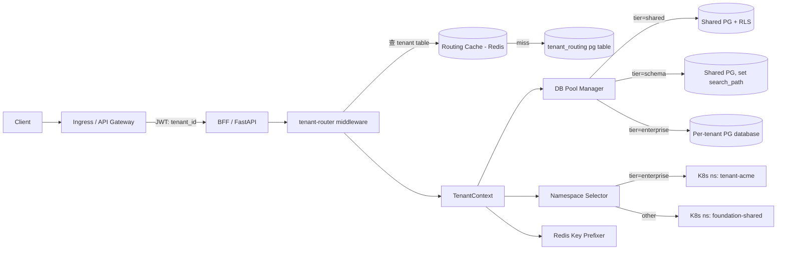
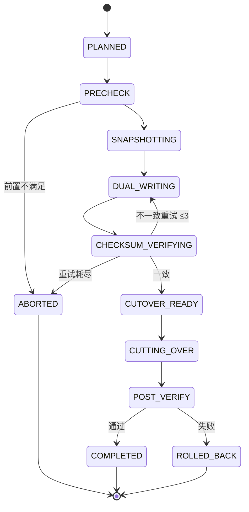

# SaaS 多租户三级隔离 + 租户路由 — Design v1

> 状态：Draft v1 · Owner：架构组 · 评审：架构组 + DBA + SRE · 配套：[CONVENTIONS](../CONVENTIONS.md) · [multi-tenancy](../multi-tenancy.md)
>
> 关联模块：identity-v1（tenant 上下文源） + authz-v1（资源访问） + billing-v1（套餐字段驱动路由） + lifecycle-v1（迁移期数据冻结）

## 1. Context

底座 SaaS 形态承诺四档套餐对应不同隔离强度：

| 套餐 | 数据隔离 | 应用隔离 | 适合规模 |
|---|---|---|---|
| Free / Pro | Postgres RLS（行级，共享库） | 共享 K8s namespace + Pod | 1k-10k 租户 |
| Business | 独立 Postgres schema（每租户一 schema） | 共享 namespace + Pod，按租户路由 | 100-1000 租户 |
| Enterprise | 独立 Postgres database + 独立 ClickHouse 表 | 独立 K8s namespace + 独立 Pod | 10-100 租户 |
| Dedicated | 独立 K8s 集群 / 独立 VPC | 整套独占 | 个位数大客户 |

**问题**：业务代码不能知道租户在哪一档——否则套餐升级必须改业务代码。需要**租户路由层**透明承接：

- 入口 middleware 根据 `tenant.tier` 决定 DB 连接、ClickHouse session、namespace 选择、缓存 key 前缀
- 套餐升级（Pro → Business / Business → Enterprise）触发**自动迁移**，停机 <5min
- 共享资源（共享 namespace 的 K8s ResourceQuota、Postgres connection pool）防止单租户打爆

**非目标**：
- 不做单 Pod 内进程级 sandbox（业务沙盒走 agent runtime workspace，默认 gVisor，可切 microVM；本文件管 K8s 层以上）
- 不重写业务 ORM（业务用 SDK 即可；ORM session 工厂由 SDK 注入）
- 不涉及 Dedicated（独立集群在客户私有化路线，与本文 SaaS 路由独立）

## 2. 核心原则（铁律）

1. **租户路由 = 单点真相**：任何业务代码不直接选 DB / namespace / cache key；必经 SDK `with_tenant_context(tenant_id)`，路由由 middleware 决定。
2. **降级前禁止越权**：每条 SQL 必经 RLS 校验（即使在独立 schema / database 模式下，RLS 仍开启作为兜底）。
3. **路由表不可缓存过久**：tier 变更 → 缓存最多 30s 内全部失效（subscription 事件驱动）。
4. **迁移过程数据强一致**：双写期 checksum 比对、回滚要可触发、过程入 audit。
5. **共享资源公平**：shared / schema 模式必须有 connection limit、CPU/memory quota、I/O 限速。

## 3. 整体架构



## 4. 数据模型

```sql
-- packages/org/migrations/0xxx_tenant_routing.sql
-- 路由表是 org 模块的扩展（tenant 是 org 模块的根实体）

CREATE TABLE org.tenant_routing (
  tenant_id              TEXT PRIMARY KEY REFERENCES org.tenant(id),
  tier                   TEXT NOT NULL,                  -- 'SHARED' / 'SCHEMA' / 'ENTERPRISE' / 'DEDICATED'
  -- 数据层路由
  pg_cluster_id          TEXT NOT NULL,                  -- 'pg-shared-1' / 'pg-ent-cluster-3'
  pg_database            TEXT NOT NULL,                  -- 共享: 'foundation'; 独立: 'tenant_acme'
  pg_schema              TEXT,                           -- schema 模式: 'tenant_acme'; 否则 NULL
  ch_cluster_id          TEXT NOT NULL,                  -- ClickHouse cluster
  ch_database            TEXT NOT NULL,
  -- 应用层路由
  k8s_namespace          TEXT NOT NULL,                  -- 'foundation-shared' / 'tenant-acme'
  -- 缓存
  redis_cluster_id       TEXT NOT NULL,
  redis_key_prefix       TEXT NOT NULL,                  -- 'shared:tenant_acme:' / 'ent:tenant_acme:'
  -- 合规约束（pipl/gdpr 触发）
  data_residency         TEXT,                           -- 'cn-only' / 'eu-only' / 'us-only' / 'global' / NULL
                                                          -- 路由解析 / 套餐迁移时强制校验 target cluster region 匹配
  -- 状态
  status                 TEXT NOT NULL DEFAULT 'ACTIVE', -- 'ACTIVE'/'MIGRATING'/'FROZEN'/'ARCHIVED'
  migration_id           TEXT,                           -- 迁移期关联 migration 表
  created_at             TIMESTAMPTZ NOT NULL DEFAULT now(),
  updated_at             TIMESTAMPTZ NOT NULL DEFAULT now()
);

CREATE INDEX idx_tenant_routing_tier ON org.tenant_routing(tier);
CREATE INDEX idx_tenant_routing_pg_cluster ON org.tenant_routing(pg_cluster_id);

-- 路由表 RLS：仅平台管理员可写，所有租户可读自己那行
ALTER TABLE org.tenant_routing ENABLE ROW LEVEL SECURITY;
ALTER TABLE org.tenant_routing FORCE ROW LEVEL SECURITY;
CREATE POLICY routing_read_self ON org.tenant_routing
  FOR SELECT
  USING (tenant_id = current_setting('app.tenant_id', true));
CREATE POLICY routing_platform_admin ON org.tenant_routing
  FOR ALL
  USING (current_setting('app.role', true) = 'platform_admin');


CREATE TABLE org.tier_migration (
  id                     TEXT PRIMARY KEY,                -- mig_<ULID>
  tenant_id              TEXT NOT NULL REFERENCES org.tenant(id),
  from_tier              TEXT NOT NULL,
  to_tier                TEXT NOT NULL,
  status                 TEXT NOT NULL,                   -- UPPER_SNAKE_CASE per §6.1
  initiated_by           TEXT NOT NULL,
  initiated_at           TIMESTAMPTZ NOT NULL,
  snapshot_completed_at  TIMESTAMPTZ,
  dual_write_started_at  TIMESTAMPTZ,
  cutover_at             TIMESTAMPTZ,
  completed_at           TIMESTAMPTZ,
  rollback_reason        TEXT,
  checksum_passed        BOOLEAN,
  bytes_migrated         BIGINT,
  rows_migrated          BIGINT,
  audit_event_id         TEXT,
  created_at             TIMESTAMPTZ NOT NULL DEFAULT now()
);

CREATE INDEX idx_migration_tenant_status ON org.tier_migration(tenant_id, status);

ALTER TABLE org.tier_migration ENABLE ROW LEVEL SECURITY;
ALTER TABLE org.tier_migration FORCE ROW LEVEL SECURITY;
```

> tier / status 值按 [CONVENTIONS §2.8](../CONVENTIONS.md) `UPPER_SNAKE_CASE`。

## 5. tenant-router middleware

### 5.1 SDK 入口

```python
from foundation_sdk import with_tenant_context, get_session

async def handle_request(request):
    tenant_id = extract_from_jwt(request)               # 已由 identity 模块校验
    async with with_tenant_context(tenant_id) as ctx:
        # ctx 自动:
        # - 选 DB 连接（pg cluster + database + schema/search_path）
        # - 设 RLS 变量 app.tenant_id
        # - 选 ClickHouse session
        # - 设 redis key prefix
        # - 选 k8s namespace（业务调用 K8s API 时用）
        async with get_session() as session:
            ...
```

### 5.2 路由解析顺序

1. **本地内存 LRU**（TTL 30s，最大 10000 租户）→ 命中即返回
2. **Redis 缓存**（TTL 5min）→ 命中回填本地
3. **`org.tenant_routing` Postgres 表**（强一致查询）→ 命中回填两级
4. 全失败 → `FOUNDATION.ORG.TENANT.NOT_FOUND` 404

### 5.3 缓存失效

- `subscription` 事件 `foundation.billing.subscription.updated` → 异步发 `foundation.org.tenant.routing_changed` → 路由 service 广播 invalidate 到所有 BFF 实例（Redis Pub/Sub）
- 紧急场景：admin API `POST /api/org/v1/tenants/{id}/routing:invalidate-cache`

### 5.4 DB 连接池策略

每个 service 启动时按 tier 创建多个连接池：

| Tier | 连接池实现 | 池大小（每实例） |
|---|---|---|
| SHARED | 单连共享池 → 共享 PG cluster | 50 |
| SCHEMA | 单连共享池 → 共享 PG cluster；每请求 `SET search_path` | 50 |
| ENTERPRISE | 按 `pg_cluster_id` 分池；惰性创建 | 每集群 10，最多 100 个集群 |

**PgBouncer 模式**：transaction 模式；`SET search_path` 与 `SET app.tenant_id` 必须在每事务开头执行。

### 5.5 ClickHouse 路由

- SHARED / SCHEMA：共用 `foundation.audit_event`，按 `tenant_id` 字段查；ORDER BY `(tenant_id, ts)`，主键前缀剪枝
- ENTERPRISE：独立 database 或独立 ReplicatedMergeTree 表 + 跨集群联邦查询
- DEDICATED：完全独立部署

### 5.6 Redis Key 命名

```
<tier>:<tenant_id>:<service>:<entity>:<id>
```

例：`shared:tenant_acme:identity:session:abc123`、`ent:tenant_bigco:billing:cart:xyz`

**KEYS / SCAN 禁用**：业务必须明确指定 key；运维通过 `tier:tenant_id:*` 前缀做隔离清理。

## 6. 套餐迁移工具

### 6.1 状态机（`tier_migration.status`）



> 状态名遵循 [CONVENTIONS §2.8](../CONVENTIONS.md) `UPPER_SNAKE_CASE`。

### 6.2 阶段细节

| 阶段 | 操作 | 业务可用性 | 超时 |
|---|---|---|---|
| PRECHECK | 校验目标 cluster 容量、namespace 资源、license 配额 | 全可用 | 5min |
| SNAPSHOTTING | pg_dump --jobs=8 + ClickHouse `BACKUP` + MinIO sync（rclone） | 全可用，读副本 lag <30s | 1h（按数据量） |
| DUAL_WRITING | 业务写入双写新旧两边（middleware 拦截）；读还走旧 | 读延迟 +5ms；写延迟 +20ms | 长，直到 checksum 通过 |
| CHECKSUM_VERIFYING | 抽样 + 全表 row count + critical column hash | 同 dual_writing | 30min |
| CUTOVER_READY | 等待 cutover 窗口（运维选时） | 同 dual_writing | 24h（窗口内） |
| CUTTING_OVER | 入"FROZEN"短窗口（拒写 5s），切流，路由表更新 | 写阻塞 ≤5s | 5min |
| POST_VERIFY | 业务回归测试 + 写入新边 + 旧边只读保留 7 天 | 全可用 | 7 天 |
| COMPLETED | 旧边数据归档 / 删除 | — | — |

### 6.3 失败回滚

- DUAL_WRITING 阶段失败 → 直接放弃新边，关掉双写，回退到 ACTIVE
- CUTTING_OVER 阶段失败（极少见，路由表写失败）→ 反向切回旧边路由，删新边数据
- POST_VERIFY 失败 → 路由切回旧边（旧边 7 天内仍可用），新边数据保留 30 天调试

### 6.4 安全约束

- 迁移由 **平台管理员**触发；租户管理员只能"提单"（subscription 升级），实际迁移走 platform admin 审批
- L4/L5 数据涉及租户迁移须 **4 眼审批**（接 pam-v1）
- 全过程入 audit：`foundation.org.tier_migration.<status>` 系列事件

## 7. 资源公平性（防单租户打爆）

### 7.1 共享 PG cluster
- PgBouncer：每租户最大 active 连接 = 50（pool_size 软限制）
- 长事务自动 kill：单事务 >60s → pg_stat_activity terminate + audit 告警
- 慢查询限制：`statement_timeout = 30s` 默认；shared 模式严格 5s

### 7.2 共享 namespace
- K8s ResourceQuota（按 tenant 标签）：CPU、Memory、PVC 数量、Pod 数量
- NetworkPolicy：限制租户间互访
- LimitRange：Pod 默认 request/limit，防"无限制 Pod"挤占

### 7.3 共享 Redis
- 每租户 maxmemory 软限制（按 key prefix 估算）
- `CONFIG SET maxmemory-policy allkeys-lru` 兜底
- 慢命令禁用：`CLIENT LIST` / `KEYS *` / `FLUSHDB` 在共享集群上禁

### 7.4 API 限流（与 api-platform-v1 联动）
- 全局：每租户每秒 1000 req（shared / schema），无上限（enterprise / dedicated）
- 单 user：每秒 100 req
- 触发 → 429 + Retry-After

## 8. SDK 接口

```python
from foundation_sdk import tenant_routing

# 查询当前租户的路由信息
info = tenant_routing.get(tenant_id)
# info.tier / info.pg_cluster_id / info.k8s_namespace ...

# 平台管理员：发起迁移
mig = tenant_routing.plan_migration(
    tenant_id="tenant_acme",
    to_tier="ENTERPRISE",
    target_pg_cluster="pg-ent-3",
    target_namespace="tenant-acme",
    cutover_window="2026-06-15T02:00:00Z/2026-06-15T04:00:00Z"
)
tenant_routing.approve(mig.id, approver="ops_lead")        # 4 眼审批之一
tenant_routing.execute(mig.id)                              # 进入 SNAPSHOTTING

# 查询进度
tenant_routing.get_migration(mig.id)

# 紧急回滚（仅平台管理员，未到 COMPLETED 都可滚）
tenant_routing.rollback(mig.id, reason="checksum failed")
```

## 9. 部署形态差异

| Profile | 路由表实现 | 套餐 |
|---|---|---|
| small（私有化） | 单租户写死 SHARED；不开启 routing 表 | 仅 Enterprise（约等于 Dedicated） |
| medium（私有化多租户） | 路由表生效；常用 SCHEMA 模式 | 全部 4 档可用 |
| large / SaaS 主集群 | 路由表 + 跨 cluster 联邦 | 全部 4 档 |

## 10. 事件契约

| 事件 | 触发 | payload 关键字段 |
|---|---|---|
| `foundation.org.tenant.routing_changed` | 路由变更（tier 切换 / cluster 切换） | tenant_id, old_tier, new_tier |
| `foundation.org.tier_migration.planned` | 迁移计划入库 | migration_id, from/to_tier |
| `foundation.org.tier_migration.executing` | 进入 SNAPSHOTTING | migration_id |
| `foundation.org.tier_migration.cutover_started` | 路由切流前 | migration_id |
| `foundation.org.tier_migration.completed` | 完成 | migration_id, bytes_migrated |
| `foundation.org.tier_migration.rolled_back` | 回滚 | migration_id, reason |

> 事件命名遵循 [CONVENTIONS §3.1](../CONVENTIONS.md) 四段式。

## 11. 错误码

| Code | HTTP |
|---|---|
| `FOUNDATION.ORG.TENANT.NOT_FOUND` | 404 |
| `FOUNDATION.ORG.ROUTING.CACHE_STALE` | 409 |
| `FOUNDATION.ORG.MIGRATION.PRECHECK_FAILED` | 412 |
| `FOUNDATION.ORG.MIGRATION.CHECKSUM_MISMATCH` | 409 |
| `FOUNDATION.ORG.MIGRATION.CUTOVER_WINDOW_MISSED` | 410 |
| `FOUNDATION.ORG.MIGRATION.CONCURRENT_FORBIDDEN` | 409 |
| `FOUNDATION.ORG.MIGRATION.APPROVAL_REQUIRED` | 403 |
| `FOUNDATION.ORG.RESOURCE.QUOTA_EXCEEDED` | 429 |

> 格式遵循 [errors.md](../errors.md) 四段式。

## 12. 合规映射

| 合规模式 | 强制要求 |
|---|---|
| `equal_protection_3` | 迁移过程入审计 + 数据校验签字 |
| `equal_protection_3` 及以上 | shared/schema 模式禁用对 L4/L5 数据；强制升 enterprise（用 `compliance.is_at_least(...)` 判定） |
| `finance_jrt0071` | 必须独立 PG database 及以上；禁用共享 schema/RLS |
| `pipl` / `gdpr` | 路由表附加 `data_residency` 字段，迁移目标 cluster 必须满足驻留约束 |

## 13. 待解决问题

1. **跨 cluster 联邦查询性能**：ENTERPRISE 跨 cluster 联邦审计/搜索的 P95 → v1.1 验证
2. **PG database 创建上限**：单 PG cluster database 数量上限（PG 物理无限制，但 pg_dump 性能下降）→ 经验值 ≤200 个 ent 租户 / cluster
3. **K8s namespace 数量**：单集群推荐 ≤5000；超出走多 cluster；large profile 配 federation
4. **租户删除清理**：tenant 硬删除后清理路由表 + 物理删 schema/database → 与 lifecycle-v1 §legal_hold 联动

## 14. 验证标准（A-M5 出口）

- [ ] 4 档 tier 都能 e2e 创建租户 + CRUD + 路由正确
- [ ] tier 升级（Pro→Business、Business→Enterprise）自动迁移工具往返 1 万次随机数据，checksum 一致
- [ ] 迁移期间业务可用，cutover 写阻塞 ≤5s
- [ ] 路由 cache 失效在事件触发后 ≤30s 内全部 BFF 实例失效
- [ ] 共享 PG 单租户慢查询不影响其他租户（注入 100 个慢查询测试）
- [ ] RLS 兜底有效：构造越权查询 1 万次，全部被拒
- [ ] 迁移回滚测试：CHECKSUM_VERIFYING 失败 → 自动回滚 → 数据双边一致

## 15. 参考

- [Single-Tenant vs Multi-Tenant Database — AWS](https://aws.amazon.com/blogs/database/multi-tenant-data-isolation-with-postgresql-row-level-security/)
- [Stripe — Online migrations](https://stripe.com/blog/online-migrations)
- [PgBouncer transaction mode](https://www.pgbouncer.org/features.html)
- [K8s ResourceQuota](https://kubernetes.io/docs/concepts/policy/resource-quotas/)
- 等保 2.0 三级 8.1.4.2（数据完整性）+ 8.1.4.3（数据保密性）
