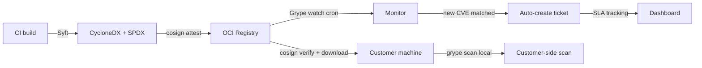

# SSDLC CI 安全门 + SBOM + 漏洞 SLA — Design v1

> 状态：Draft v1 · Owner：安全团队 + DevEx · 评审：架构组 + SRE · 配套：[CONVENTIONS](../CONVENTIONS.md)
>
> 关联模块：security-ops（owner） + penetration-test-scope-v1（深度测试） + ha-fault-injection-v1（可用性测试） + compliance-v1（合规驱动）

## 1. Context

底座 v1.0 在 A-M5 出口承诺：

- **CI 全绿**（SAST / SCA / DAST / Secret / License）
- **SBOM 每次发版生成**
- **漏洞 SLA dashboard**
- **应急响应演练 ≥1 次完整复盘**

**问题**：

- 工具碎片化（Semgrep / Trivy / OSV-Scanner / gitleaks / OWASP ZAP / Syft / Grype / kube-bench …），各自 SARIF 格式不一致
- 阈值不统一：哪些 CVE 阻断合并、哪些只告警？阈值不清就要么"全 fail" 要么"全 pass"，都不解决问题
- 豁免（exception）机制必须有，否则合理 false positive 会阻塞所有 PR
- 漏洞跟踪要联通：CI 发现 → ticket → 修复 PR → 关闭 → 报表，全链路自动化

**目标**：

1. 定义底座 SSDLC 流水线 6 大门（PR 前 / PR / merge / 镜像构建 / 预发 / 生产前）
2. 给每个门工具选型、阈值、豁免策略
3. SBOM 全链路：构建时生成 → registry 附 attestation → 客户交付随包 → 客户后续监控
4. 漏洞 SLA + dashboard + 应急响应 runbook 模板

**非目标**：
- 不替代深度 pentest（→ penetration-test-scope-v1）
- 不替代 chaos / 备份恢复（→ ha-fault-injection-v1）
- 不做安全意识培训内容（管理流程，HR + 安全合规）

## 2. 核心原则

1. **左移**：能在 PR 拦的不放到镜像；能在镜像拦的不放到预发。
2. **可信工具链**：CI runner 隔离 + 私有 image registry + 依赖镜像源；不允许在 CI 拉公网未审计代码。
3. **阈值明确 + 豁免可追溯**：每个门有阈值表；豁免需 PR 评审 + 时间窗 + 责任人。
4. **SBOM 即附件**：所有镜像 / Helm chart 必须签名 + 附 SBOM；客户能离线复核。
5. **漏洞 SLA = 合同**：超期触发自动升级；不允许"挂着不修"。
6. **演练 ≥1 次复盘**：年度至少一次完整桌面 / 红蓝 / 应急演练，2 周内复盘报告入审计。

## 3. 流水线 6 大门

```
┌─────────────────────────────────────────────────────────────────┐
│  pre-commit hook    PR open    PR merge    image build          │
│  ──────────────    ───────    ────────    ───────────           │
│  gitleaks          SAST       SBOM         image vuln scan       │
│  trivy fs (fast)   SCA        license      image sign            │
│  go/py linters     IaC scan   secret rescan attestation upload   │
│                    unit tests rebase guard                       │
│                                                                  │
│       ▼                ▼            ▼              ▼              │
│  staging deploy    pre-prod gate                                  │
│  ────────────     ───────────                                     │
│  DAST (ZAP)        compliance check                               │
│  kube-bench        evidence freshness                             │
│  multi-tenant fuzz canary required                                │
└─────────────────────────────────────────────────────────────────┘
```

### Gate 1：pre-commit hook（本地）
| 工具 | 检查 | 触发 |
|---|---|---|
| [pre-commit](https://pre-commit.com/) | 钩子框架 | `git commit` |
| [gitleaks](https://github.com/gitleaks/gitleaks) | secret 扫描 | 必装 |
| [trivy fs --severity HIGH,CRITICAL --skip-dirs node_modules](https://trivy.dev/) | 快速 SCA | 必装 |
| ruff / mypy / eslint / go vet | lint | 必装 |
| typos | typo | 可选 |

`make install-hooks` 一键装。CI 上 `lint` job 复跑作为兜底（hook 可被绕）。

### Gate 2：PR open（PR pipeline，强制）

| 项 | 工具 | 阈值 → action | 备注 |
|---|---|---|---|
| SAST | [Semgrep](https://semgrep.dev/) + 定制规则 | Critical/High → **block** | OWASP Top 10 + 自定义跨租户规则 |
| SCA | [Trivy fs](https://trivy.dev/) + [OSV-Scanner](https://github.com/google/osv-scanner) | Critical/High（CVSS≥7） → **block**；Medium → comment | 双工具交叉降漏 |
| IaC scan | [Checkov](https://www.checkov.io/) + [kube-linter](https://github.com/stackrox/kube-linter) | High → block | Helm / K8s yaml / Terraform |
| Secret rescan | gitleaks（CI 强跑） | 任何命中 → block | 防本地 hook 被绕 |
| License scan | [scancode-toolkit](https://github.com/nexB/scancode-toolkit) 或 [trivy fs --scanners license](https://aquasecurity.github.io/trivy/latest/docs/scanner/license/) | GPL/AGPL → **block**（除非 service-isolated 例外） | NOTICE 自动生成 |
| Unit / Integration test | pytest / vitest | fail → block | 覆盖率门禁 ≥ 80%（按模块） |
| Rebase guard | git | 落后 main >5 commits → 警告 + 自动 rebase | 减少 merge 冲突 |
| Policy regression（OPA） | `opa test` + coverage ≥ 90% | fail → block | 与 opa-bundle-v1 联动 |
| Multi-tenant isolation fuzz（核心 PR） | tests/multi-tenant-fuzz | fail → block | identity/authz/billing PR 强跑 |

### Gate 3：PR merge（合并瞬间）

| 项 | 工具 |
|---|---|
| 强制 ≥2 reviewer 同意 + CODEOWNERS 命中 | GitHub branch protection / GitLab merge approval |
| 合规变更 → 强制 compliance lead 签字 | CODEOWNERS for `docs/compliance/` + `packages/compliance/` |
| 安全敏感变更 → 安全 lead 签字 | CODEOWNERS for `packages/crypto/` + `packages/identity/` + `packages/authz/` + `packages/dlp/` |

### Gate 4：image build（合并后）

| 项 | 工具 | 阈值 |
|---|---|---|
| 基础镜像选 distroless / chainguard | Dockerfile review | — |
| 多阶段构建 + 最小化 | Dockerfile lint | High → fail |
| Image vuln scan | Trivy / Grype | Critical → block 推送；High → 创建跟踪 ticket |
| SBOM 生成 | [Syft](https://github.com/anchore/syft) → CycloneDX + SPDX | 必出 |
| 镜像签名 | [cosign](https://github.com/sigstore/cosign) keyless（Sigstore） | 必签 |
| SBOM attestation | cosign attest --predicate sbom.json | 必附 |
| Provenance | [SLSA L3](https://slsa.dev/) build attestation | 努力达标 |
| 镜像扫描结果 → Grype watch | 长期监控镜像 in-registry 的新 CVE | 后台 cron |

### Gate 5：staging deploy

| 项 | 工具 |
|---|---|
| DAST | [OWASP ZAP baseline scan](https://www.zaproxy.org/docs/docker/baseline-scan/) + auth scan | High → block |
| K8s 配置审计 | [kube-bench](https://github.com/aquasecurity/kube-bench) + [kube-hunter](https://github.com/aquasecurity/kube-hunter) | High → block |
| 运行时 Falco 规则 lint | falcoctl | fail → block |
| 多租户隔离 fuzz（深度）| custom suite 1 万次 | 任何越权 → block |
| chaos lint 与 dry-run | ChaosRun lint | fail → block |

### Gate 6：production pre-deploy

| 项 | 检查 |
|---|---|
| 镜像签名验证 | cosign verify in admission controller |
| SBOM diff | 新版 SBOM 与上版比对，新增依赖通过 license + CVE 复审 |
| compliance evidence freshness | 关键 evidence ≤30 天 |
| canary required | 至少 1 个 canary deployment 健康 5min |
| Approval | release captain + on-call SRE 双签 |

## 4. 漏洞 SLA

| Severity | 通报 | 修复 | 验证 | 超期 |
|---|---|---|---|---|
| Critical | 1h | 24h | 7d | 升级到 CTO + 风险接受 |
| High | 24h | 7d | 14d | 升级到 VP Eng |
| Medium | 1 周 | 30d | 60d | 月报 dashboard |
| Low | 月报 | 60d | 季度 | dashboard 跟踪 |

> 与 [penetration-test-scope-v1](./penetration-test-scope-v1.md) §8 SLA 对齐。

**SLA 起算时间**：
- CI 发现的漏洞：CI ticket 创建时间
- 外部 pentest：vendor 报告日
- CVE 监控（Grype watch）：CVE 进入 NVD 时间
- 客户报告：客户提交时间

**自动升级链路**：
- ticket 临到期 72h → notification 通知 owner + manager
- 超期 → 自动转 in_progress → 24h 内必须有 update
- 持续超期 → 自动创建 risk-acceptance 申请 → 走 CTO 审批

## 5. SBOM 全链路



**关键点**：
- SBOM 与镜像绑定（attestation），不允许漂移
- 客户拿到 SBOM 后可独立扫描（不依赖底座的网络）
- 平台方持续监控（image 已发布数月仍可发现新 CVE）
- SBOM 必须包含：依赖名 / 版本 / SHA256 / license / source URL

## 6. 豁免（Exception）流程

CI 检查无法 100% 准确；必须有可追溯豁免机制。

### 6.1 豁免对象
- 特定 CVE 在特定服务（如：某 dev-dep 的 CVE 仅运行在 test 环境）
- 特定 license（GPL 包装在独立 service 运行，无链接污染）
- 特定 SAST 规则在特定文件（已 review 确认 false positive）

### 6.2 豁免存储

```yaml
# .security/exceptions.yaml
exceptions:
  - id: EX-2026-001
    type: cve
    cve: CVE-2025-12345
    package: dev-tool-x
    services: ["dev-only"]
    reason: "only used in CI; not shipped"
    approver: security-lead@example.com
    expires_at: 2026-08-31
    risk_assessment_doc: docs/security/risk-acceptance/EX-2026-001.md
  - id: EX-2026-002
    type: sast_rule
    rule_id: python.lang.security.deserialization.unsafe-pickle
    files: ["packages/audit/tests/fixtures/legacy_pickle.py"]
    reason: "test fixture only"
    approver: audit-owner@example.com
    expires_at: 2026-12-31
```

### 6.3 强制规则
- 每条豁免**必须有过期时间**（最长 6 月）
- 过期前 30 天 CI 警告
- 过期后自动失效，重新触发原检查
- 豁免文件本身在 PR 中变更需要安全 lead + service owner 双签

## 7. 应急响应（IR）

### 7.1 事件分级
| Severity | 定义 | 示例 | SLA 通报 |
|---|---|---|---|
| Critical | 数据泄露 / RCE / 全局服务不可用 | 跨租户数据被读 | 1h 内通报客户 + 监管 |
| High | 单租户数据风险 / 关键服务不可用 | DB 主库挂、备份失败 | 4h 内 |
| Medium | 性能严重下降 / 单功能挂 | 某 service 限流误伤 | 24h |
| Low | 体验问题、监控告警 | UI bug | 周报 |

### 7.2 角色分工
- **指挥（IC）**：on-call SRE lead；统筹 + 对外口径
- **技术（Tech）**：受影响服务 owner；定位 + 修复
- **法务（Legal）**：监管通报 + 客户合同条款
- **PR / 客户**：客户成功 / 公关
- **安全 / 合规**：取证 + 审计 + 监管材料

### 7.3 Runbook 模板（4 类）
| 场景 | 模板要点 |
|---|---|
| **数据泄露** | 隔离 → 取证 → 评估范围 → 通报客户（72h GDPR / PIPL）→ 监管通报 → 复盘 |
| **勒索** | 隔离 → 备份恢复优先 → 不付赎金原则 → 法务 + 公安 → 复盘 |
| **DDoS** | 流量分析 → 上游清洗 → 速率限制 → 长尾监控 |
| **内部威胁** | 账户冻结 → 取证 → HR + 法务联动 → 影响评估 |

模板位置：`docs/security/runbooks/`

### 7.4 演练
- **桌面演练**（tabletop）：季度 1 次，1-2h，按 runbook 走流程，不实操
- **半实操**（playbook drill）：年度 1 次，半天，在 chaos cluster 实操隔离 / 恢复
- **红蓝对抗**：年度 1 次，2-5 天，外部红队 + 内部蓝队
- **复盘**：每次演练 2 周内出 PIR（Post-Incident Review）报告，入审计 + 触发 action items

## 8. 数据模型

```sql
-- packages/security_ops/migrations/0xxx_vuln_tracking.sql

CREATE TABLE security_ops.scan_run (
  id              TEXT PRIMARY KEY,             -- scan_<ULID>
  type            TEXT NOT NULL,                -- 'SAST'/'SCA'/'DAST'/'IMAGE_VULN'/'IAC'/'SECRET'/'LICENSE'
  tool            TEXT NOT NULL,                -- 'semgrep'/'trivy'/'zap'/...
  target          TEXT NOT NULL,                -- repo / image / url
  commit_sha      TEXT,
  pipeline_id     TEXT,
  started_at      TIMESTAMPTZ NOT NULL,
  finished_at     TIMESTAMPTZ,
  status          TEXT NOT NULL,                -- 'RUNNING'/'PASSED'/'FAILED'/'ERRORED'
  sarif_s3_key    TEXT,
  findings_count  JSONB NOT NULL DEFAULT '{}'   -- {"critical":0,"high":2,...}
);

CREATE TABLE security_ops.vulnerability (
  id              TEXT PRIMARY KEY,             -- vuln_<ULID>
  source          TEXT NOT NULL,                -- 'SAST'/'SCA'/'PENTEST'/'CVE_MONITOR'/'CUSTOMER_REPORT'
  source_ref      TEXT,                         -- scan_id / finding_id / external ticket
                                                -- 当 source='PENTEST' 时 → security_ops.pentest_finding.id
                                                -- 当 source IN ('SAST','SCA','IMAGE_VULN') 时 → security_ops.scan_run.id + SARIF result index
  cve_id          TEXT,                         -- 如适用
  title           TEXT NOT NULL,
  severity        TEXT NOT NULL,                -- 'CRITICAL'/'HIGH'/'MEDIUM'/'LOW'
  cvss_score      NUMERIC(3,1),
  package_affected TEXT,                        -- foundation package name
  status          TEXT NOT NULL,                -- 'OPEN'/'TRIAGED'/'IN_FIX'/'AWAITING_VERIFY'/'CLOSED'/'RISK_ACCEPTED'/'EXEMPTED'
  found_at        TIMESTAMPTZ NOT NULL,
  due_at          TIMESTAMPTZ NOT NULL,
  assignee        TEXT,
  fix_pr_url      TEXT,
  closed_at       TIMESTAMPTZ,
  exception_id    TEXT,                         -- 关联 exceptions.yaml id
  risk_acceptance_id TEXT,
  notes_md        TEXT,
  created_at      TIMESTAMPTZ NOT NULL DEFAULT now()
);

CREATE INDEX idx_vuln_status_due ON security_ops.vulnerability(status, due_at) WHERE status NOT IN ('CLOSED','RISK_ACCEPTED','EXEMPTED');
CREATE INDEX idx_vuln_severity_status ON security_ops.vulnerability(severity, status);

CREATE TABLE security_ops.incident (
  id              TEXT PRIMARY KEY,             -- inc_<ULID>
  severity        TEXT NOT NULL,                -- 'CRITICAL'/'HIGH'/'MEDIUM'/'LOW'
  category        TEXT NOT NULL,                -- 'DATA_BREACH'/'RANSOMWARE'/'DDOS'/'INSIDER'/'OUTAGE'/'OTHER'
  title           TEXT NOT NULL,
  detected_at     TIMESTAMPTZ NOT NULL,
  reported_by     TEXT NOT NULL,
  ic              TEXT,                         -- incident commander
  status          TEXT NOT NULL,                -- 'DETECTED'/'INVESTIGATING'/'CONTAINED'/'RESOLVED'/'POST_MORTEM'
  containment_at  TIMESTAMPTZ,
  resolved_at     TIMESTAMPTZ,
  pir_s3_key      TEXT,                         -- post-incident review PDF
  customers_notified BOOLEAN,
  regulators_notified BOOLEAN,
  affected_tenants TEXT[],
  audit_event_ids TEXT[],
  created_at      TIMESTAMPTZ NOT NULL DEFAULT now()
);

CREATE INDEX idx_incident_status ON security_ops.incident(status, severity);

ALTER TABLE security_ops.scan_run ENABLE ROW LEVEL SECURITY;
ALTER TABLE security_ops.vulnerability ENABLE ROW LEVEL SECURITY;
ALTER TABLE security_ops.incident ENABLE ROW LEVEL SECURITY;
ALTER TABLE security_ops.scan_run FORCE ROW LEVEL SECURITY;
ALTER TABLE security_ops.vulnerability FORCE ROW LEVEL SECURITY;
ALTER TABLE security_ops.incident FORCE ROW LEVEL SECURITY;
```

> 状态值按 [CONVENTIONS §2.8](../CONVENTIONS.md) `UPPER_SNAKE_CASE`。

## 9. SDK 接口

```python
from foundation_security_ops import scan, vuln, incident, sbom

# CI 流水线上报
scan.report_run(
    type="SAST", tool="semgrep", target="repo:saas-foundation",
    commit_sha=..., pipeline_id=..., sarif_s3_key=..., status="FAILED",
    findings_count={"critical": 0, "high": 1, "medium": 5}
)
# 自动 fanout 创建 vulnerability 记录

# 漏洞管理
vuln.list(status="OPEN", severity="HIGH") -> List[Vulnerability]
vuln.assign(vuln_id, assignee="alice@example.com")
vuln.mark_in_fix(vuln_id, pr_url="...")
vuln.close(vuln_id, verification_evidence="...")
vuln.request_exception(vuln_id, exception_yaml_path)
vuln.request_risk_acceptance(vuln_id, rationale, mitigations)

# SBOM
sbom.generate(image_ref) -> bytes                   # CycloneDX
sbom.verify_attestation(image_ref) -> bool
sbom.diff(image_ref_a, image_ref_b) -> Diff
sbom.watch_register(image_ref, notify=[...])        # Grype watch

# 应急响应
inc.declare(severity="HIGH", category="OUTAGE", title="PG primary down")
inc.update(inc_id, status="CONTAINED", notes="failover ok")
inc.resolve(inc_id, root_cause=..., pir_pdf=...)

# 报表
scan.dashboard() -> {pipelines_today, pass_rate, top_vulnerabilities}
vuln.sla_dashboard() -> {overdue_critical, overdue_high, by_owner}
incident.list(since="2026-01-01") -> List[Incident]
```

## 10. 事件契约

| 事件 | 触发 |
|---|---|
| `foundation.security_ops.scan.failed` | CI 扫描失败（阈值触发） |
| `foundation.security_ops.vuln.opened` | 新漏洞 |
| `foundation.security_ops.vuln.overdue` | SLA 超期 |
| `foundation.security_ops.vuln.closed` | 修复闭环 |
| `foundation.security_ops.vuln.risk_accepted` | 走风险接受 |
| `foundation.security_ops.sbom.generated` | 镜像 SBOM 出 |
| `foundation.security_ops.sbom.cve_matched` | Grype watch 命中新 CVE |
| `foundation.security_ops.incident.declared` | 事件宣告 |
| `foundation.security_ops.incident.resolved` | 事件解决 |
| `foundation.security_ops.drill.completed` | 演练完成 |

> 命名遵循 [CONVENTIONS §3.1](../CONVENTIONS.md) 四段式。

## 11. 错误码

| Code | HTTP |
|---|---|
| `FOUNDATION.SECURITY_OPS.SCAN.THRESHOLD_VIOLATED` | 422 |
| `FOUNDATION.SECURITY_OPS.VULN.NOT_FOUND` | 404 |
| `FOUNDATION.SECURITY_OPS.VULN.EXCEPTION_EXPIRED` | 410 |
| `FOUNDATION.SECURITY_OPS.VULN.SLA_OVERDUE` | 409 |
| `FOUNDATION.SECURITY_OPS.SBOM.MISSING_ATTESTATION` | 412 |
| `FOUNDATION.SECURITY_OPS.SBOM.SIGNATURE_INVALID` | 422 |
| `FOUNDATION.SECURITY_OPS.INCIDENT.NOT_FOUND` | 404 |

> 格式遵循 [errors.md](../errors.md) 四段式。

## 12. 部署形态差异

| Profile | CI 强度 | 演练 | SBOM 监控 |
|---|---|---|---|
| small | 全部 6 门 | 季度桌面 + 年度半实操 | Grype 本地 cron |
| medium | 同上 + DAST | 季度 + 年度红蓝 | Grype + central dashboard |
| large | 同上 + chaos preflight | 月度桌面 + 季度 IR | + 持续 SIEM 集成 |

## 13. 合规映射

| 合规模式 | 强制要求 |
|---|---|
| `equal_protection_3` | CI 全 6 门 + SBOM + 漏洞 SLA + 年度演练 ≥1 |
| `equal_protection_4` | 同上 + 季度演练 + 国产 SAST/SCA 工具评估 |
| `finance_jrt0071` | 同等保四级 + 监管报送材料预案 |
| `soc2` | CC7.x 系列 + 6 月运行证据 + 外审 |
| `iso27001` | A.14.2 安全开发生命周期 + A.16 事件管理 |

> 各合规模式判定使用 `compliance.is_at_least(...)` helper。

## 14. 待解决问题

1. **CI 平台选型**：GitHub Actions（SaaS）vs GitLab CI self-hosted（私有客户偏好）→ 双套都跑 → 模板复用
2. **SAST 国产工具评估**：360 / 奇安信代码卫士 / 默安等，用于政企外销 → v1.1
3. **SLSA L3 + provenance**：当前 L2，L3 需 hermetic build → v1.1 升级
4. **AI 代码 review**：Semgrep + LLM 复审，降低 false positive → v1.1 实验性
5. **Bug bounty 平台**：私有化 v1 不开；SaaS 阶段 v2 接 HackerOne / Bugcrowd

## 15. 验证标准（A-M5 出口）

- [ ] 6 大门 CI 模板 GitHub Actions + GitLab CI 双套就位
- [ ] 阈值表 + 豁免文件 schema + 过期机制端到端
- [ ] SBOM 每次镜像构建生成 + cosign attestation + 客户能离线 grype verify
- [ ] Grype watch cron 跑通，模拟新 CVE 注入 → 自动开 ticket → 通知 owner
- [ ] 漏洞 SLA dashboard：按 owner / severity / age 三维聚合
- [ ] 1 次完整应急演练（半实操级别）完成 + PIR 报告入审计
- [ ] 4 类 runbook 模板就位
- [ ] CI 平均时长 ≤15min（避免开发体验崩溃）

## 16. 参考

- [OWASP SAMM](https://owaspsamm.org/)
- [NIST SSDF (SP 800-218)](https://csrc.nist.gov/publications/detail/sp/800-218/final)
- [SLSA Framework](https://slsa.dev/)
- [Sigstore docs](https://docs.sigstore.dev/)
- [Syft + Grype docs](https://anchore.com/opensource/)
- [OWASP ZAP automation](https://www.zaproxy.org/docs/automate/)
- [CIS Software Supply Chain Security Guide](https://www.cisecurity.org/insights/white-papers/cis-software-supply-chain-security-guide)
- 等保 2.0 三级 9.4 安全建设管理 + 9.5 安全运维管理
- SOC 2 CC7.x Operations / CC8.x Change Management
- ISO 27001 A.12 / A.14 / A.16
